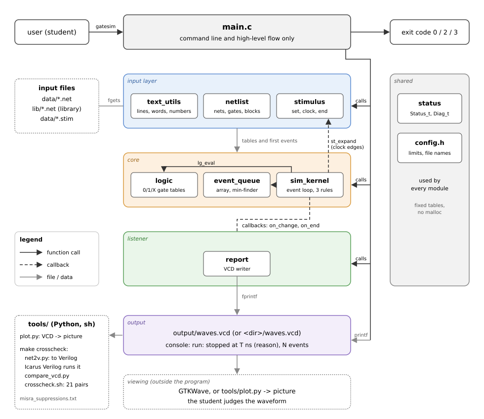

# GateSim

A gate-level timing simulator for digital-electronics students, written in C99.
Describe a circuit from gates with propagation delays, choose how long it runs, and GateSim simulates it event by
event and writes the waveform of every net. Unlike the usual student simulators, it does not stop when a circuit
oscillates or races: it keeps running until your end time, and you look at the waveform and judge what the circuit did.

Documents: [project proposal](docs/project_proposal.md), [detailed design](docs/detailed_design.md),
[architecture diagram](docs/architecture.svg), [MISRA deviations](docs/misra_deviations.md).

## Domain

Education: the digital electronics laboratory. Users are second-year engineering students who design counters,
adders, multiplexers, latches and flip-flops by hand, the lab instructors who check their work, and examiners.

## Problem

Free student simulators (Logisim, Digital, CircuitVerse) are built to find a stable state. When a circuit does not
settle, they stop: Logisim gives up and reports "oscillation", Digital detects the oscillation and stops,
CircuitVerse ends with a "stack limit exceeded" error for a JK flip-flop with J = K = 1. That is exactly where the
textbook timing effects begin: race-around in a level-triggered JK flip-flop, an SR latch released from S = R = 1, a
ring oscillator. So the timing of a hand-designed circuit, and questions such as "where does every unused state of my
counter go?", are worked out by clicking and on paper. Industrial simulators get the timing right but need Verilog.

## Solution

GateSim is a lightweight, focused command-line tool. It reads a netlist (`.net`: gates with a type, inputs and a delay;
blocks from a flip-flop and adder library) and a stimulus (`.stim`: input changes, clocks and the end time), simulates
the circuit event by event with the values 0, 1 and X and inertial delay, and writes every net change into a VCD
waveform file.

The idea is simple: **GateSim simulates, the student judges.**
- It keeps running through oscillations and races. A circuit that never settles is not an error; it just keeps
  switching in the waveform until the end time.
- The student sets how long it runs (`end T` in the stimulus).
- The result is a standard VCD file. Open it in GTKWave, or draw it as a picture with `tools/plot.py`.
- From the picture the student decides whether the circuit settled, oscillates, or cycles through a sequence of
  values, and whether that is what the design was meant to do.

Its results are checked against Icarus Verilog, an independent event-driven simulator (`make crosscheck`).

## Features

- Gates AND, OR, NAND, NOR, XOR, XNOR (1 to 4 inputs), NOT, BUF; constant nets VCC and GND.
- A delay per gate, `#d` or `#rise,fall` (1 to 1000 ns); event-driven simulation with inertial delay and 0/1/X.
- Blocks (`subckt`, `inst`) and a library (`include`): master-slave and level-triggered JK flip-flops, SR latch,
  D latch, half and full adder.
- Stimulus: `set` lines (an input value at a time), `clock` lines (period, high time, start), the `end` time.
- Runs until the end time, whatever the circuit does; stops earlier only when nothing is left to happen.
- Output: `waves.vcd` with every net (GTKWave), a one-line run summary, exit codes; `--check-only` for a netlist.
- `tools/plot.py` draws a waveform as a PNG picture; `--number` reads a group of nets as one binary number.
- Error messages name the file, the line and the offending word.
- `make crosscheck` compares every demo circuit with Icarus Verilog; `make check` runs the MISRA C:2012 analysis.

## Functional requirements

The full list with priorities is in the proposal (section 4.1), the traceability to modules and tests in 4.3.

| ID | The system shall ... |
|---|---|
| FR-01 | read a netlist of input, output and gate lines (8 gate types, 1 to 4 inputs, delay `#d` or `#r,f`) |
| FR-02 | reject an invalid circuit and warn about gate outputs that are never read |
| FR-03 | support blocks (`subckt`, `inst`) and a library file (`include`) |
| FR-04 | read the set lines and the required end line of a stimulus |
| FR-05 | generate clocks (period, high time, start) on up to 8 inputs |
| FR-06 | simulate event by event with 0, 1, X, rise and fall delays and inertial delay |
| FR-07 | keep running through oscillations until the end time, and report when and why the run stopped |
| FR-08 | write the waveform of every net into a VCD file |
| FR-09 | check a netlist alone (`--check-only`) and print its summary; print the usage text (`--help`) |
| FR-10 | report every input error as `gatesim: file:line: message 'word'` and end with a meaningful exit code |
| FR-11 | provide a tool that draws a VCD file as a picture (`tools/plot.py`) |

## Architecture



| Layer | Modules | Job |
|---|---|---|
| Command line | `main.c` | Read the arguments, call the modules in order, print the summary, choose the exit code |
| Input | `text_utils`, `netlist`, `stimulus` | Read the `.net` and `.stim` text files into fixed tables |
| Core | `logic`, `event_queue`, `sim_kernel` | Calculate gates, keep the pending events, run the simulation |
| Listener | `report` (VCD writer) | Called back by the kernel for every net change; writes `waves.vcd` |
| Viewing (outside the program) | GTKWave, `tools/plot.py` | Show the waveform; the student judges it |

The kernel knows nothing about files: it calls a listener (`on_change`, `on_end`) and expands clock edges through a
hook that the stimulus module provides (`st_expand`).

## Modules

| Module | Files | Responsibility |
|---|---|---|
| config | `include/config.h` | Every limit and named constant (no magic numbers, no malloc) |
| status | `src/status.c`, `include/status.h` | `Status_t` codes and their readable texts; `Diag_t` (file, line, message) |
| text_utils | `src/text_utils.c`, `include/text_utils.h` | Read a line, cut the comment, split into words, checked numbers, name rule, paths |
| logic | `src/logic.c`, `include/logic.h` | 0/1/X values, gate types, lookup tables, calculate one gate |
| netlist | `src/netlist.c`, `include/netlist.h` | Nets and gates tables, gate/block/inst/include lines, whole-circuit checks |
| event_queue | `src/event_queue.c`, `include/event_queue.h` | Pending events: add, find the earliest, remove, find a gate's event |
| sim_kernel | `src/sim_kernel.c`, `include/sim_kernel.h` | Main event loop, the three inertial-delay rules, the listener and the expansion hook |
| stimulus | `src/stimulus.c`, `include/stimulus.h` | set, clock and end lines; the first events of a run; the next clock edge |
| report | `src/report.c`, `include/report.h` | The VCD waveform writer |
| main | `src/main.c` | Command line and the high-level flow only |

## Folder structure

```
gatesim/
  Makefile  README.md  LICENSE  .editorconfig  .gitignore  .gitattributes
  include/   config.h and one header per module
  src/       main.c and one source per module
  tests/     test_<module>.cpp (GoogleTest) and tests/data/ (small input files for the tests)
  lib/       flipflops.net, adders.net (the block library)
  data/      sample circuits (*.net) and their stimuli (*.stim)
  tools/     plot.py (picture of a waveform); net2v.py, compare_vcd.py, crosscheck.sh (Icarus cross-check);
             misra_suppressions.txt
  docs/      project_proposal.md, detailed_design.md, architecture.svg, misra_deviations.md
```
`docs/architecture.svg` takes the place of the template's `architecture.png` (GitHub shows it inline, and it stays
sharp at any zoom).
`build/` and `output/` are generated by make and are not in the repository.

## C concepts used

| Concept | Where |
|---|---|
| Functions | One job each, a `Status_t` result, outputs through pointers written only on success |
| Structs | `Net_t`, `Gate_t`, `Block_t`, `Netlist_t`, `Event_t`, `EventQueue_t`, `SetLine_t`, `ClockDef_t`, `Stimulus_t`, `SimKernel_t`, `SimResult_t`, `VcdWriter_t`, `Diag_t` |
| Enums | `Status_t`, `GateType_t`, `DriverKind_t`, `EventKind_t`, `StopReason_t`, `ExitCode_t` |
| Arrays | Tables of nets, gates, blocks, events, set lines and clocks; 3x3 logic lookup tables; the stack of open files for `include` |
| Strings | Names, words of a line split in place, messages, paths (bounded copies only) |
| Pointers | Out-parameters, big tables passed by pointer, a `void *` callback context |
| Function pointers | The kernel's listener callbacks and the stimulus expansion hook |
| Named constants | `include/config.h`; every unsigned literal has a `U` suffix (MISRA 7.2) |
| File handling | `fopen`/`fgets`/`fclose` for the input files, `fprintf`/`fputs` for `waves.vcd`, every call checked |
| Status codes | One `Status_t` enum for every module, with a text table |

No dynamic memory and no recursion: every table is a fixed-size array sized in `include/config.h`.

## Coding standards

- C99 for the program, C++17 for the GoogleTest files; zero warnings with `-Wall -Wextra -Wpedantic -Werror` and the
  extra flags of the Makefile.
- House function style: validate every argument first, return a `Status_t`, write outputs only on success, one
  `return` per function, fixed-width types (`uint32_t`, `uint16_t`, `uint8_t`, `bool`), named constants, loops that end
  through their condition (no `break`), every `switch` with a `default`.
- Naming: files and functions in snake_case with a module prefix (`nl_add_gate`), types in PascalCase with `_t`
  (`Netlist_t`), constants in UPPER_CASE (`MAX_NETS`); Allman braces, 4 spaces, at most 120 columns (`.editorconfig`);
  Doxygen comments on every file and prototype.
- Not used: `malloc`, recursion, `goto`, `exit`, `atoi`, `strcpy`, `gets`, `scanf`, variable-length arrays,
  file-scope mutable globals, `<time.h>`.
- MISRA C:2012 (design section 12).

### Static analysis

The C code follows MISRA C:2012. `make check` runs cppcheck with its MISRA addon on `src/` and exits with 0 when it
finds nothing but the recorded deviations:

```bash
sudo apt install cppcheck      # once
make check
```

Two rules are deviated, each with a reason, a risk and a mitigation in
[docs/misra_deviations.md](docs/misra_deviations.md): 21.6 (`stdio.h`, used only in `main.c`, `text_utils` and
`report`, the modules that read the input files, write the waveform and print the results) and the advisory 11.5
(the VCD listener and the clock expansion hook turn their `void *` back into their own struct; 3 casts, each marked
in the code). `tools/misra_suppressions.txt` lists the 21.6 files for cppcheck.

## Prerequisites

Ubuntu 24.04 (or another Linux) with:

```bash
sudo apt install build-essential libgtest-dev                     # required: gcc, g++, make, GoogleTest
sudo apt install gtkwave python3 python3-matplotlib               # optional: view and draw waveforms
sudo apt install iverilog cppcheck                                # optional: make crosscheck, make check
```

## Build, run and test

### Get the code

```bash
git clone https://github.com/amankgithub/gatesim.git
cd gatesim
```

### Build

```bash
make all          # build build/release/gatesim (zero warnings, -Werror)
make run          # run the demo (a master-slave JK flip-flop); the waveform goes to output/waves.vcd
make test         # build and run the GoogleTest suite
make clean        # remove build/ and output/
make debug        # build build/debug/gatesim with -g -O0 (for gdb); make MODE=debug all is the same
make coverage     # run the tests with gcov counters and print the line coverage per source file
make crosscheck   # compare every demo waveform with Icarus Verilog (needs iverilog, python3)
make check        # MISRA C:2012 static analysis with cppcheck (needs cppcheck)
make print-vars   # show the build variables (mode, flags, sources, objects)
```

`make run` prints:

```
./build/release/gatesim data/jk_ms.net data/jk_ms.stim --out output
run: stopped at 100 ns (end time reached), 40 events
waveform: output/waves.vcd
```

Other files: `make run ARGS="data/ring5.net data/ring5.stim --out output"`.

### Run a simulation

```bash
./build/release/gatesim <netlist.net> <stimulus.stim> [--out <dir>]
./build/release/gatesim --check-only <netlist.net>
./build/release/gatesim --help
```

A run writes the waveform of every net to `<dir>/waves.vcd` (default `output/`; the folder must exist, `make run`
creates `output/`) and prints two lines: when and why the run stopped (`end time reached`, or `stable: nothing left to
happen` when no event is left before the end time) with the number of events applied, and where the waveform is.
If the waveform cannot be written (for example `--out` names a folder that does not exist), the run still goes on:
`waveform: not written (cannot open file)`.

Look at the waveform with GTKWave (select the scope `gatesim` and append the nets) or draw it with `tools/plot.py`:

```bash
gtkwave output/waves.vcd
python3 tools/plot.py output/waves.vcd [NET ...] [--number NET ...] [-o picture.png]
```

`plot.py` draws one row per net (default: every net, in file order): 0 low, 1 high, X as a grey band. `--number`
adds a last row that reads the given nets as one binary number (the first net is the most significant bit) and writes
the value on each stretch where it holds (on stretches wider than 2 % of the picture). The picture goes next to the
VCD file with the same name and `.png` (`output/waves.png`), or to the `-o` file. A net that is not in the file is an
error (`plot.py: output/s0/waves.vcd: no net named Q3`, exit code 2).

### Example 1: where does every state of a counter go?

`data/counter_0357.net` is a synchronous counter designed by hand to count 0 -> 3 -> 5 -> 7 -> 0 (three master-slave
JK flip-flops from the library, J2 = K2 = Q1, J1 = K1 = 1, J0 = 1, K0 = Q2.Q1). The states 1, 2, 4 and 6 are not
used by the design. What happens if the counter powers up in one of them?

The eight stimulus files `data/counter_s0.stim` .. `data/counter_s7.stim` each load one start state through the
active-low PRE and CLR inputs at 0 ns, release them at 10 ns, and run a clock of period 40 ns (high from 20 ns) for
8 cycles (`end 360`). Eight commands give eight pictures:

```bash
for k in 0 1 2 3 4 5 6 7; do
    mkdir -p output/s$k
    ./build/release/gatesim data/counter_0357.net data/counter_s$k.stim --out output/s$k
    python3 tools/plot.py output/s$k/waves.vcd CLK Q2 Q1 Q0 --number Q2 Q1 Q0
done
```

```
run: stopped at 360 ns (end time reached), 268 events
waveform: output/s0/waves.vcd
picture: output/s0/waves.png
run: stopped at 360 ns (end time reached), 262 events
waveform: output/s1/waves.vcd
picture: output/s1/waves.png
...
```

The flip-flops change when CLK falls. Reading the number row of each picture (the value of Q2 Q1 Q0 between two
falling edges):

| Start (file) | The number row of the picture |
|---|---|
| 0 (`counter_s0.stim`) | 0 -> 3 -> 5 -> 7 -> 0 -> 3 -> 5 -> 7 -> 0 |
| 1 (`counter_s1.stim`) | 1 -> 3 -> 5 -> 7 -> 0 -> 3 -> 5 -> 7 -> 0 |
| 2 (`counter_s2.stim`) | 2 -> 5 -> 7 -> 0 -> 3 -> 5 -> 7 -> 0 -> 3 |
| 3 (`counter_s3.stim`) | 3 -> 5 -> 7 -> 0 -> 3 -> 5 -> 7 -> 0 -> 3 |
| 4 (`counter_s4.stim`) | 4 -> 7 -> 0 -> 3 -> 5 -> 7 -> 0 -> 3 -> 5 |
| 5 (`counter_s5.stim`) | 5 -> 7 -> 0 -> 3 -> 5 -> 7 -> 0 -> 3 -> 5 |
| 6 (`counter_s6.stim`) | 6 -> 1 -> 3 -> 5 -> 7 -> 0 -> 3 -> 5 -> 7 |
| 7 (`counter_s7.stim`) | 7 -> 0 -> 3 -> 5 -> 7 -> 0 -> 3 -> 5 -> 7 |

The judgement is the student's: the designed loop 0 -> 3 -> 5 -> 7 -> 0 works, and every unused state joins it
(1 -> 3, 2 -> 5, 4 -> 7 after one clock; 6 -> 1 -> 3 after two), so the counter is self-starting. The pictures also
show a timing detail the state table does not: after a falling clock edge, a flip-flop output that rises changes
5 ns later and one that falls 7 ns later. So on the changes 3 -> 5, 2 -> 5 and 6 -> 1 the counter shows 7 for 2 ns
in between (for start 0: 3 until 85 ns, 7 from 85 to 87 ns, then 5). That stretch is too short to be labelled in the
full picture; zoom in GTKWave to see it.

### Example 2: every input of a 4-bit adder

`data/adder4.net` is a 4-bit ripple-carry adder from four full-adder blocks (20 gates). To try every input pair, each
input bit gets its own clock with twice the period of the bit below it (`data/adder4.stim`): A0 changes every 40 ns,
A1 every 80 ns, ..., B3 every 5120 ns, so in step k (from k x 40 ns) A = k mod 16 and B = k / 16. The 256 steps take
10240 ns:

```
clock A0 period 80 high 40 start 40
clock A1 period 160 high 80 start 80
...
clock B3 period 10240 high 5120 start 5120
end 10240
```

```bash
./build/release/gatesim data/adder4.net data/adder4.stim
python3 tools/plot.py output/waves.vcd A3 A2 A1 A0 B3 B2 B1 B0 COUT S3 S2 S1 S0
```

```
run: stopped at 10240 ns (end time reached), 2290 events
waveform: output/waves.vcd
picture: output/waves.png
```

The picture shows the inputs as square waves of doubling period (a binary count) and the sum bits below them, with
short spikes where the carry ripples through the four stages before the sum settles. Over 256 steps a single value is
too narrow to read in the full picture; zoom in GTKWave, or let a few lines of Python do the judging. The reader of
`tools/compare_vcd.py` turns the VCD file into a list of `(time, value)` changes per net; this script (run from the
repository root) checks the sum at the last nanosecond of every step:

```python
import sys
sys.path.insert(0, "tools")
from compare_vcd import read_vcd

def number(histories, nets, t):
    """the nets read as one binary number at time t (first net = most significant bit)"""
    bits = ""
    for n in nets:
        bits += [v for (tt, v) in histories[n] if tt <= t][-1]
    return int(bits, 2)

h, end = read_vcd("output/waves.vcd")
wrong = 0
for step in range(256):
    t = step * 40 + 39                      # the last ns of the step: the sum had 39 ns to settle
    a = number(h, ["A3", "A2", "A1", "A0"], t)
    b = number(h, ["B3", "B2", "B1", "B0"], t)
    s = number(h, ["COUT", "S3", "S2", "S1", "S0"], t)
    if s != a + b:
        wrong += 1
        print("step %d: %d + %d gave %d" % (step, a, b, s))
print("%d steps checked, %d wrong" % (256, wrong))
```

```
256 steps checked, 0 wrong
```

Reading the sum only 10 ns after each step (`step * 40 + 10`) gives `256 steps checked, 56 wrong`, because the carry
has not rippled through yet; at 16 ns after each step none are wrong.

### Other demo circuits

The demo circuits in `data/` show the classic timing effects (see "Sample input" for the list). The run lines are
the real output; what the waveform shows is described next to them.

| Command (netlist + stimulus) | Run line | What the waveform shows |
|---|---|---|
| `data/ring5.net data/ring5.stim` | `run: stopped at 100 ns (end time reached), 52 events` | A ring oscillator: after EN rises at 10 ns, n0 rises every 20 ns (22, 42, 62, 82) until the end time |
| `data/jk_level.net data/jk_level.stim` | `run: stopped at 42 ns (stable: nothing left to happen), 32 events` | Race-around: while CLK is high (20 to 40 ns) Q toggles with a period of 8 ns (it rises at 24, 32 and 40 ns); after CLK falls the latch holds and nothing is left to happen |
| `data/jk_ms.net data/jk_ms.stim` | `run: stopped at 100 ns (end time reached), 40 events` | The master-slave JK flip-flop of the library toggles exactly once per clock, when CLK falls (Q 0 at 8, 1 at 45, 0 at 87 ns) |
| `data/sr_nor.net data/sr_nor.stim` | `run: stopped at 80 ns (end time reached), 44 events` | S = R = 1 released together at 50 ns: Q and QN switch together every 2 ns until the end time (a latch that never decides) |
| `data/sr_nor.net data/sr_nor_skew.stim` | `run: stopped at 52 ns (stable: nothing left to happen), 15 events` | The same, but R is released 1 ns later: the latch settles in reset |
| `data/inv_pulse.net data/inv_pulse.stim` | `run: stopped at 47 ns (stable: nothing left to happen), 14 events` | Inertial delay: of the pulses 1, 2, 3 and 4 ns wide, only the 3-ns and 4-ns pulses reach the output of an inverter with delay 3 |
| `data/mux_hazard.net data/mux_hazard.stim` | `run: stopped at 45 ns (stable: nothing left to happen), 17 events` | A static-1 hazard: S falls at 20 ns and F drops to 0 from 24 to 27 ns although A = B = 1 |
| `data/mux_fast.net data/mux_hazard.stim` | `run: stopped at 43 ns (stable: nothing left to happen), 15 events` | A faster inverter: the gap is swallowed, F stays 1 |
| `data/mux_consensus.net data/mux_hazard.stim` | `run: stopped at 45 ns (stable: nothing left to happen), 16 events` | The consensus term A.B of the K-map: F stays 1 |

Every net starts as `x` (unknown) until something drives it, as in a real circuit before reset.

### Check a netlist

`--check-only` reads the netlist, checks the whole circuit and prints a summary without running it:

```
$ ./build/release/gatesim --check-only data/counter_0357.net
data/counter_0357.net: OK
  gates    : 28 (AND 1, NAND 24, NOT 3)
  nets     : 36 (inputs 7, outputs 3)
  blocks   : 4 defined, 3 instances
  warnings : 0
```

A net that a gate reads (or an output) without any driver is an error, reported without a line number because it
concerns the whole circuit: `gatesim: tests/data/bad_undriven.net: net is read but never driven 'b'`. A gate output
that nothing reads and that is not an output is only a warning:

```
$ ./build/release/gatesim --check-only tests/data/warn_unused.net
tests/data/warn_unused.net: OK
  gates    : 2 (NOT 1, BUF 1)
  nets     : 3 (inputs 1, outputs 1)
  blocks   : 0 defined, 0 instances
  warnings : 1
  warning: net 't' is driven but never read
```

A gate name or an output declared twice is rejected (`name already used`). Loops are allowed: a latch is a loop.

### Run the unit tests

```bash
make test                                              # 77 tests
make test GTEST_ARGS="--gtest_filter=Kernel.*"         # one test group
make test GTEST_ARGS="--gtest_shuffle --gtest_repeat=3"  # random order, three times
make coverage                                          # line coverage per source file (gcov)
```

### Cross-check with Icarus Verilog

GateSim's own results are checked against Icarus Verilog, an independent event-driven simulator:

```bash
sudo apt install iverilog      # once
make crosscheck
```

For every demo circuit, `tools/net2v.py` writes the netlist and stimulus as a Verilog testbench (one gate primitive
with the same rise and fall delays per gate), Icarus runs it, and `tools/compare_vcd.py` compares the two waveforms
net by net up to the time where GateSim stopped. The files of each pair are in `build/crosscheck/<stim>__<net>/`.

```
sh tools/crosscheck.sh build/release/gatesim
MATCH inv_pulse + inv_pulse: 2 nets compared up to 47 ns, all match
MATCH inv_risefall + inv_risefall: 2 nets compared up to 38 ns, all match
MATCH sr_nor + sr_nor: 4 nets compared up to 80 ns, all match
...
MATCH mod6_ripple + mod6_ripple: 32 nets compared up to 340 ns, all match
MATCH adder4 + adder4: 29 nets compared up to 10240 ns, all match
MATCH counter_0357 + counter_s0: 36 nets compared up to 360 ns, all match
...
MATCH counter_0357 + counter_s7: 36 nets compared up to 360 ns, all match
```

All 21 pairs match, including the three versions of the multiplexer, the 4-bit adder through all 256 input pairs and
the counter from all 8 start states. A pair that differs prints a `DIFF <net>` block with both histories
(`time:value`) and the target exits with 1.

## Sample input

The sample data are the circuits in `data/*.net` with their stimuli `data/*.stim` (they replace the template's
`data/sample_data.txt`), and the library `lib/*.net`:

| Files | Circuit | Shows |
|---|---|---|
| `inv_pulse`, `inv_risefall` | one inverter (delay 3; rise 2, fall 5) | inertial delay: short pulses are swallowed |
| `sr_nor` (+ `sr_nor_skew.stim`) | SR latch from two NOR gates | a latch that never decides; the same with a skewed release |
| `ring5` | ring oscillator (NAND with enable + 4 inverters) | a free-running loop, period 20 ns |
| `jk_level` (+ `jk_level_narrow.stim`) | level-triggered JK flip-flop | race-around while the clock is high; a clock pulse too narrow to decide |
| `jk_ms` | master-slave JK flip-flop from the library | one toggle per clock (the `make run` demo) |
| `mux_hazard`, `mux_fast`, `mux_consensus` (one `mux_hazard.stim`) | 2:1 multiplexer | a static-1 hazard, and two ways to remove it |
| `mod6_ripple` | ripple mod-6 counter | brief wrong states between clock edges |
| `adder4` | 4-bit ripple-carry adder from four full adders | every input pair, each input bit driven by its own clock |
| `counter_0357` (+ `counter_s0.stim` .. `counter_s7.stim`) | synchronous counter 0 -> 3 -> 5 -> 7 | where every start state goes |

Both files have one statement per line. Words are separated by spaces or tabs, empty lines are ignored, and the first
`#` that is not followed by a digit starts a comment (`#2` is a delay, `# text` is a comment). A line has at most 254
characters and 16 words.

### Netlist lines (`.net`)

```
input  EN                       # nets set by the stimulus
output n0 n1 n2 n3 n4           # nets the user wants to see
gate g0 NAND #2  n0 = EN n4     # gate NAME TYPE #delay OUT = IN ...
gate g1 NOT  #2,5  y = a        # rise delay 2, fall delay 5
```

Gate types: `AND`, `OR`, `NAND`, `NOR`, `XOR`, `XNOR` (1 to 4 inputs) and `NOT`, `BUF` (1 input), in capitals. The
delay is in ns, 1 to 1000: `#d` for both directions, or `#r,f` for a rise delay r (output changes to 1) and a fall
delay f (output changes to 0); a change to `x` uses the shorter one. A net exists from the first line that names it;
every net has exactly one driver (an input line or one gate output). Names (nets, gates, blocks, ports, instances)
have 1 to 31 characters: a letter or `_` first, then letters, digits, `_` and `.` (`FF2.a1`); anything else is
`not a valid name`. This keeps every name a valid Verilog name for the cross-check.

A block is a group of gate lines written once and used several times:

```
subckt HA A B -> S CO           # block HA with ports A B (inputs) and S CO (outputs)
gate x XOR #3  S  = A B
gate a AND #2  CO = A B
ends
inst H1 HA A=a0 B=b0 S=s0 CO=c1      # one copy: every port connected to a net
```

A block has 1 to 8 ports and 1 to 16 gate lines; the `->` between input and output ports is optional. `inst` copies
every gate of the block: the gate `x` becomes `H1.x`, a port becomes the net connected to it, and any other net
inside the block becomes `H1.<name>` (so two instances never share an inner net). Every port must be connected exactly
once (`port missing, unknown or connected twice`). Blocks have one level: a block holds only gate lines
(`not allowed here 'inst'`), and a file must not end inside a block (`not allowed here 'subckt HA not closed'`).

```
include ../lib/flipflops.net    # read a library of blocks (path relative to this file)
inst FF1 JK_MS J=VCC K=VCC CLK=CLK PRE=P1 CLR=C1 Q=Q1 QN=Q1N
```

`include PATH` reads the blocks of another file; the path is relative to the file that has the line. An included
file may not include another one (`not allowed here 'include'`). `VCC` and `GND` are constant nets (always 1 and 0):
they exist as soon as a line names them, are never renamed inside a block, and cannot be an input or a gate output.

### Library (`lib/`)

| File | Block | Ports (inputs -> outputs) | Gates |
|---|---|---|---|
| `lib/flipflops.net` | `JK_MS` master-slave JK flip-flop, PRE and CLR active low | `J K CLK PRE CLR -> Q QN` | 9 |
| | `JK_LEVEL` level-triggered JK flip-flop (race-around) | `J K CLK PRE CLR -> Q QN` | 4 |
| | `SR_NOR` SR latch from two NOR gates | `S R -> Q QN` | 2 |
| | `D_LATCH` gated D latch | `D EN PRE CLR -> Q QN` | 5 |
| `lib/adders.net` | `HA` half adder | `A B -> S CO` | 2 |
| | `FA` full adder | `A B CI -> S CO` | 5 |

Circuits built from it: `data/jk_ms.net` (one JK_MS), `data/counter_0357.net` (three JK_MS, 28 gates and 36 nets),
`data/mod6_ripple.net` (a ripple mod-6 counter, 29 gates) and `data/adder4.net` (four FA blocks):

```
data/adder4.net: OK
  gates    : 20 (AND 8, OR 4, XOR 8)
  nets     : 29 (inputs 9, outputs 5)
  blocks   : 2 defined, 4 instances
  warnings : 0
```

### Stimulus lines (`.stim`)

```
set EN 0 @0                             # input EN becomes 0 at 0 ns
set EN 1 @10
clock CLK period 40 high 20 start 20    # CLK: 0 until 20, then 1 for 20 ns every 40 ns
end 100                                 # the run ends at 100 ns (required, exactly once)
```

- `set NET V @T`: NET must be an input of the netlist, V is `0`, `1` or `x` (unknown), T is a time in ns
  (0 to 1 000 000 000). A set line after the end time is ignored. At most 256 set lines.
- `clock NET period P high H start S`: NET (an input) is 0 from 0 until S, then rises at S, S + P, S + 2P, ... and
  stays 1 for H ns each time (P from 2 to 1 000 000 000, H from 1 to P - 1, S up to 1 000 000 000). At most 8 clocks.
- `end T`: the end time of the run (0 to 1 000 000 000 ns), required exactly once. Choose it long enough to see what
  you want to see: an oscillating circuit runs until this time.

A net is driven by set lines or by one clock line, never by both (`net already has a driver`). An input that no line
sets stays `x`.

## Sample output

| Output | Contents | Open with |
|---|---|---|
| `output/waves.vcd` (or `<dir>/waves.vcd`) | Every change of every net (Value Change Dump, 1 ns steps), from 0 to the time the run stopped | `gtkwave output/waves.vcd` |
| Console | `run: stopped at <T> ns (<reason>), <N> events` and `waveform: <path>` | the terminal |
| `output/waves.png` (from `tools/plot.py`) | One row per chosen net, plus the optional number row | any image viewer |

The start of `waves.vcd` for `make run` (`data/jk_ms.net`, 14 nets; the nets of the instance are named `FF.<name>`):

```
$version GateSim 1.0 $end
$timescale 1ns $end
$scope module gatesim $end
$var wire 1 ! J $end
$var wire 1 " K $end
$var wire 1 # CLK $end
$var wire 1 $ PRE_N $end
$var wire 1 % CLR_N $end
$var wire 1 & Q $end
$var wire 1 ' QN $end
$var wire 1 ( FF.a1 $end
...
$upscope $end
$enddefinitions $end
#0
$dumpvars
x!
...
```

Each net gets a short code (`!`, `"`, ...); after the header, every time step is a `#<time>` line followed by the new
values (`1&` means Q became 1). The file ends with the time where the run stopped, so a quiet stretch before the end
time is shown too.

## Unit tests

77 GoogleTest tests (C++17) in `tests/`, one file per module, with positive, negative (a bad input gives the right
status and leaves the outputs unchanged) and boundary cases. They run from the repository root, use only relative
paths, write temporary files only into `build/` and remove them, and pass in any order (`--gtest_shuffle`).

| File | Module | Tests |
|---|---|---|
| `test_status.cpp` | status | UT-01..UT-03 (3) |
| `test_text_utils.cpp` | text_utils | UT-04..UT-22 (19) |
| `test_logic.cpp` | logic | UT-23..UT-32 (10) |
| `test_netlist.cpp` | netlist | UT-33..UT-54 (22) |
| `test_event_queue.cpp` | event_queue | UT-55..UT-60 (6) |
| `test_sim_kernel.cpp` | sim_kernel | UT-61..UT-70 (10) |
| `test_stimulus.cpp` | stimulus | UT-71..UT-75 (5) |
| `test_report.cpp` | report | UT-76..UT-77 (2) |

```
[==========] 77 tests from 38 test suites ran.
[  PASSED  ] 77 tests.
```

The kernel tests compare each run with the expected changes or a whole trace (`tests/data/*.trace`) written by a
separate Python reference model of the kernel (not part of this repository), which was itself checked against Icarus
Verilog. Every test is listed with its requirement in the proposal (section 4.4) and described in the design
(section 14.2).

## Error handling

Every function that can fail returns a `Status_t`; nothing is half-written on an error. Input files are checked word
by word before anything is stored, and the first error stops the program with the file, the line and the offending
word:

```
gatesim: tests/data/bad_type.net:3: unknown gate type 'NAN'
gatesim: tests/data/bad_undriven.net: net is read but never driven 'b'
gatesim: x.stim:1: name not found 'NOPE'
gatesim: tests/data/no_end.stim: missing end line
gatesim: data/no_such.net: cannot open file
```
(the third line comes from a stimulus file `x.stim` with the two lines `set NOPE 1 @0` and `end 10`; the fourth from
`./build/release/gatesim data/sr_nor.net tests/data/no_end.stim`)

| Exit code | Meaning |
|---|---|
| 0 | The run is done (also when only the waveform could not be written); also `--check-only` and `--help` |
| 2 | Wrong arguments (the usage text is printed on stderr), or an input file could not be read or has an error |
| 3 | The run could not be completed (event list full, time overflow); the message is `gatesim: run failed: <reason>` |

All status codes, where they are detected and what the user sees are listed in the design (section 11.2, error
catalogue; 11.3, recovery).

## Known limitations

- GateSim does not judge the result. It does not compare outputs with expected values, does not detect or name
  oscillations, glitches or lockout, and does not search for the fastest clock: the student reads the waveform. A
  check can be automated with a short script that reads the VCD file, like the adder script above.
- One run per command: one netlist, one stimulus file, one waveform. Several start states or input sets mean several
  stimulus files and several commands (as in the counter example).
- Fixed limits (`include/config.h`): 512 nets, 512 gates, 4 inputs per gate, 1024 pending events, names of up to 31
  characters, lines of up to 254 characters and 16 words, 8 blocks of up to 16 gates and 8 ports, one level of
  `include`, 256 set lines, 8 clocks; delays 1 to 1000 ns; times up to 1 000 000 000 ns (1 s).
- Simple algorithms: the event list is an unsorted array searched for the earliest event; names are found by a linear
  search; after each time step every gate is checked for a changed input. This is fast enough for circuits of the
  size above.
- Values 0, 1 and X only, and exactly one driver per net (no Z, no tri-state bus).
- Blocks have one level (a block cannot use another block), and an included file cannot include another one.
- Inputs are set one net at a time (no bus notation), so a multi-bit start state takes one set line per PRE or CLR
  net.

## Out of scope

A graphical editor, analog and electrical effects (real metastability, wire delay, load-dependent delay), Verilog or
other HDL input, behavioural code, logic minimisation or automatic design, and circuits above the fixed limits.
GateSim shows how a circuit the student designed behaves in time; it does not make the design and does not decide
whether it is right.

## Future enhancements

Ideas that would extend GateSim beyond this version:
- A binary heap for the event list, so the earliest event is found without looking at every pending event.
- Fan-out lists (the gates that read each net) and a hash table for name lookup, so big circuits load and run faster.
- Blocks inside blocks (a full adder built from half-adder blocks, a counter built from flip-flop blocks).
- Tri-state buffers with the value Z, several drivers on one bus net, and pull-ups.
- A drag-and-drop circuit editor that exports this netlist format.
- Scripts that read the VCD file and judge the result automatically (expected values, oscillations, glitches).

## Author

Aman Khandelwal, Roll No 612509003, Instrumentation and Control Engineering, Division/Batch: none.
Individual mini project for the course Programming Fundamentals and Software Engineering (KPIT APEX Lab).

## GitHub

https://github.com/amankgithub/gatesim

## License

MIT License, see [LICENSE](LICENSE).
