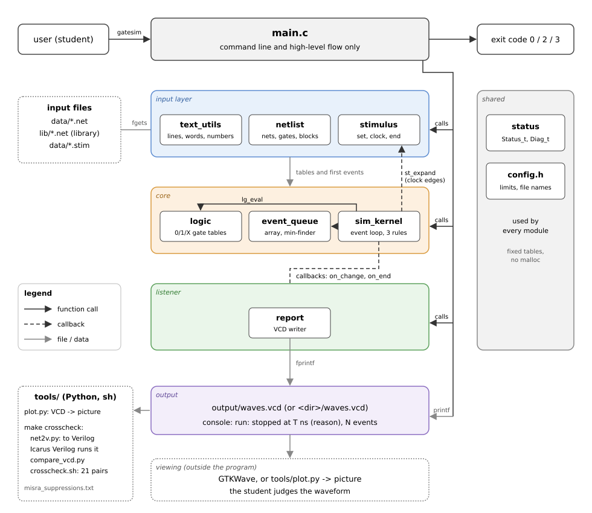

# GateSim: Detailed Design

Sections 1-4 and the high-level architecture (5.1-5.4) are in [docs/project_proposal.md](project_proposal.md). This
document holds the detailed architecture (5) and sections 6 to 24 of the mini project template. It describes GateSim
1.0, the version in this repository.

| Version | Date | Change |
|---|---|---|
| 1.0 | 9 Nov 2026 | first complete version, written after the code and checked against it, the tests and real runs |

---

## 5. Architecture (detailed)

GateSim is a command-line program in four layers inside the program and one outside it. `main.c` calls the layers in
this order. Below it, each module uses only `status`, `config.h`, `text_utils` and `logic` (the shared base) and the
data types of the modules listed before it in the table of section 6.1. There are no circular dependencies:

- `netlist` uses `logic` (gate types and values) and `text_utils` (reading the file).
- `event_queue` uses `logic` (the value of an event).
- `sim_kernel` uses `netlist` (the nets and gates it simulates) and `event_queue`.
- `stimulus` uses `netlist` (names of the input nets), `event_queue` (it adds the first events) and the types
  `Event_t` and `SkExpansion_t` of the kernel (its expansion hook `st_expand` has the kernel's hook type).
- `report` uses `netlist` (the nets of the VCD header) and the listener types of the kernel.
- The kernel never includes `stimulus.h` or `report.h`. It reaches them only through two function pointers that
  `main.c` hands it: the expansion hook (clock edges) and the listener (the VCD writer).

| Layer | Modules | Job |
|---|---|---|
| Command line | `main.c` | Read the arguments, call the modules in order, print the summary, choose the exit code |
| Input | `text_utils`, `netlist`, `stimulus` | Read the `.net` and `.stim` text files into fixed tables |
| Core | `logic`, `event_queue`, `sim_kernel` | Calculate gates, keep the pending events, run the simulation |
| Listener | `report` (VCD writer) | Called back by the kernel for every net change; writes `waves.vcd` |
| Viewing (outside the program) | GTKWave, `tools/plot.py` | Show the waveform; the student judges it |

`status` (one `Status_t` with readable texts and the error message `Diag_t`) and `config.h` (named limits) are shared
by every module. The Python scripts in `tools/` are not part of the C program: `plot.py` draws a waveform, and
`net2v.py`, `compare_vcd.py` and `crosscheck.sh` compare GateSim with Icarus Verilog (section 15.3).



The template asks for `docs/architecture.png`. GateSim ships `docs/architecture.svg` instead: GitHub shows it inline,
and it is plain text, so a change to it shows in a diff.

**One run, from start to end** (the names are the functions of section 8):

1. `main` reads the command line (`parse_mode`).
2. `nl_load` reads the `.net` file (and the library it includes) into the net, gate and block tables and checks the
   whole circuit.
3. `st_load` reads the `.stim` file into the set lines, clock lines and the end time.
4. `eq_init` empties the event list; `st_seed` adds one event per set line and one per clock.
5. `sk_init` gives every net its start value (X; VCC 1, GND 0); `sk_set_source` makes `st_expand` the hook for clock
   events; `rw_vcd_open` writes the VCD header and `sk_set_listener` makes the VCD writer the listener.
6. `sk_run` runs time step after time step until nothing is left to happen or the end time is passed. In each step
   it applies the events of that time, recalculates the gates (`lg_eval`), keeps, cancels or schedules their next
   change and calls the listener for every net that changed; the listener writes the change into the VCD file.
7. `rw_vcd_close` closes the file; `main` prints the result line and the waveform path and returns the exit code.

## 6. Module Design

### 6.1 Module Summary

| Module | Source | Header | Responsibility |
|---|---|---|---|
| config | N/A | `include/config.h` | Named limits and file names shared by every module |
| status | `src/status.c` | `include/status.h` | `Status_t` codes and their readable texts; `Diag_t` (file, line, message) |
| text_utils | `src/text_utils.c` | `include/text_utils.h` | Read a line, cut the comment, split into words, checked numbers, names, paths |
| logic | `src/logic.c` | `include/logic.h` | Logic values 0/1/X, gate types, lookup tables, calculate one gate |
| netlist | `src/netlist.c` | `include/netlist.h` | Nets, gates and blocks tables; netlist lines; include; whole-circuit checks |
| event_queue | `src/event_queue.c` | `include/event_queue.h` | Pending events: add, find the earliest (min-finder), remove, find a gate's event |
| sim_kernel | `src/sim_kernel.c` | `include/sim_kernel.h` | Main event loop, the three inertial-delay rules, listener and expansion hook |
| stimulus | `src/stimulus.c` | `include/stimulus.h` | set, clock and end lines; the first events of a run; the next clock edge |
| report | `src/report.c` | `include/report.h` | The VCD waveform writer (`waves.vcd`), the kernel's listener |
| main | `src/main.c` | N/A | Command line and the high-level flow only |

Six modules do the work of the simulator (`logic`, `netlist`, `event_queue`, `sim_kernel`, `stimulus`, `report`);
`status`, `text_utils` and `config.h` are the shared helpers, and `main.c` holds only the flow.

### 6.2 Module Details

One subsection per module: purpose, files, responsibilities, public functions, data owned, dependencies and the
status codes it returns. Section 8 gives the full design (parameters, return values, conditions, tests) of the
important functions. Every public function follows the same rules (section 12.3): it checks its arguments first,
returns a `Status_t` and writes its outputs only when it succeeds. In `netlist` and `stimulus` a public function only
checks its pointers and then calls a `static` worker of the same name without the prefix (`nl_add_gate` calls
`add_gate`); inside the file the workers call each other, so the pointer checks are done once per call from outside.

#### 6.2.1 status

- **Purpose:** one status type for every module, and a readable text for every code (used in error messages).
- **Files:** `src/status.c`, `include/status.h`
- **Responsibilities:**
  - define the one `Status_t` that every module returns (27 codes, `STATUS_OK` = 0)
  - give every code its readable text (`status_text`)
  - declare `Diag_t`, the error message (file, line, text) that the readers fill
- **Public functions:** `const char *status_text(Status_t status)` gives the phrase of a code from a constant table;
  a code outside `0..STATUS_COUNT-1` gives `"unknown status"`. It cannot fail, so it returns the text directly
  instead of a `Status_t` (a documented exception to the function rules, section 12.3).
- **Data owned:** `STATUS_TEXTS[STATUS_COUNT]`, a `static const char *const` table at block scope inside
  `status_text` (read-only, smallest scope, MISRA 8.9).
- **Rule for new codes:** a new code is appended just before `STATUS_COUNT` and its text at the same place in the
  table, so existing values never change.
- **Dependencies:** config (the sizes of `Diag_t`). **Status codes returned:** none.

#### 6.2.2 text_utils

- **Purpose:** the reading helpers of every input file in one module, so the readers (`netlist`, `stimulus`) only
  see words. It is the only input module with stdio (MISRA 21.6 deviation, section 12.5).
- **Files:** `src/text_utils.c`, `include/text_utils.h`
- **Responsibilities:**
  - open, read line by line and close the input files
  - cut comments and split a line into words in place
  - parse numbers (no `atoi`) and check names
  - build error messages (`Diag_t`) and file paths (the output file, a relative include path); split `PORT=NET`
- **Public functions:**
  - `Status_t tu_open(LineReader_t *reader, const char *path)`: copies the path into the reader (BAD_ARG if it does
    not fit `MAX_PATH_LEN`), then `fopen` for reading; FILE_OPEN if that fails; `line_no` = 0. The reader keeps its
    file name because the error message and the base of a relative include path are the name of the file being read.
  - `Status_t tu_read_line(LineReader_t *reader, char *buf, uint32_t buf_size)`: `fgets` into a local buffer,
    strips `\n` and a trailing `\r` (files saved with Windows line ends), `line_no++`. END_OF_FILE when no line is
    left, LINE_TOO_LONG when the line has no `\n` and the file goes on, FILE_READ on `ferror`. `buf` is written
    only on OK.
  - `Status_t tu_close(LineReader_t *reader)`: `fclose` if open, then `fp = NULL` (safe to call twice).
  - `Status_t tu_cut_comment(char *line)`: the first `#` that is **not followed by a digit** becomes `'\0'`
    (`#2` is a delay word, `# text` a comment).
  - `Status_t tu_split_words(char *line, char *words[], uint32_t max_words, uint32_t *out_count)`: words are
    separated by spaces and tabs; a `'\0'` is written after each word. More than `max_words` words gives
    TOO_MANY_WORDS, checked before anything is written (`count_words` counts first).
  - `Status_t tu_parse_u32(const char *text, uint32_t min_value, uint32_t max_value, uint32_t *out_value)`: digits
    only (no sign, no space, not empty), then `strtoul` and `errno`; the `unsigned long` result is compared with the
    range **before** the cast to `uint32_t` (on 64-bit Linux `strtoul("4294967296")` does not set ERANGE). Anything
    else gives BAD_NUMBER. Used instead of `atoi` (MISRA 21.7).
  - `Status_t tu_check_name(const char *name)`: 1 to `MAX_NAME_LEN - 1` (31) characters; the first a letter or `_`,
    the others letters, digits, `_` or `.` (`FF2.a1`); else BAD_NAME. The character rule keeps every name a valid
    Verilog identifier once the cross-check maps `.` to `_`.
  - `Status_t tu_copy_text(char *dst, uint32_t dst_size, const char *src)`: bounded copy (length checked first,
    then `memcpy`; never `strcpy`); BAD_ARG if `src` does not fit, `dst` unchanged.
  - `Status_t tu_set_diag(Diag_t *diag, const char *file, uint32_t line, const char *what, const char *name)`: fills
    an error message; text = `what`, or `what` + ` '` + `name` + `'` when `name` is not NULL
    (`"unknown gate type 'NAN'"`); a NULL `file` gives `""`. BAD_ARG if the file or the text does not fit (`diag`
    unchanged); the readers then fall back to the status text alone, which always fits.
  - `Status_t tu_join_dir(const char *dir, const char *file_name, char *out, uint32_t out_size)`: `dir` + `/` +
    `file_name` (`"output/waves.vcd"`); BAD_ARG for an empty `dir` (that would give a path from the root) or a path
    that does not fit (`out` unchanged).
  - `Status_t tu_split_assign(char *word, char **out_left, char **out_right)`: splits a `PORT=NET` word of an `inst`
    line in place (`"J=Q1"` gives `"J"` and `"Q1"`; the `=` becomes `'\0'`). Exactly one `=` with text on both
    sides, else SYNTAX and the word is unchanged.
  - `Status_t tu_join_path(const char *base_file, const char *relative, char *out, uint32_t out_size)`: the path of
    a file named inside another file: the folder of `base_file` (up to and including its last `/`) + `relative`
    (`"data/counter_0357.net"` + `"../lib/flipflops.net"` = `"data/../lib/flipflops.net"`); a `relative` that starts
    with `/` is used as it is, a `base_file` without `/` gives `relative` unchanged. BAD_ARG if it does not fit.
- **Static helpers:** `is_separator` (space or tab), `is_digit`, `is_name_start` (letter or `_`), `is_name_char`
  (letter, digit, `_` or `.`), `count_words` (counts the words without changing the line).
- **Data owned:** none (the caller owns the `LineReader_t`).
- **Dependencies:** status, config, `<stdio.h>`, `<stdlib.h>` (`strtoul`), `<errno.h>`, `<string.h>`.
  **Status codes returned:** OK, NULL_ARG, BAD_ARG, TOO_MANY_WORDS, BAD_NUMBER, BAD_NAME, FILE_OPEN, FILE_READ,
  END_OF_FILE, LINE_TOO_LONG, SYNTAX.

#### 6.2.3 logic

- **Purpose:** the logic values 0, 1 and X (unknown), the gate types, and the output of one gate from its input
  values. X is the value of a net that nothing has driven yet; a deciding input wins over X (a 0 into an AND gives
  0, a 1 into an OR gives 1), otherwise X spreads. XOR has no deciding value.
- **Files:** `src/logic.c`, `include/logic.h`
- **Responsibilities:**
  - define the values 0, 1, X and the eight gate types
  - calculate one gate from its input values with lookup tables (`lg_eval`)
  - check the number of inputs of a gate type
  - turn type names and value texts into values and back
- **Public functions:**
  - `Status_t lg_eval(GateType_t type, const LogicValue_t inputs[], uint32_t count, LogicValue_t *out_value)`:
    folds the inputs: result = input 0, then result = TABLE[result][input i] for every further input, with the AND,
    OR or XOR table; NAND, NOR and XNOR end with the NOT table; NOT = NOT_TABLE[input 0]; BUF = input 0 (X stays X).
    Returns INPUT_COUNT for a wrong count, BAD_ARG for a type >= `GT_COUNT` or a value >= `LV_COUNT`, NULL_ARG for a
    NULL pointer; `*out_value` is written only on OK.
  - `Status_t lg_check_input_count(GateType_t type, uint32_t count)`: NOT and BUF exactly 1 input, the others
    1..`MAX_GATE_INPUTS` (4); else INPUT_COUNT (BAD_ARG for a bad type). `lg_eval` and `nl_parse_gate_words` use it.
  - `Status_t lg_type_from_name(const char *name, GateType_t *out_type)`: the exact upper-case names `AND`, `OR`,
    `NAND`, `NOR`, `XOR`, `XNOR`, `NOT`, `BUF`; anything else (also `nand`) gives UNKNOWN_TYPE.
  - `const char *lg_type_name(GateType_t type)`: the name of a type as written in a netlist (`"NAND"`); `"?"` for a
    type >= `GT_COUNT`. The check-only summary uses it. A pure lookup that cannot fail (documented exception).
  - `Status_t lg_value_from_text(const char *text, LogicValue_t *out_value)`: `"0"`, `"1"` and `"x"` (the value
    word of a `set` line); anything else gives BAD_NUMBER.
  - `char lg_value_char(LogicValue_t value)`: `'0'`, `'1'` or `'x'` for the VCD file; `'?'` for an invalid value. A
    pure lookup that cannot fail (documented exception).
- **Static helpers:** `values_are_valid` (every input below `LV_COUNT`), `combine_inputs` (the fold through one
  3 x 3 table).
- **Data owned:** the `static const` tables AND, OR, XOR (3 x 3) and NOT (3) at block scope in `lg_eval`, the value
  characters at block scope in `lg_value_char`, and `TYPE_NAMES[GT_COUNT]` at file scope (read by
  `lg_type_from_name` and `lg_type_name`); all read-only (section 7.2).
- **Dependencies:** status, config. **Status codes returned:** OK, NULL_ARG, BAD_ARG, INPUT_COUNT, UNKNOWN_TYPE,
  BAD_NUMBER.

#### 6.2.4 netlist

- **Purpose:** the circuit as tables: nets, gates and blocks, filled from the lines of a `.net` file (and one
  included library), then checked as a whole.
- **Files:** `src/netlist.c`, `include/netlist.h`
- **Responsibilities:**
  - own the net, gate and block tables; find or add a net by name
  - parse `input`, `output`, `gate`, `subckt`, `ends`, `inst` and `include` lines; reject a bad line without
    changing the tables
  - store a block once and copy its gates for each `inst` line, with renamed nets
  - read one level of `include` with a stack of two line readers (no recursion)
  - check the whole circuit after the last line: an undriven net is an error, an unused gate output a warning
- **How the tables refer to each other:** by index. A gate stores the row numbers of its output and input nets
  (`uint16_t`), never pointers, so a table can be copied or cleared as a whole. A net exists from the first line that
  names it; nets are numbered in that order.
- **Public functions:**
  - `Status_t nl_init(Netlist_t *nl)`: clears the whole netlist with `memset` (nets, gates, blocks, the counts and
    the warning list).
  - `Status_t nl_find_net(const Netlist_t *nl, const char *name, uint16_t *out_index)` and
    `Status_t nl_find_gate(const Netlist_t *nl, const char *name, uint16_t *out_index)`: linear search (section
    13.2); NOT_FOUND if there is no such name.
  - `Status_t nl_find_or_add_net(Netlist_t *nl, const char *name, uint16_t *out_index)`: the row of an existing net,
    or a new net at the end: no driver, not an output, not read, value X; `VCC` and `GND` are created as constants
    (`DRV_CONST`, value 1 and 0). BAD_NAME, TABLE_FULL (nothing added).
  - `Status_t nl_add_input(Netlist_t *nl, const char *name)`: declares one input net (found or added) and counts it.
    DUPLICATE if it is already an input; TWO_DRIVERS if a gate drives it or it is VCC or GND.
  - `Status_t nl_parse_delay(const char *word, uint16_t *out_rise, uint16_t *out_fall)`: `#d` (both delays d) or
    `#r,f` (rise r, fall f), each `MIN_DELAY..MAX_DELAY` through `tu_parse_u32`. The number part is copied first, so
    the `,` can be cut without changing the line. SYNTAX without `#`, BAD_NUMBER for a missing or bad number
    (`#2,`, `#,5`, `#2,5,6`).
  - `Status_t nl_parse_gate_words(char *const words[], uint32_t count, GateSpec_t *out_spec)`: checks
    `gate NAME TYPE #d OUT = IN1 [IN2 ...]` word by word (at least 7 words, word 5 `=`, names, type, delay, input
    count) and fills a `GateSpec_t` (names not yet turned into rows).
  - `Status_t nl_add_gate(Netlist_t *nl, const GateSpec_t *spec)`: a check-only pass first (`check_gate`: gate name
    unused, room in the gate table, output net without a driver and not VCC or GND, room for every new net, a name
    used twice in the line counted once), then the write pass: the nets are found or added, the output is marked
    `DRV_GATE`, the inputs `is_read`. So on any error nothing is added.
  - `Status_t nl_find_block(const Netlist_t *nl, const char *name, uint8_t *out_block)`: linear search of the blocks.
  - `Status_t nl_parse_line(Netlist_t *nl, NlParseState_t *state, char *line, Diag_t *out_diag)`: cuts the comment,
    splits the words (an empty line is OK), finds the keyword in a table (`find_keyword`) and handles the line in a
    `switch`. Between `subckt` and `ends` only gate lines and `ends` are allowed (NESTING). On an error the message is
    the status text and the offending word (section 11.2): `unknown gate type 'NAN'`.
  - `Status_t nl_load(Netlist_t *nl, const char *path, Diag_t *out_diag)`: clears the tables, reads the file line by
    line through a stack of `MAX_INCLUDE_DEPTH` (2) line readers, opens an included file when a line asks for it
    (relative to the including file, `tu_join_path`) and goes back to the including file at its end. The first error
    stops the load; every open file is closed on every path. A file that ends inside a block is NESTING. After the
    last line, `check_circuit` checks the whole circuit.
- **Static helpers (the workers):** `find_net`, `find_gate`, `find_or_add_net`, `add_input`, `parse_delay`,
  `parse_gate_words`, `add_gate`, `find_block`, `parse_line` (workers of the public functions); `add_output` (an
  output line: DUPLICATE if declared twice), `check_gate` (check-only pass of `add_gate`), `check_declare_names` and
  `parse_declare_line` (an input or output line: every name checked before any is added), `parse_gate_line` (a gate
  line into the open block or into the circuit), `check_block_words` and `begin_block` (a `subckt` line),
  `add_block_gate` (a gate line inside a block), `parse_ends_line`, `connect_ports` (the `PORT=NET` words of an
  `inst` line), `inner_net_name` (the name of a block net inside one instance), `expand_inst` (an `inst` line),
  `parse_include_line` (records the path in the parse state), `open_include` (pushes the included file on the reader
  stack), `end_of_file` (no block left open), `check_circuit` (the whole-circuit check); the small helpers
  `copy_name` (check + copy a name), `join_three` (`"FF2" "." "m1"` -> `"FF2.m1"` without stdio), `find_keyword`,
  `set_line_diag` (fills the message; falls back to the status text alone), `name_seen_before`, `constant_value` and
  `is_constant_name` (VCC, GND), `input_conflict`, `output_conflict`, `clear_tables`.
- **Blocks:** a `subckt NAME P1 .. Pk [-> Q1 .. Qm]` line starts a block (1 to `MAX_BLOCK_PORTS` ports, the `->`
  optional and informational). Its gate lines are stored as `GateSpec_t` with the names as written; `ends` closes it
  (a block needs at least one gate). An `inst INST BLOCK PORT=NET ...` line connects every port exactly once
  (`connect_ports`, BAD_PORT for a missing, unknown or repeated port) and then adds each gate of the block through
  `add_gate` as `INST.gate`: a net that is a port becomes the connected net, VCC and GND stay as they are, any other
  net becomes `INST.net`. Example: with the library block `JK_MS` (gate `m1: a1 = J CLK QN CLR`), the line
  `inst FF2 JK_MS J=Q1 K=Q1 CLK=CLK PRE=P2 CLR=C2 Q=Q2 QN=Q2N` adds the gate `FF2.m1: FF2.a1 = Q1 CLK Q2N C2`.
  Blocks have one level: a block holds only gate lines.
- **Data owned:** none at file scope; the caller owns the `Netlist_t` (section 7.1). The keyword table is a
  `static const` array at block scope in `find_keyword`.
- **Dependencies:** status, config, logic, text_utils (no stdio function is called here). **Status codes
  returned:** OK, NULL_ARG, BAD_ARG, TOO_MANY_WORDS, UNKNOWN_KEYWORD, SYNTAX, BAD_NAME, UNKNOWN_TYPE, INPUT_COUNT,
  BAD_NUMBER, DUPLICATE, TWO_DRIVERS, TABLE_FULL, NOT_FOUND, BAD_PORT, NESTING, FILE_OPEN, FILE_READ, LINE_TOO_LONG,
  UNDRIVEN.

#### 6.2.5 event_queue

- **Purpose:** the list of future changes of the simulation. An unsorted fixed array: adding writes the next free
  row; the earliest event is found by a min-finder over every used row (section 13.2).
- **Files:** `src/event_queue.c`, `include/event_queue.h`
- **Responsibilities:**
  - keep the pending events in a fixed array
  - add an event stamped with its sequence number
  - find and remove the earliest event (ties broken by the sequence number)
  - find the pending event of one gate (to cancel it, inertial delay)
- **Public functions:**
  - `Status_t eq_init(EventQueue_t *q)`: `count` = 0, `next_seq` = 0 (the rows keep old data; only rows
    `0..count-1` are ever read).
  - `Status_t eq_add(EventQueue_t *q, uint32_t time, EventKind_t kind, uint16_t index, LogicValue_t value)`: writes
    row `count` with `seq = next_seq`, then `count++`, `next_seq++`. QUEUE_FULL when `MAX_EVENTS` rows are used
    (nothing changes); BAD_ARG for an unknown kind or value.
  - `Status_t eq_find_earliest(const EventQueue_t *q, uint16_t *out_row)`: the min-finder on (time, seq): start
    with row 0 and keep the earlier one of each further row (`is_earlier`). Two events at the same time come out in
    the order they were added, whatever rows they sit in. QUEUE_EMPTY when the list is empty.
  - `Status_t eq_remove(EventQueue_t *q, uint16_t row, Event_t *out_event)`: hands back the event, copies the last
    row into the hole and decrements `count` (the row order does not matter, so nothing is shifted); BAD_ARG if
    `row >= count`.
  - `Status_t eq_find_gate_event(const EventQueue_t *q, uint16_t gate, uint16_t *out_row)`: linear search for the
    `EV_GATE` event of one gate (the kernel keeps at most one per gate); NOT_FOUND if there is none.
- **Static helpers:** `is_earlier` (smaller time, or the same time and smaller seq).
- **Data owned:** none at file scope; the caller owns the `EventQueue_t` (about 16 KB, section 7.1).
- **Dependencies:** status, config, logic. **Status codes returned:** OK, NULL_ARG, BAD_ARG, QUEUE_FULL,
  QUEUE_EMPTY, NOT_FOUND.

#### 6.2.6 sim_kernel

- **Purpose:** the event-driven simulation of section 13.2. `sk_run` runs the whole loop and tells its listener
  about every net change. Values 0, 1 and X; every net starts as X (the power-up unknown) until something drives it,
  except VCC and GND, which start (and stay) 1 and 0. Inertial delay: a gate holds at most one promised output
  change, so a pulse shorter than the gate delay is swallowed.
- **Files:** `src/sim_kernel.c`, `include/sim_kernel.h`
- **Responsibilities:**
  - run the event loop until the list is empty or the next event is after the end time
  - apply the events of a time step and recalculate the gates with the three inertial-delay rules
  - have the stimulus events it does not know (clock edges) expanded through the hook (`sk_set_source`)
  - tell the listener about every net change and about the end of the run
- **Public functions:**
  - `Status_t sk_init(SimKernel_t *k, Netlist_t *nl, EventQueue_t *queue, uint32_t end_time)`: prepares one run:
    every net takes its `init_value` (X; 1 for VCC, 0 for GND), no gate has a pending change, every `changed_flag`
    is false; no listener, no source; keeps the netlist, the event list and the end time. BAD_ARG if
    `end_time > MAX_TIME_NS` (nothing changes). The event list is not touched: the caller empties it (`eq_init`) and
    adds the stimulus events, before or after `sk_init`.
  - `Status_t sk_set_listener(SimKernel_t *k, const SkListener_t *listener)`: copies the listener (after `sk_init`,
    before `sk_run`); its `ctx` must stay valid during the run; a second call replaces it.
  - `Status_t sk_set_source(SimKernel_t *k, const void *source, SkExpandFn_t expand)`: the source of the stimulus
    events the kernel does not know. `main.c` passes the `Stimulus_t` and `st_expand`.
  - `Status_t sk_gate_delay(const Gate_t *gate, LogicValue_t new_value, uint16_t *out_delay)`: the delay of an
    output change: `rise` for a change to 1, `fall` for a change to 0, the shorter of the two for a change to X (X
    may turn out to be either, so it arrives as early as the faster one); BAD_ARG for a value >= `LV_COUNT`. The
    kernel calls its static worker `gate_delay`.
  - `Status_t sk_run(SimKernel_t *k, SimResult_t *out_result)`: the loop of section 13.2, one pass per time step.
    `EV_GATE` and `EV_SET` events are applied directly; any other kind (`EV_CLOCK`) goes to the expansion hook
    (BAD_ARG without a source), which says which net it sets and which event follows it. After the gates of a step
    are calculated, the listener's `on_change(ctx, net, now, old_value, new_value)` is called for every net whose
    value really changed at that time, in the order of the first change. After the loop, a run without an error
    calls `on_end(ctx, &result)` once. `*out_result` = reason, stop time (the end time for `STOP_END_TIME`, else the
    time of the last step) and the number of events taken from the list; written only on OK.
- **Why clock edges go through a hook:** a clock keeps only one event in the list and adds its next edge when an
  edge is taken (a clock of period 40 ns over 1 s would otherwise need 50 million events up front). The rule for the
  next edge belongs to the clock line, so the stimulus module expands the event and the kernel only sets the net and
  adds the follow-up; the kernel does not know what a clock is.
- **Why the waveform goes through a listener:** the VCD writer needs each change as it happens, and `main` should
  only call modules in order, not own the simulation loop. A listener (a context pointer and two callbacks) lets the
  kernel report changes without knowing who listens (the VCD writer in the program, a recorder in the tests).
- **Static helpers:** `set_net` (new value; the first change of a net in a step sets its flag and remembers its old
  value), `apply_event` (EV_GATE clears the gate's `has_pending` and sets its output net, EV_SET sets the net, a bad
  index is BAD_ARG; any other kind goes to `expand_event`), `expand_event` (calls the hook, sets its net, adds the
  follow-up), `apply_events_of_now` (takes every event of this time), `has_changed_input`, `cancel_pending`
  (`eq_find_gate_event` + `eq_remove`), `evaluate_gate` (the three rules of inertial delay), `evaluate_gates` (every
  gate in the first step, later only those with a changed input), `report_changes` (calls `on_change` for the real
  changes and clears the step's flags), `gate_delay` (the delay choice).
- **Data owned:** none at file scope; the caller owns the `SimKernel_t`. `Net_t.value`, `Gate_t.has_pending` and
  `Gate_t.pending` are run state written only here. The time, the first-step flag and the event count of a run are
  locals of `sk_run`.
- **Dependencies:** status, config, logic, netlist, event_queue. **Status codes returned:** OK, NULL_ARG, BAD_ARG,
  QUEUE_FULL, TIME_OVERFLOW, NOT_FOUND (a pending gate event missing from the list: only if the list was changed
  from outside the kernel), and the status of the expansion hook.

#### 6.2.7 stimulus

- **Purpose:** reads the `.stim` file (`set`, `clock` and `end` lines), turns it into the first events of a run, and
  gives the next edge of a clock while the kernel runs (the expansion hook).
- **Files:** `src/stimulus.c`, `include/stimulus.h`
- **Responsibilities:**
  - parse `set NET VALUE @TIME`, `clock NET period P high H start S` and `end TIME`; reject a bad line without
    changing the stimulus
  - keep one driver per input net: set lines or one clock, never both
  - require exactly one end line
  - add the first events of a run (`st_seed`) and expand each clock event into the next one (`st_expand`)
- **Public functions:**
  - `Status_t st_init(Stimulus_t *st)`: no set lines, no clocks, no end line.
  - `Status_t st_parse_line(Stimulus_t *st, const Netlist_t *nl, char *line, Diag_t *out_diag)`: cuts the comment,
    splits the words (an empty line is OK); the first word picks the handler (`set`, `clock`, `end`, else
    UNKNOWN_KEYWORD). Every word is checked left to right before anything is stored. On an error the message is the
    status text and the offending word (`net is not an input 'Q'`).
  - `Status_t st_load(Stimulus_t *st, const Netlist_t *nl, const char *path, Diag_t *out_diag)`: starts empty, reads
    the file line by line (through `text_utils`), stops at the first error, closes the file on every path, then
    requires the end line (NO_END, line 0).
  - `Status_t st_seed(const Stimulus_t *st, EventQueue_t *queue)`: a check-only pass first (room for every event),
    then one `EV_SET` per set line up to the end time, in file order, and one `EV_CLOCK` per clock at time 0 (value
    0 if the clock starts later, else its first rise). BAD_ARG without an end line, QUEUE_FULL if the events do not
    fit (nothing added).
  - `Status_t st_find_clock(const Stimulus_t *st, uint16_t net, uint8_t *out_clock)`: the clock line of a net
    (linear search); NOT_FOUND if the net has none.
  - `Status_t st_expand(const void *source, const Event_t *event, uint32_t end_time, SkExpansion_t *out)`: the
    kernel's expansion hook for an `EV_CLOCK` event: the clock's net takes the event's value; the next edge is the
    fall at `time + high` after a rise, the first rise at `start` after the low at 0 of a clock that starts later,
    and the rise at `time + (period - high)` after a fall. No follow-up after `end_time`. BAD_ARG for another kind,
    an unknown clock or a value that is not 0 or 1. The `source` is turned back into the `Stimulus_t` (MISRA 11.5
    deviation, section 12.5).
- **Static helpers:** `parse_stim_line` (worker of `st_parse_line`, used by `st_load`), `parse_set_line`,
  `parse_clock_line`, `parse_end_line` (one per kind of line; each returns the position of the offending word),
  `parse_time_word` (an `@T` word, SYNTAX without `@`), `find_input_net` (the net exists and is an input),
  `find_clock` (worker of `st_find_clock`), `has_set_line` (a set line already drives the net), `set_stim_diag`
  (fills the message), `clear_stimulus` (worker of `st_init` and `st_load`).
- **Every input combination:** an input bit becomes its own clock, each with twice the period of the bit below it
  (`data/adder4.stim`: A0 period 80, A1 period 160, ..., B3 period 10240, so a new input pair comes every 40 ns).
  `MAX_CLOCKS` is 8 for exactly this demo: the 8 input bits of the 4-bit adder.
- **Data owned:** none at file scope; the caller owns the `Stimulus_t` (about 2 KB, section 7.1).
- **Dependencies:** status, config, logic, netlist, event_queue, sim_kernel (types), text_utils (no stdio function is
  called here). **Status codes returned:** OK, NULL_ARG, BAD_ARG, TOO_MANY_WORDS, UNKNOWN_KEYWORD, SYNTAX, NOT_FOUND,
  NOT_INPUT, TWO_DRIVERS, BAD_NUMBER, DUPLICATE, TABLE_FULL, FILE_OPEN, FILE_READ, LINE_TOO_LONG, NO_END,
  QUEUE_FULL.

#### 6.2.8 report

- **Purpose:** the VCD waveform writer. It is the kernel's listener: every net change arrives through `on_change`
  and is written at once, so no change has to be kept in memory.
- **Files:** `src/report.c`, `include/report.h`
- **Responsibilities:**
  - give every net a short VCD code (`!`, `"`, ... and two characters from the 95th net on)
  - create `waves.vcd` and write its header and the start values
  - write every net change with its time while the kernel runs, and the stop time at the end
  - remember a failed write and report it when the file is closed
- **Public functions:**
  - `Status_t rw_vcd_code(uint16_t net, char *out, uint32_t out_size)`: net i < 94 gets one character (33 + i, `'!'`
    to `'~'`); net i >= 94 gets two: 33 + j / 94 and 33 + j % 94 with j = i - 94 (net 94 is `!!`, net 95 `!"`, net
    511 `%J`). BAD_ARG for a net >= `MAX_NETS` or an `out_size` too small (`RW_VCD_CODE_SIZE` = 3 always fits).
  - `Status_t rw_vcd_open(VcdWriter_t *w, const Netlist_t *nl, const char *path)`: `fopen(path, "w")`, then the
    header: `$version GateSim 1.0 $end`, `$timescale 1ns $end`, `$scope module gatesim $end`, one
    `$var wire 1 <code> <name> $end` per net in net order, `$upscope`, `$enddefinitions`, `#0`, `$dumpvars` with every
    start value (`x`; VCC `1`, GND `0`) and `$end`. FILE_OPEN if the file cannot be created (a missing folder);
    FILE_WRITE if the header cannot be written (the file is closed again). There is no `$date` line (that would need
    `<time.h>`).
  - `Status_t rw_vcd_listener(VcdWriter_t *w, SkListener_t *out_listener)`: the listener for `sk_set_listener`:
    `ctx` = `w`, `on_change` = `vcd_on_change`, `on_end` = `vcd_on_end`.
  - `Status_t rw_vcd_close(VcdWriter_t *w)`: `fclose` (it also writes what is still buffered); FILE_WRITE if any
    write or the close failed; safe to call twice.
- **Static helpers:** `vcd_code` and `vcd_code_length` (the code of a net), `write_header`, `vcd_on_change` (writes
  `#now` when the time differs from the last time written, then the value and the code, `1"`), `vcd_on_end` (writes
  `#stop_time` when the run stopped later than the last time written, so the file covers the whole run). After a
  failed write nothing more is written. Both callbacks turn their `ctx` back into the `VcdWriter_t` (MISRA 11.5
  deviation, section 12.5).
- **Data owned:** none at file scope; the caller owns the `VcdWriter_t`.
- **Dependencies:** status, config, logic (`lg_value_char`), netlist, sim_kernel (the listener types), `<stdio.h>`.
  **Status codes returned:** OK, NULL_ARG, BAD_ARG, FILE_OPEN, FILE_WRITE.

#### 6.2.9 main.c (command line and flow)

- **Purpose:** the command line and the high-level flow only; every job is done by a module.
- **Files:** `src/main.c` (no header: no other file calls it)
- **Responsibilities:**
  - parse the command line into one of three modes
  - call the modules in order
  - print the run summary, the check-only summary and the error messages
  - choose the exit code
- **Data owned:** `App_t`, one `static` object at block scope in `main` that holds the netlist, stimulus, event
  list, kernel and VCD writer (about 96 KB, section 7.1; too big for the stack; only `main` owns it, MISRA 8.9).
- **Dependencies:** status, config, text_utils, logic, netlist, event_queue, sim_kernel, stimulus, report,
  `<stdio.h>` (console output), `<string.h>` (`strcmp` of the options), `<inttypes.h>` (`PRIu32` and friends).
- **Functions (all static except `main`):** `main` picks the mode (`parse_mode`, which returns a `Mode_t`) and
  calls `load_netlist` (`nl_load`, prints the message of an error), `print_check_only` (the check-only summary),
  `run_simulation` (stimulus, run, result) and `start_waveform` (`tu_join_dir`, `rw_vcd_open`, `rw_vcd_listener`,
  `sk_set_listener`); `print_usage` (the usage text on stdout or stderr), `print_diag` (a load error on stderr as
  `gatesim: file:line: text`, without the line part for line 0 and without the file part for an empty file name)
  and `stop_reason_text` (the text of a `StopReason_t`).
- Check-only (`gatesim --check-only <netlist.net>`): `nl_load` (which checks the whole circuit), then
  `print_check_only`, exit 0:
  ```
  data/ring5.net: OK
    gates    : 5 (NAND 1, NOT 4)
    nets     : 6 (inputs 1, outputs 5)
    blocks   : 0 defined, 0 instances
    warnings : 0
  ```
  The gate types appear in `GateType_t` order, only those that are used (`lg_type_name`); each kept warning adds a
  line `  warning: net 't' is driven but never read`.
- Run (`gatesim <netlist.net> <stimulus.stim> [--out <dir>]`): `nl_load` -> `st_load` -> `eq_init` -> `st_seed`
  -> `sk_init(end time of the stimulus)` -> `sk_set_source(stimulus, st_expand)` -> `start_waveform` -> `sk_run` ->
  `rw_vcd_close`, then two lines. `make run` (`data/jk_ms.net` with `data/jk_ms.stim`) prints:
  ```
  run: stopped at 100 ns (end time reached), 40 events
  waveform: output/waves.vcd
  ```
  `<dir>` is `output` (`DEFAULT_OUT_DIR`) unless `--out` gives one; the folder must exist (C99 cannot create folders;
  `make run` does `mkdir -p output`). A waveform that cannot be written does not stop the run: the second line is
  `waveform: not written (cannot open file)` and the exit code stays 0.
- Help (`gatesim --help`): the usage text on stdout, exit 0. Anything else: the usage text on stderr, exit 2.
- Errors: the reader's `Diag_t` on stderr, e.g. `gatesim: tests/data/bad_type.net:3: unknown gate type 'NAN'`,
  exit 2; a run that fails prints `gatesim: run failed: <status text>`, exit 3. The exit codes are the local enum
  `ExitCode_t` (`EXIT_OK` 0, `EXIT_INPUT_ERROR` 2, `EXIT_RUN_ERROR` 3); one `return`, no `exit()`.

#### 6.2.10 tools (Python, outside the C program)

| Tool | Job |
|---|---|
| `tools/plot.py VCD [NET ...] [--number NET ...] [-o PNG]` | Draws a VCD file as a PNG picture (matplotlib): one row per net (default: every net, in file order), 0 low, 1 high, X a grey band; `--number` adds a row that reads the given nets as one binary number (first net the most significant bit) and writes the value on each stretch wider than 2 % of the picture. Default picture: the VCD name with `.png`. Prints `picture: <path>`; a net that is not in the file is an error (exit 2) |
| `tools/net2v.py NETLIST STIMULUS -o OUT.v [--vcd ICARUS.vcd]` | Writes the netlist and stimulus as a Verilog testbench for Icarus Verilog (section 15.3) |
| `tools/compare_vcd.py GATESIM_VCD ICARUS_VCD [--end T] [--name LABEL]` | Compares two VCD files net by net; its reader `read_vcd` is also used by `plot.py` |
| `tools/crosscheck.sh [GATESIM_BIN]` | Runs the 21 demo pairs through GateSim and Icarus and compares them (`make crosscheck`) |
| `tools/misra_suppressions.txt` | The Rule 21.6 suppressions of `make check` (section 12.5) |

The tools are FR-11 (`plot.py`) and NFR-08 (the cross-check). They are not unit-tested: `plot.py` is checked by
looking at its pictures, the cross-check scripts by their own result (every pair MATCH, section 19.2).

## 7. Data Design

- Nets, gates and blocks live in fixed arrays inside one netlist struct. They refer to each other by index: a gate
  stores the index of its output net and of each input net, so no pointers are stored between tables.
- Pending events live in a fixed array. Each event has a time in ns, a sequence number (the order in which it was
  added, so two events at the same time are always taken in the same order), what it changes and the new value.
- Every shared limit (nets, gates, inputs per gate, events, line length, name length) is a named constant in
  `config.h` (proposal 3.4).
- Times are whole nanoseconds in `uint32_t`; table indices are fixed-width unsigned types.

Dynamic memory is intentionally avoided (MISRA C:2012 Rule 21.3 and Directive 4.12): every table is a fixed-size
array, owned by the caller and passed by pointer.

### 7.1 Structures

Each structure with its purpose, its definition (copied from the header or, for the private ones, from the `.c`
file) and its members.

**Diag_t** (status.h): one error message for the user, filled by the readers.

```c
typedef struct
{
    char     file[MAX_PATH_LEN];   /**< the file, "" when not tied to a file */
    uint32_t line;                 /**< the line, 1-based; 0 when not tied to a line */
    char     text[MAX_MSG_LEN];    /**< status text, often followed by the offending word in quotes */
} Diag_t;
```

| Member | C Type | Valid Range or Size | Description |
|---|---|---|---|
| `file` | `char[MAX_PATH_LEN]` | `""` when not tied to a file | The file of the error |
| `line` | `uint32_t` | 0 when not tied to a line | The line of the error, 1-based |
| `text` | `char[MAX_MSG_LEN]` | at most 159 characters | The status text, usually followed by the offending word: `unknown gate type 'NAN'` |

**LineReader_t** (text_utils.h): an open text file read line by line.

```c
typedef struct
{
    FILE     *fp;                  /**< open file, NULL when closed */
    char      path[MAX_PATH_LEN];  /**< the file name, for error messages and as the base of relative include paths */
    uint32_t  line_no;             /**< number of the line last read, 1-based (0 before the first) */
} LineReader_t;
```

| Member | C Type | Valid Range or Size | Description |
|---|---|---|---|
| `fp` | `FILE *` | NULL when closed | The open file |
| `path` | `char[MAX_PATH_LEN]` | at most 255 characters | The file name, for error messages and as the base of a relative include path |
| `line_no` | `uint32_t` | 0 before the first line | Number of the line last read, 1-based (a too-long line is counted too) |

**Net_t** (netlist.h): one wire of the circuit.

```c
typedef struct
{
    char         name[MAX_NAME_LEN];   /**< name from the file ("Q", "n0") */
    DriverKind_t driver;               /**< what drives it */
    bool         is_output;            /**< named on an output line */
    bool         is_read;              /**< some gate reads it */
    LogicValue_t init_value;           /**< value at the start of a run: X; 1 for VCC, 0 for GND */
    LogicValue_t value;                /**< current value during a run (written only by sim_kernel) */
} Net_t;
```

| Member | C Type | Valid Range or Size | Description |
|---|---|---|---|
| `name` | `char[MAX_NAME_LEN]` | 1..31 characters (`tu_check_name`) | Name from the file |
| `driver` | `DriverKind_t` | `DRV_NONE`..`DRV_CONST` | What drives the net (an input line, a gate, a constant) |
| `is_output` | `bool` | | Named on an output line |
| `is_read` | `bool` | | Some gate reads it (set by `nl_add_gate`) |
| `init_value` | `LogicValue_t` | `LV_X`; `LV_1` for VCC, `LV_0` for GND | Value at the start of every run |
| `value` | `LogicValue_t` | `LV_0`, `LV_1`, `LV_X` | Current value during a run (written only by sim_kernel) |

**Gate_t** (netlist.h): one gate of the circuit.

```c
typedef struct
{
    char         name[MAX_NAME_LEN];     /**< gate name from the file */
    GateType_t   type;                   /**< one of the GateType_t values */
    uint8_t      in_count;               /**< 1..MAX_GATE_INPUTS (NOT, BUF: 1) */
    uint16_t     in[MAX_GATE_INPUTS];    /**< input net indices, in file order */
    uint16_t     out;                    /**< output net index */
    uint16_t     rise;                   /**< delay of a change to 1, MIN_DELAY..MAX_DELAY ns */
    uint16_t     fall;                   /**< delay of a change to 0, MIN_DELAY..MAX_DELAY ns */
    bool         has_pending;            /**< run state (written only by sim_kernel): an output change of
                                              this gate is in the event list */
    LogicValue_t pending;                /**< run state: the promised new output value, when has_pending */
} Gate_t;
```

| Member | C Type | Valid Range or Size | Description |
|---|---|---|---|
| `name` | `char[MAX_NAME_LEN]` | 1..31 characters, unique | Gate name from the file (`INST.gate` for a gate of an instance) |
| `type` | `GateType_t` | `GT_AND`..`GT_BUF` | The gate type |
| `in_count` | `uint8_t` | 1..`MAX_GATE_INPUTS` (NOT, BUF: 1) | Number of inputs |
| `in` | `uint16_t[MAX_GATE_INPUTS]` | net rows 0..`net_count`-1 | Input nets, in file order |
| `out` | `uint16_t` | a net row | Output net (its `driver` is `DRV_GATE`) |
| `rise` | `uint16_t` | `MIN_DELAY`..`MAX_DELAY` (1..1000) | Delay of an output change to 1, ns |
| `fall` | `uint16_t` | `MIN_DELAY`..`MAX_DELAY` (1..1000) | Delay of an output change to 0, ns |
| `has_pending` | `bool` | | Run state: an output change of this gate is in the event list |
| `pending` | `LogicValue_t` | valid when `has_pending` | Run state: the promised new output value |

**GateSpec_t** (netlist.h): one gate line before its names are turned into net rows (from `nl_parse_gate_words`;
also the form in which a block stores its gate lines).

```c
typedef struct
{
    char       name[MAX_NAME_LEN];                  /**< gate name */
    GateType_t type;                                /**< gate type */
    uint16_t   rise;                                /**< delay to 1, ns */
    uint16_t   fall;                                /**< delay to 0, ns */
    char       out[MAX_NAME_LEN];                   /**< output net name */
    uint8_t    in_count;                            /**< number of inputs */
    char       in[MAX_GATE_INPUTS][MAX_NAME_LEN];   /**< input net names */
} GateSpec_t;
```

| Member | C Type | Valid Range or Size | Description |
|---|---|---|---|
| `name` | `char[MAX_NAME_LEN]` | 1..31 characters | Gate name |
| `type` | `GateType_t` | `GT_AND`..`GT_BUF` | Gate type |
| `rise`, `fall` | `uint16_t` | 1..1000 | Delays to 1 and to 0, ns |
| `out` | `char[MAX_NAME_LEN]` | a valid name | Output net name |
| `in_count` | `uint8_t` | 1..4 (NOT, BUF: 1) | Number of inputs |
| `in` | `char[MAX_GATE_INPUTS][MAX_NAME_LEN]` | `in_count` valid names | Input net names; unused slots are empty strings |

**Block_t** (netlist.h): a block, gate lines stored once and copied by each `inst` line.

```c
typedef struct
{
    char       name[MAX_NAME_LEN];                   /**< block name */
    uint8_t    port_count;                           /**< 1..MAX_BLOCK_PORTS */
    uint8_t    first_output_port;                    /**< ports before "->" are inputs (informational only) */
    char       ports[MAX_BLOCK_PORTS][MAX_NAME_LEN]; /**< port names, in line order */
    uint8_t    gate_count;                           /**< used rows of gates[] */
    GateSpec_t gates[MAX_BLOCK_GATES];               /**< the gate lines, names as written in the block */
} Block_t;
```

| Member | C Type | Valid Range or Size | Description |
|---|---|---|---|
| `name` | `char[MAX_NAME_LEN]` | 1..31 characters, unique | Block name |
| `port_count` | `uint8_t` | 1..`MAX_BLOCK_PORTS` (8) | Number of ports |
| `first_output_port` | `uint8_t` | 0..`port_count` | Ports before `->` are inputs (`port_count` without `->`; informational only) |
| `ports` | `char[MAX_BLOCK_PORTS][MAX_NAME_LEN]` | unique names | Port names, in line order |
| `gate_count` | `uint8_t` | 1..`MAX_BLOCK_GATES` (16) after `ends` | Used rows of `gates` |
| `gates` | `GateSpec_t[MAX_BLOCK_GATES]` | | The gate lines with the names as written in the block |

**NlParseState_t** (netlist.h): what `nl_parse_line` remembers from one line to the next.

```c
typedef struct
{
    bool    in_block;                      /**< between `subckt` and `ends` */
    uint8_t block;                         /**< the open block (valid when in_block) */
    bool    include_requested;             /**< an include line was read; nl_load opens the file and clears it */
    char    include_path[MAX_PATH_LEN];    /**< the path of that line, relative to the file that has it */
} NlParseState_t;
```

| Member | C Type | Valid Range or Size | Description |
|---|---|---|---|
| `in_block` | `bool` | false before the first line | Between `subckt` and `ends` |
| `block` | `uint8_t` | 0..`block_count`-1 | The open block (valid when `in_block`) |
| `include_requested` | `bool` | | An include line was read; `nl_load` opens the file and clears it |
| `include_path` | `char[MAX_PATH_LEN]` | at most 255 characters | The path of that line, relative to the file that has it |

**Netlist_t** (netlist.h): the whole circuit (about 76 KB; owned by the caller, passed by pointer).

```c
typedef struct
{
    Net_t    nets[MAX_NETS];     /**< nets in order of first mention */
    uint16_t net_count;          /**< used rows of nets[] */
    Gate_t   gates[MAX_GATES];   /**< gates in file order (an instance's gates where its inst line is) */
    uint16_t gate_count;         /**< used rows of gates[] */
    Block_t  blocks[MAX_BLOCKS]; /**< blocks in file order */
    uint8_t  block_count;        /**< used rows of blocks[] */
    uint16_t inst_count;         /**< inst lines expanded */
    uint16_t input_count;        /**< nets declared on input lines */
    uint16_t output_count;       /**< nets declared on output lines */
    uint16_t unused[MAX_WARNINGS];   /**< nl_load check: gate outputs that nothing reads and that are no outputs */
    uint16_t warning_count;      /**< nl_load check: number of such nets (unused[] keeps the first MAX_WARNINGS) */
} Netlist_t;
```

| Member | C Type | Valid Range or Size | Description |
|---|---|---|---|
| `nets`, `net_count` | `Net_t[MAX_NETS]`, `uint16_t` | 0..512 rows | Nets in order of first mention |
| `gates`, `gate_count` | `Gate_t[MAX_GATES]`, `uint16_t` | 0..512 rows | Gates in file order (an instance's gates where its `inst` line is) |
| `blocks`, `block_count` | `Block_t[MAX_BLOCKS]`, `uint8_t` | 0..8 rows | Blocks in file order (also those of an included library) |
| `inst_count` | `uint16_t` | | `inst` lines expanded |
| `input_count`, `output_count` | `uint16_t` | 0..512 | Nets declared on input and output lines |
| `unused` | `uint16_t[MAX_WARNINGS]` | net rows | The first 16 gate outputs that nothing reads and that are no outputs |
| `warning_count` | `uint16_t` | 0..512 | Number of such nets (all are counted, 16 are kept) |

**Event_t** (event_queue.h): one future change.

```c
typedef struct
{
    uint32_t     time;    /**< when it happens, ns */
    uint32_t     seq;     /**< stamped by eq_add: 0, 1, 2, ... (breaks ties between equal times) */
    EventKind_t  kind;    /**< what it does */
    uint16_t     index;   /**< EV_GATE: gate; EV_SET: net; EV_CLOCK: clock */
    LogicValue_t value;   /**< the new value */
} Event_t;
```

| Member | C Type | Valid Range or Size | Description |
|---|---|---|---|
| `time` | `uint32_t` | 0..`MAX_TIME_NS` | When it happens, ns |
| `seq` | `uint32_t` | 0, 1, 2, ... | Stamped by `eq_add`; breaks ties between equal times |
| `kind` | `EventKind_t` | `EV_GATE`, `EV_SET`, `EV_CLOCK` | What it does |
| `index` | `uint16_t` | a gate, net or clock row | `EV_GATE`: gate; `EV_SET`: net; `EV_CLOCK`: clock |
| `value` | `LogicValue_t` | below `LV_COUNT` | The new value |

**EventQueue_t** (event_queue.h): the event list (16,392 bytes; owned by the caller, passed by pointer).

```c
typedef struct
{
    Event_t  rows[MAX_EVENTS];   /**< rows 0..count-1 are used, in no particular order */
    uint16_t count;              /**< used rows */
    uint32_t next_seq;           /**< seq of the next added event */
} EventQueue_t;
```

| Member | C Type | Valid Range or Size | Description |
|---|---|---|---|
| `rows` | `Event_t[MAX_EVENTS]` | rows 0..`count`-1 used | The pending events, in no particular order |
| `count` | `uint16_t` | 0..`MAX_EVENTS` (1024) | Used rows |
| `next_seq` | `uint32_t` | | `seq` of the next added event |

**SimResult_t** (sim_kernel.h): the result of one run.

```c
typedef struct
{
    StopReason_t reason;           /**< why it stopped */
    uint32_t     stop_time;        /**< END_TIME: the end time; otherwise the time of the last step (0 if none), ns */
    uint32_t     events_applied;   /**< events taken from the list */
} SimResult_t;
```

| Member | C Type | Valid Range or Size | Description |
|---|---|---|---|
| `reason` | `StopReason_t` | `STOP_QUEUE_EMPTY`, `STOP_END_TIME` | Why the run stopped |
| `stop_time` | `uint32_t` | 0..`MAX_TIME_NS` | `STOP_END_TIME`: the end time; otherwise the time of the last step (0 if none) |
| `events_applied` | `uint32_t` | | Events taken from the list (the `N events` of the run line) |

**SkExpansion_t** (sim_kernel.h): what one stimulus event does, as the expansion hook says.

```c
typedef struct
{
    uint16_t     net;          /**< the net it sets */
    LogicValue_t value;        /**< the new value of that net */
    bool         has_next;     /**< a follow-up event is added to the list */
    uint32_t     next_time;    /**< time of the follow-up, ns (valid when has_next; after the event's own time) */
    LogicValue_t next_value;   /**< value of the follow-up, which has the same kind and index */
} SkExpansion_t;
```

| Member | C Type | Valid Range or Size | Description |
|---|---|---|---|
| `net` | `uint16_t` | a net row | The net the event sets (the clock's net) |
| `value` | `LogicValue_t` | `LV_0`, `LV_1` | Its new value |
| `has_next` | `bool` | | A follow-up event is added (false when it would be after the end time) |
| `next_time` | `uint32_t` | later than the event's time | Time of the follow-up, ns |
| `next_value` | `LogicValue_t` | `LV_0`, `LV_1` | Value of the follow-up (same kind and index) |

**Callback types** (sim_kernel.h): the expansion hook and the two listener callbacks.

```c
typedef Status_t (*SkExpandFn_t)(const void *source, const Event_t *event, uint32_t end_time,
                                 SkExpansion_t *out);
typedef void (*SkOnChangeFn_t)(void *ctx, uint16_t net, uint32_t now, LogicValue_t old_value,
                               LogicValue_t new_value);
typedef void (*SkOnEndFn_t)(void *ctx, const SimResult_t *result);
```

`SkExpandFn_t` turns a stimulus event that the kernel does not know into a net change and its follow-up (no
follow-up after `end_time`); `SkOnChangeFn_t` is called once for every net whose value really changed in a time step,
after the gates of that step are calculated, in the order of the first change; `SkOnEndFn_t` is called once after a
run that ended without an error.

**SkListener_t** (sim_kernel.h): who is told about a run.

```c
typedef struct
{
    void          *ctx;         /**< the listener's own data, handed back to every callback */
    SkOnChangeFn_t on_change;   /**< may be NULL (any callback may be NULL) */
    SkOnEndFn_t    on_end;
} SkListener_t;
```

| Member | C Type | Valid Range or Size | Description |
|---|---|---|---|
| `ctx` | `void *` | valid during `sk_run` | The listener's own data (the `VcdWriter_t`), handed back to every callback |
| `on_change` | `SkOnChangeFn_t` | may be NULL | Called for every real net change |
| `on_end` | `SkOnEndFn_t` | may be NULL | Called once after a run without an error |

**SimKernel_t** (sim_kernel.h): the kernel: what it runs on, who listens, and the scratch data of one time step
(2,120 bytes).

```c
typedef struct
{
    Netlist_t    *nl;                       /**< the circuit (net values and pending gate changes are run state) */
    EventQueue_t *queue;                    /**< the event list, seeded by the caller */
    const void   *source;                   /**< what expand reads (the stimulus); NULL without a source */
    SkExpandFn_t  expand;                   /**< expands every event kind other than EV_GATE and EV_SET */
    SkListener_t  listener;                 /**< told about the run (valid when has_listener) */
    bool          has_listener;             /**< sk_set_listener was called */
    uint32_t      end_time;                 /**< events after this time are not processed, ns */
    bool          changed_flag[MAX_NETS];   /**< net changed in this step ("visited" flag) */
    uint16_t      changed[MAX_NETS];        /**< the changed nets of this step, in order of first change */
    LogicValue_t  old_value[MAX_NETS];      /**< value at the start of the step, per changed[] entry */
    uint16_t      changed_count;            /**< used rows of changed[] and old_value[] */
} SimKernel_t;
```

| Member | C Type | Valid Range or Size | Description |
|---|---|---|---|
| `nl` | `Netlist_t *` | set by `sk_init` | The circuit; net values and pending gate changes are run state |
| `queue` | `EventQueue_t *` | set by `sk_init` | The event list, seeded by the caller |
| `source` | `const void *` | NULL without a source | What `expand` reads (the `Stimulus_t`) |
| `expand` | `SkExpandFn_t` | NULL without a source | Expands every event kind other than `EV_GATE` and `EV_SET` |
| `listener`, `has_listener` | `SkListener_t`, `bool` | | The listener, valid when `has_listener` |
| `end_time` | `uint32_t` | 0..`MAX_TIME_NS` | Events after this time are not processed |
| `changed_flag` | `bool[MAX_NETS]` | | Net changed in this step (a "visited" flag, so a net is listed once) |
| `changed` | `uint16_t[MAX_NETS]` | rows 0..`changed_count`-1 | The changed nets of this step, in order of first change |
| `old_value` | `LogicValue_t[MAX_NETS]` | one per `changed` row | Value at the start of the step |
| `changed_count` | `uint16_t` | 0..512; 0 between steps | Used rows of `changed` and `old_value` |

**SetLine_t** (stimulus.h): one `set` line.

```c
typedef struct
{
    uint32_t     time;    /**< when, ns (0..MAX_TIME_NS) */
    uint16_t     net;     /**< the input net (index into the netlist) */
    LogicValue_t value;   /**< LV_0, LV_1 or LV_X */
} SetLine_t;
```

| Member | C Type | Valid Range or Size | Description |
|---|---|---|---|
| `time` | `uint32_t` | 0..`MAX_TIME_NS` | When, ns |
| `net` | `uint16_t` | a net row with `driver == DRV_INPUT` | The input net |
| `value` | `LogicValue_t` | `LV_0`, `LV_1`, `LV_X` | The new value |

**ClockDef_t** (stimulus.h): one `clock` line: an input net that is 0 until `start`, then rises every `period` and
stays 1 for `high` ns.

```c
typedef struct
{
    uint16_t net;      /**< the input net */
    uint32_t period;   /**< ns, MIN_CLOCK_PERIOD..MAX_TIME_NS */
    uint32_t high;     /**< ns the clock is 1 in each period, 1..period-1 */
    uint32_t start;    /**< the first rising edge, ns (0..MAX_TIME_NS); before it the clock is 0 */
} ClockDef_t;
```

| Member | C Type | Valid Range or Size | Description |
|---|---|---|---|
| `net` | `uint16_t` | an input net without set lines | The clock's net |
| `period` | `uint32_t` | `MIN_CLOCK_PERIOD`..`MAX_TIME_NS` | Time between two rising edges, ns |
| `high` | `uint32_t` | 1..`period`-1 | Time the clock is 1 in each period, ns |
| `start` | `uint32_t` | 0..`MAX_TIME_NS` | The first rising edge; before it the clock is 0 |

**Stimulus_t** (stimulus.h): the whole stimulus (2,188 bytes; owned by the caller, passed by pointer).

```c
typedef struct
{
    SetLine_t  sets[MAX_SET_LINES];   /**< set lines in file order */
    uint16_t   set_count;             /**< used rows of sets[] */
    ClockDef_t clocks[MAX_CLOCKS];    /**< clock lines in file order */
    uint8_t    clock_count;           /**< used rows of clocks[] */
    bool       has_end;               /**< an end line was read */
    uint32_t   end_time;              /**< the end time, ns (valid when has_end) */
} Stimulus_t;
```

| Member | C Type | Valid Range or Size | Description |
|---|---|---|---|
| `sets`, `set_count` | `SetLine_t[MAX_SET_LINES]`, `uint16_t` | 0..256 rows | Set lines in file order (also those after the end time) |
| `clocks`, `clock_count` | `ClockDef_t[MAX_CLOCKS]`, `uint8_t` | 0..8 rows | Clock lines in file order |
| `has_end` | `bool` | true after a successful `st_load` | An end line was read |
| `end_time` | `uint32_t` | 0..`MAX_TIME_NS` | The end time, valid when `has_end` |

**VcdWriter_t** (report.h): an open VCD file being written.

```c
typedef struct
{
    FILE            *fp;          /**< the open file, NULL when closed */
    const Netlist_t *nl;          /**< the circuit of the header (a change of any other net is not written) */
    bool             failed;      /**< a write failed: nothing more is written, close gives FILE_WRITE */
    uint32_t         last_time;   /**< the last "#time" line written, ns */
} VcdWriter_t;
```

| Member | C Type | Valid Range or Size | Description |
|---|---|---|---|
| `fp` | `FILE *` | NULL when closed | The open file |
| `nl` | `const Netlist_t *` | | The circuit of the header; a change of a net outside it is not written |
| `failed` | `bool` | | A write failed: nothing more is written, `rw_vcd_close` gives FILE_WRITE |
| `last_time` | `uint32_t` | 0 after the header | The last `#time` line written, ns |

**App_t** (main.c, private): everything the program works on, one `static` object at block scope in `main`, shared
by its helpers through a pointer (98,376 bytes with gcc on 64-bit Linux).

```c
typedef struct
{
    Netlist_t    nl;       /**< the circuit */
    Stimulus_t   st;       /**< the stimulus */
    EventQueue_t queue;    /**< the event list */
    SimKernel_t  kernel;   /**< the simulation */
    VcdWriter_t  vcd;      /**< the waveform file, the listener of the kernel */
} App_t;
```

| Member | C Type | Valid Range or Size | Description |
|---|---|---|---|
| `nl` | `Netlist_t` | about 76 KB | The circuit |
| `st` | `Stimulus_t` | about 2 KB | The stimulus |
| `queue` | `EventQueue_t` | about 16 KB | The event list |
| `kernel` | `SimKernel_t` | about 2 KB | The simulation |
| `vcd` | `VcdWriter_t` | 24 bytes | The waveform file, the listener of the kernel |

**GateTypeName_t** (logic.c, private): one row of the gate type name table `TYPE_NAMES[GT_COUNT]`.

```c
typedef struct
{
    const char *name;   /**< name as written in a netlist file */
    GateType_t  type;   /**< the matching type */
} GateTypeName_t;
```

| Member | C Type | Valid Range or Size | Description |
|---|---|---|---|
| `name` | `const char *` | `"AND"` .. `"BUF"` | The name as written in a netlist file |
| `type` | `GateType_t` | `GT_AND`..`GT_BUF` | The matching type; row i holds type i, so `lg_type_name` can index the table |

### 7.2 Enumerations and Value Types

Each enumeration with its purpose, its definition (copied from the header or, for the private ones, from the `.c`
file) and the meaning of each constant. The first constant is set to 0 explicitly; a `..._COUNT` constant (kept last)
gives the number of values and sizes the tables.

#### 7.2.1 `LogicValue_t` (logic.h)

The value of a net (X: unknown); a small number, so it can index the tables.

```c
typedef uint8_t LogicValue_t;

#define LV_0        ((LogicValue_t)0U)   /**< logic 0 */
#define LV_1        ((LogicValue_t)1U)   /**< logic 1 */
#define LV_X        ((LogicValue_t)2U)   /**< unknown: not driven yet, or depends on an unknown input */
#define LV_COUNT    3U                   /**< number of values (size of the tables) */
```

It is a `uint8_t` with named constants, not an enum, so a value can index the 3 x 3 tables directly.

| Constant | Meaning |
|---|---|
| `LV_0` = 0 | logic 0 |
| `LV_1` = 1 | logic 1 |
| `LV_X` = 2 | unknown: not driven yet, or depends on an unknown input |
| `LV_COUNT` = 3 | number of values (size of the tables) |

#### 7.2.2 `GateType_t` (logic.h)

The gate types: the families with 1..`MAX_GATE_INPUTS` inputs first, the one-input gates last.

```c
typedef enum
{
    GT_AND = 0,
    GT_OR,
    GT_NAND,
    GT_NOR,
    GT_XOR,
    GT_XNOR,
    GT_NOT,
    GT_BUF,
    GT_COUNT
} GateType_t;
```

| Constant | Meaning |
|---|---|
| `GT_AND = 0` | AND, 1 to 4 inputs: 1 only when every input is 1 |
| `GT_OR` | OR, 1 to 4 inputs: 1 when at least one input is 1 |
| `GT_NAND` | NAND: the inverse of AND |
| `GT_NOR` | NOR: the inverse of OR |
| `GT_XOR` | XOR, 1 to 4 inputs: 1 when an odd number of inputs is 1 |
| `GT_XNOR` | XNOR: the inverse of XOR |
| `GT_NOT` | NOT, exactly 1 input: the inverse |
| `GT_BUF` | BUF, exactly 1 input: a copy (a wire with a delay) |
| `GT_COUNT` | number of types, keep last |

The gate tables (logic.c, `static const`, indexed [a][b] with a, b in 0, 1, X):

| Table | Contents | Meaning |
|---|---|---|
| `AND_TABLE[3][3]` | {{0, 0, 0}, {0, 1, X}, {0, X, X}} | 1 only when both are 1; a 0 decides even against X |
| `OR_TABLE[3][3]` | {{0, 1, X}, {1, 1, 1}, {X, 1, X}} | 1 when at least one is 1; a 1 decides even against X |
| `XOR_TABLE[3][3]` | {{0, 1, X}, {1, 0, X}, {X, X, X}} | 1 when the two differ (over several inputs: an odd number of 1s); any X gives X |
| `NOT_TABLE[3]` | {1, 0, X} | the inverse; X stays X |

A gate with more inputs is folded through the table: for `NAND(1, X, 0)` the AND fold gives
`AND_TABLE[AND_TABLE[1][X]][0]` = `AND_TABLE[X][0]` = 0, and NOT gives 1 (UT-25); for `NAND(1, X, 1)` the fold gives
X and NOT gives X (UT-26).

#### 7.2.3 `DriverKind_t` (netlist.h)

What drives a net; after loading, every net that is read must have a driver.

```c
typedef enum
{
    DRV_NONE = 0,   /**< nothing yet */
    DRV_INPUT,      /**< declared on an input line, set by the stimulus */
    DRV_GATE,       /**< the output of one gate */
    DRV_CONST       /**< VCC (always 1) or GND (always 0) */
} DriverKind_t;
```

| Constant | Meaning |
|---|---|
| `DRV_NONE = 0` | nothing yet |
| `DRV_INPUT` | declared on an input line, set by the stimulus |
| `DRV_GATE` | the output of one gate |
| `DRV_CONST` | VCC (always 1) or GND (always 0) |

#### 7.2.4 `EventKind_t` (event_queue.h)

What an event does when its time comes.

```c
typedef enum
{
    EV_GATE = 0,    /**< a gate output takes its new value (index = gate) */
    EV_SET,         /**< a stimulus sets an input net (index = net) */
    EV_CLOCK,       /**< an edge of a clock line (index = clock); the stimulus module expands it */
    EV_COUNT        /**< number of kinds, keep last */
} EventKind_t;
```

| Constant | Meaning |
|---|---|
| `EV_GATE = 0` | a gate output takes its new value (index = gate) |
| `EV_SET` | a stimulus sets an input net (index = net) |
| `EV_CLOCK` | an edge of a clock line (index = clock); the stimulus module expands it |
| `EV_COUNT` | number of kinds, keep last |

#### 7.2.5 `StopReason_t` (sim_kernel.h)

Why a run stopped; `main.c` prints it as `stable: nothing left to happen` or `end time reached`.

```c
typedef enum
{
    STOP_QUEUE_EMPTY = 0,   /**< no event left: the circuit is stable */
    STOP_END_TIME           /**< the next event is after the end time */
} StopReason_t;
```

| Constant | Meaning |
|---|---|
| `STOP_QUEUE_EMPTY = 0` | no event left: the circuit is stable |
| `STOP_END_TIME` | the next event is after the end time |

#### 7.2.6 `Status_t` (status.h)

The result of every function that can fail.

```c
typedef enum
{
    STATUS_OK = 0,          /**< "ok" */
    STATUS_NULL_ARG,        /**< "null pointer argument" */
    STATUS_BAD_ARG,         /**< "argument out of range" */
    STATUS_UNKNOWN_TYPE,    /**< "unknown gate type" */
    STATUS_INPUT_COUNT,     /**< "wrong number of inputs for this gate type" */
    STATUS_TOO_MANY_WORDS,  /**< "too many words on the line" */
    STATUS_BAD_NUMBER,      /**< "not a valid number" */
    STATUS_BAD_NAME,        /**< "not a valid name" */
    STATUS_FILE_OPEN,       /**< "cannot open file" */
    STATUS_FILE_READ,       /**< "cannot read file" */
    STATUS_END_OF_FILE,     /**< "end of file" */
    STATUS_LINE_TOO_LONG,   /**< "line too long" */
    STATUS_TABLE_FULL,      /**< "table full" */
    STATUS_DUPLICATE,       /**< "name already used" */
    STATUS_NOT_FOUND,       /**< "name not found" */
    STATUS_TWO_DRIVERS,     /**< "net already has a driver" */
    STATUS_SYNTAX,          /**< "syntax error" */
    STATUS_UNKNOWN_KEYWORD, /**< "unknown keyword" */
    STATUS_QUEUE_FULL,      /**< "event list full" */
    STATUS_QUEUE_EMPTY,     /**< "event list empty" */
    STATUS_TIME_OVERFLOW,   /**< "time overflow" */
    STATUS_NOT_INPUT,       /**< "net is not an input" */
    STATUS_NO_END,          /**< "missing end line" */
    STATUS_UNDRIVEN,        /**< "net is read but never driven" */
    STATUS_FILE_WRITE,      /**< "cannot write file" */
    STATUS_BAD_PORT,        /**< "port missing, unknown or connected twice" */
    STATUS_NESTING,         /**< "not allowed here" */
    STATUS_COUNT            /**< number of codes, keep last */
} Status_t;
```

The meaning of each of the 27 codes, where it is detected and what the user sees: the error catalogue, section 11.2.

#### 7.2.7 `ExitCode_t` (main.c)

The exit code of the program (section 11.3); `main` has one `return` with it, no `exit()`.

```c
typedef enum
{
    EXIT_OK = 0,            /**< the run (or the check, or the help text) is done */
    EXIT_INPUT_ERROR = 2,   /**< wrong arguments, or a file could not be read or has an error */
    EXIT_RUN_ERROR = 3      /**< the run could not be completed (event list full, time overflow) */
} ExitCode_t;
```

| Constant | Meaning |
|---|---|
| `EXIT_OK = 0` | the run (or the check, or the help text) is done; also when only the waveform could not be written |
| `EXIT_INPUT_ERROR = 2` | wrong arguments, or a file could not be read or has an error |
| `EXIT_RUN_ERROR = 3` | the run could not be completed (event list full, time overflow) |

Exit code 1 is not used: GateSim does not judge the result, so there is no "check failed" outcome.

#### 7.2.8 `Mode_t` (main.c)

What the command line asks for; `parse_mode` returns it and `main` picks the flow with a `switch`.

```c
typedef enum
{
    MODE_RUN = 0,       /**< gatesim <netlist.net> <stimulus.stim> [--out <dir>] */
    MODE_CHECK_ONLY,    /**< gatesim --check-only <netlist.net> */
    MODE_HELP,          /**< gatesim --help */
    MODE_BAD_ARGS       /**< anything else */
} Mode_t;
```

| Constant | Meaning |
|---|---|
| `MODE_RUN = 0` | `gatesim <netlist.net> <stimulus.stim> [--out <dir>]` |
| `MODE_CHECK_ONLY` | `gatesim --check-only <netlist.net>` |
| `MODE_HELP` | `gatesim --help` |
| `MODE_BAD_ARGS` | anything else |

#### 7.2.9 `NetKeyword_t` (netlist.c, private)

The index of the keyword table of a `.net` file: `find_keyword` turns the first word of a line into it, and
`nl_parse_line` picks the handler with a `switch`.

```c
typedef enum
{
    KW_INPUT = 0,
    KW_OUTPUT,
    KW_GATE,
    KW_SUBCKT,
    KW_ENDS,
    KW_INST,
    KW_INCLUDE,
    KW_COUNT        /**< number of keywords, keep last */
} NetKeyword_t;
```

| Constant | Meaning |
|---|---|
| `KW_INPUT = 0` | the `input` line |
| `KW_OUTPUT` | the `output` line |
| `KW_GATE` | the `gate` line |
| `KW_SUBCKT` | the `subckt` line |
| `KW_ENDS` | the `ends` line |
| `KW_INST` | the `inst` line |
| `KW_INCLUDE` | the `include` line |
| `KW_COUNT` | number of keywords, keep last |

The stimulus reader has only three keywords, so it picks the handler with an `if ... else if` chain of `strcmp`
calls (`set`, `clock`, `end`, else UNKNOWN_KEYWORD) and has no keyword enum.

### 7.3 Constants

Every shared limit is in `include/config.h` (proposal 3.4). A constant that belongs to one interface is in that
module's header (`RW_VCD_CODE_SIZE`). Constants used by one file only (keywords, word positions, option texts) are
`#define`s at the top of that `.c` file. Every unsigned constant has a `U` suffix (MISRA 7.2).

| Constant | Value | Purpose |
|---|---|---|
| `MAX_LINE_LEN` | 256 | Characters in one file line, including `\n` and `\0` (so 254 visible) |
| `MAX_WORDS` | 16 | Words in one line (the longest, an `inst` line with 8 ports, has 11) |
| `MAX_NAME_LEN` | 32 | Characters in a name, including `\0` (31 visible) |
| `MAX_PATH_LEN` | 256 | Characters in a file path, including `\0` |
| `MAX_MSG_LEN` | 160 | Characters in the text of one error message, including `\0` |
| `MAX_INCLUDE_DEPTH` | 2 | Files open at once while a netlist is read: the netlist and one included library |
| `MAX_NETS` | 512 | Rows of the net table (block instances add their inner nets) |
| `MAX_GATES` | 512 | Rows of the gate table (block instances add their inner gates) |
| `MAX_GATE_INPUTS` | 4 | Inputs of one gate (NOT and BUF have exactly 1) |
| `MIN_DELAY` | 1 | Smallest gate delay in ns: a gate never switches in zero time |
| `MAX_DELAY` | 1000 | Largest gate delay in ns |
| `MAX_WARNINGS` | 16 | Unused gate outputs remembered for the check summary (all of them are counted) |
| `MAX_BLOCKS` | 8 | Blocks (`subckt`) in one netlist |
| `MAX_BLOCK_GATES` | 16 | Gate lines in one block |
| `MAX_BLOCK_PORTS` | 8 | Ports of one block (inputs and outputs) |
| `MAX_TIME_NS` | 1000000000 | Latest simulated time in ns (1 s); twice it still fits in `uint32_t`; `now + delay` past it is TIME_OVERFLOW |
| `MAX_EVENTS` | 1024 | Pending events in the event list |
| `MAX_SET_LINES` | 256 | Set lines in one `.stim` file |
| `MAX_CLOCKS` | 8 | Clock lines in one `.stim` file (the 8 input bits of the 4-bit adder demo) |
| `MIN_CLOCK_PERIOD` | 2 | Shortest clock period in ns (at least 1 ns high and 1 ns low) |
| `VCD_FIRST_CODE` | 33 | `'!'`, the first character of a VCD net code |
| `VCD_CODE_COUNT` | 94 | Characters `'!'`..`'~'`: one-character codes; two characters cover all `MAX_NETS` |
| `DEFAULT_OUT_DIR` | `"output"` | Folder of the output files when `--out` is not given, relative to where the program runs |
| `VCD_FILE_NAME` | `"waves.vcd"` | Name of the waveform file in the output folder |
| `GATESIM_VERSION` | `"1.0"` | Program version in the `$version` line of the VCD |
| `RW_VCD_CODE_SIZE` (report.h) | 3 | Buffer size that always holds a VCD net code (two characters and `\0`) |
| `MIN_CLOCK_HIGH` (stimulus.c) | 1 | Shortest high time of a clock, ns |
| `TIME_MARK` (stimulus.c) | `'@'` | First character of a time word (`@20`) |
| `SET_WORDS`, `CLOCK_WORDS`, `END_WORDS` (stimulus.c) | 4, 8, 2 | Words of a set, clock and end line (with the word positions `SET_W_*`, `CLOCK_W_*`, `END_W_TIME`) |
| `GATE_MIN_WORDS`, `DECLARE_MIN_WORDS` (netlist.c) | 7, 2 | Fewest words of a gate line (one input) and of an input or output line |
| `SUBCKT_MIN_WORDS`, `INST_MIN_WORDS`, `INCLUDE_WORDS`, `ENDS_WORDS` (netlist.c) | 3, 4, 2, 1 | Words of the block lines (with the word positions `GW_*`, `SW_*`, `IW_*`) |
| `VCC_NAME`, `GND_NAME` (netlist.c) | `"VCC"`, `"GND"` | The constant nets |
| `INST_SEPARATOR` (netlist.c) | `"."` | Between an instance name and an inner name: `FF2.m1` |
| `DECIMAL_BASE` (text_utils.c) | 10 | Base of the numbers in the input files (`strtoul`) |
| `ARGC_TWO_FILES`, `ARGC_ONE_OPTION`, `ARGC_WITH_OUT` (main.c) | 3, 2, 5 | Command-line word counts of the three forms |
| `OPTION_CHECK_ONLY`, `OPTION_HELP`, `OPTION_OUT` (main.c) | `"--check-only"`, `"--help"`, `"--out"` | The options |

### 7.4 Data Dictionary

| Data Item | C Type | Valid Range or Size | Validation Rule | Description |
|---|---|---|---|---|
| Name (net, gate, block, port, instance) | `char[MAX_NAME_LEN]` | 1..31 characters | `tu_check_name`: a letter or `_` first, then letters, digits, `_`, `.`; `INST.name` must also fit | Every name of a `.net` or `.stim` file |
| Gate type | `GateType_t` | `GT_AND`..`GT_BUF` (8 types) | `lg_type_from_name` (exact upper case) | The kind of a gate |
| Rise delay, fall delay | `uint16_t` | `MIN_DELAY`..`MAX_DELAY` (1..1000 ns) | `nl_parse_delay` (digits only, through `tu_parse_u32`) | Delay of an output change to 1 / to 0 (a change to X: the shorter) |
| Gate inputs | `uint16_t[MAX_GATE_INPUTS]`, count `uint8_t` | 1..4 inputs (NOT, BUF: 1) | `lg_check_input_count` | Net rows read by a gate |
| Net row, gate row | `uint16_t` | 0..`net_count`-1, 0..`gate_count`-1 (at most 511) | `nl_find_or_add_net` / `nl_add_gate` (TABLE_FULL) | Index into the tables; tables refer to each other only by index |
| Block ports, block gates | `uint8_t` counts | 1..8 ports, 1..16 gates, 8 blocks | `begin_block`, `add_block_gate`, `parse_ends_line` | One block (`subckt` ... `ends`) |
| Logic value | `LogicValue_t` | `LV_0`, `LV_1`, `LV_X` | below `LV_COUNT` (`eq_add`, `lg_eval`, `sk_gate_delay`) | The value of a net or a gate output |
| Time | `uint32_t` | 0..`MAX_TIME_NS` (1 s), whole ns | `tu_parse_u32` with max `MAX_TIME_NS`; the kernel: TIME_OVERFLOW | Every simulated time (events, set lines, clock lines, end) |
| Event sequence number | `uint32_t` | 0, 1, 2, ... | stamped by `eq_add` only | Breaks ties between events of the same time (first added, first taken) |
| Pending events | `EventQueue_t.count` (`uint16_t`) | 0..`MAX_EVENTS` (1024) | `eq_add` (QUEUE_FULL) | Future changes of the run |
| Set value | `LogicValue_t` | `0`, `1`, `x` | `lg_value_from_text` (BAD_NUMBER) | The value a set line gives |
| Clock period, high, start | `uint32_t` | period `MIN_CLOCK_PERIOD`..`MAX_TIME_NS`; high 1..period-1; start 0..`MAX_TIME_NS` | `st_parse_line` (BAD_NUMBER) | One clock line |
| End time | `uint32_t` | 0..`MAX_TIME_NS`, exactly one end line | `st_parse_line` (DUPLICATE), `st_load` (NO_END) | The last time that is simulated |
| File path | `char[MAX_PATH_LEN]` | 1..255 characters | `tu_copy_text`, `tu_join_path`, `tu_join_dir` (BAD_ARG when too long) | Input files, include paths, the output file |
| Line of a file | `char[MAX_LINE_LEN]` | up to 254 characters + `\n` | `tu_read_line` (LINE_TOO_LONG) | One statement |
| Words of a line | `char *[MAX_WORDS]` | 0..16 words | `tu_split_words` (TOO_MANY_WORDS) | The words of one statement, split in place |
| Diagnostic | `Diag_t` | file (`MAX_PATH_LEN`), line, text (`MAX_MSG_LEN`) | built by `tu_set_diag` | The message of the first input error |
| VCD net code | `char[RW_VCD_CODE_SIZE]` | 1 or 2 characters `'!'`..`'~'` | `rw_vcd_code` (BAD_ARG for a net >= `MAX_NETS`) | The short name of a net in `waves.vcd` |

Static memory: every table lives in the `App_t` of `main.c` (one `static` object at block scope), 98,376 bytes in
total (about 96 KB): `Netlist_t` 77,652 bytes, `EventQueue_t` 16,392, `Stimulus_t` 2,188, `SimKernel_t` 2,120 and
`VcdWriter_t` 24 (sizes printed with `sizeof` by gcc 13.3 on 64-bit Linux). Nothing is allocated at run time.

## 8. Function Design

The important functions are every public function of netlist, event_queue, sim_kernel, stimulus and report, plus
`tu_parse_u32` (every number of the input files) and `lg_eval` (every gate value), and five static workers of
netlist that `nl_parse_line` and `nl_load` call directly (`add_output`, `begin_block`, `add_block_gate`,
`expand_inst`, `check_circuit`: they have no public function). Purpose, parameters and return values are those of
the function's header comment (`include/*.h`; for a static worker, its comment in `src/netlist.c`). Direction:
In = only read; Out = written only when the function returns `STATUS_OK`; In-Out = read and changed. "Unit tests"
lists first the tests whose row in 14.2 names the function, then the other tests that call it (directly or through a
helper of the test file).

### 8.1 Function: `tu_parse_u32`

`Status_t tu_parse_u32(const char *text, uint32_t min_value, uint32_t max_value, uint32_t *out_value);`

Purpose: Converts a decimal number with a range check (instead of atoi, MISRA 21.7).

| Parameter | C Type | Direction | Description | Valid Values |
|---|---|---|---|---|
| `text` | `const char *` | In | Digits only: no sign, no space, not empty. | not NULL |
| `min_value` | `uint32_t` | In | Smallest allowed value. | min_value <= max_value, checked |
| `max_value` | `uint32_t` | In | Largest allowed value (>= min_value). | min_value <= max_value, checked |
| `out_value` | `uint32_t *` | Out | The number, written only on STATUS_OK. | not NULL |

| Return Value | Meaning |
|---|---|
| `STATUS_OK` | success |
| `STATUS_NULL_ARG` | a pointer argument is NULL |
| `STATUS_BAD_ARG` | min_value > max_value |
| `STATUS_BAD_NUMBER` | a non-digit, an empty text, an overflow or a value outside [min_value, max_value] |

- Preconditions: `text` is a NUL-terminated word (from `tu_split_words`).
- Postconditions: On STATUS_OK `*out_value` holds the number, in [min_value, max_value].
- Errors handled: Empty text, a sign, a space, a non-digit, a value above `UINT32_MAX` (strtoul ERANGE, or above the
  range before the cast) and a value outside the range give STATUS_BAD_NUMBER; on an error nothing is written.
- Module: text_utils (`src/text_utils.c`, `include/text_utils.h`)
- Related requirements: FR-01, FR-04
- Unit tests: UT-10..UT-12; also called by every reader (delays, times, clock numbers)

### 8.2 Function: `lg_eval`

`Status_t lg_eval(GateType_t type, const LogicValue_t inputs[], uint32_t count, LogicValue_t *out_value);`

Purpose: Calculates the output of one gate.

| Parameter | C Type | Direction | Description | Valid Values |
|---|---|---|---|---|
| `type` | `GateType_t` | In | The gate type. | below `GT_COUNT`, checked |
| `inputs` | `const LogicValue_t []` | In | The input values (count entries, each LV_0, LV_1 or LV_X). | not NULL; each below `LV_COUNT`, checked |
| `count` | `uint32_t` | In | Number of inputs (see lg_check_input_count). | 1..MAX_GATE_INPUTS (NOT, BUF: 1), checked |
| `out_value` | `LogicValue_t *` | Out | The output value, written only on STATUS_OK. | not NULL |

| Return Value | Meaning |
|---|---|
| `STATUS_OK` | success |
| `STATUS_NULL_ARG` | a pointer argument is NULL |
| `STATUS_BAD_ARG` | a type >= GT_COUNT or an input value >= LV_COUNT |
| `STATUS_INPUT_COUNT` | count is wrong for the type |

- Preconditions: `inputs` has `count` entries.
- Postconditions: On STATUS_OK `*out_value` is LV_0, LV_1 or LV_X, from the tables of section 7.2.2.
- Errors handled: An unknown type or input value (BAD_ARG) and a wrong input count (INPUT_COUNT, through
  `lg_check_input_count`) are rejected before any table is read; on an error nothing is written.
- Module: logic (`src/logic.c`, `include/logic.h`)
- Related requirements: FR-06 (FR-02 for the input count)
- Unit tests: UT-23..UT-29, UT-31, UT-32; also called for every gate in UT-61..UT-70, UT-77 (through `sk_run`)

### 8.3 Function: `nl_init`

`Status_t nl_init(Netlist_t *nl);`

Purpose: Empties both tables (in fact the whole netlist: nets, gates, blocks, the warning list and every count).

| Parameter | C Type | Direction | Description | Valid Values |
|---|---|---|---|---|
| `nl` | `Netlist_t *` | Out | The netlist. | not NULL |

| Return Value | Meaning |
|---|---|
| `STATUS_OK` | success |
| `STATUS_NULL_ARG` | a pointer argument is NULL |

- Preconditions: None.
- Postconditions: The whole netlist is zero (0 nets, 0 gates, 0 blocks, 0 instances, no warnings).
- Errors handled: A NULL netlist gives STATUS_NULL_ARG.
- Module: netlist (`src/netlist.c`, `include/netlist.h`)
- Related requirements: FR-01
- Unit tests: UT-35; also called before every netlist test, UT-33..UT-54 (fixture `SetUp`)

### 8.4 Function: `nl_find_net`

`Status_t nl_find_net(const Netlist_t *nl, const char *name, uint16_t *out_index);`

Purpose: Finds a net by name (linear search).

| Parameter | C Type | Direction | Description | Valid Values |
|---|---|---|---|---|
| `nl` | `const Netlist_t *` | In | The netlist. | not NULL |
| `name` | `const char *` | In | The name. | not NULL |
| `out_index` | `uint16_t *` | Out | Its row, written only on STATUS_OK. | not NULL |

| Return Value | Meaning |
|---|---|
| `STATUS_OK` | success |
| `STATUS_NULL_ARG` | a pointer argument is NULL |
| `STATUS_NOT_FOUND` | no net has this name |

- Preconditions: None.
- Postconditions: On STATUS_OK `nl->nets[*out_index].name` equals `name`.
- Errors handled: An unknown name gives STATUS_NOT_FOUND and nothing is written.
- Module: netlist
- Related requirements: FR-01, FR-04 (the stimulus looks up its nets with it)
- Unit tests: UT-49, UT-52, UT-54; also UT-61..UT-70, UT-74 (the test helpers find nets by name)

### 8.5 Function: `nl_find_gate`

`Status_t nl_find_gate(const Netlist_t *nl, const char *name, uint16_t *out_index);`

Purpose: Finds a gate by name (linear search).

| Parameter | C Type | Direction | Description | Valid Values |
|---|---|---|---|---|
| `nl` | `const Netlist_t *` | In | The netlist. | not NULL |
| `name` | `const char *` | In | The gate name. | not NULL |
| `out_index` | `uint16_t *` | Out | Its row, written only on STATUS_OK. | not NULL |

| Return Value | Meaning |
|---|---|
| `STATUS_OK` | success |
| `STATUS_NULL_ARG` | a pointer argument is NULL |
| `STATUS_NOT_FOUND` | no gate has this name |

- Preconditions: None.
- Postconditions: On STATUS_OK `nl->gates[*out_index].name` equals `name`.
- Errors handled: An unknown name gives STATUS_NOT_FOUND and nothing is written.
- Module: netlist
- Related requirements: FR-01, FR-02 (`nl_add_gate` rejects a gate name used twice through its worker)
- Unit tests: UT-49 (the instance gates `FF2.m1`, `FF2.s3`, `FF2.i1`, `P1.g`)

### 8.6 Function: `nl_find_or_add_net`

`Status_t nl_find_or_add_net(Netlist_t *nl, const char *name, uint16_t *out_index);`

Purpose: Finds a net by name, or adds it at the end. A new net has no driver and the value X, except VCC and GND:
they are constants (DRV_CONST) with the value 1 and 0.

| Parameter | C Type | Direction | Description | Valid Values |
|---|---|---|---|---|
| `nl` | `Netlist_t *` | In-Out | The netlist. | not NULL |
| `name` | `const char *` | In | The name (checked with tu_check_name). | not NULL |
| `out_index` | `uint16_t *` | Out | The row of the found or new net, written only on STATUS_OK. | not NULL |

| Return Value | Meaning |
|---|---|
| `STATUS_OK` | success |
| `STATUS_NULL_ARG` | a pointer argument is NULL |
| `STATUS_BAD_NAME` | the name breaks the name rule |
| `STATUS_TABLE_FULL` | a new net does not fit `MAX_NETS` (nothing added) |

- Preconditions: None.
- Postconditions: On STATUS_OK the net exists; a new one is the last row, `net_count` one higher.
- Errors handled: A bad name or a full table; the table is unchanged on an error.
- Module: netlist
- Related requirements: FR-01, FR-02 (the table limit)
- Unit tests: UT-33..UT-36

### 8.7 Function: `nl_add_input`

`Status_t nl_add_input(Netlist_t *nl, const char *name);`

Purpose: Declares one input net (found or added) and counts it in input_count.

| Parameter | C Type | Direction | Description | Valid Values |
|---|---|---|---|---|
| `nl` | `Netlist_t *` | In-Out | The netlist. | not NULL |
| `name` | `const char *` | In | The net name. | not NULL |

| Return Value | Meaning |
|---|---|
| `STATUS_OK` | success |
| `STATUS_NULL_ARG` | a pointer argument is NULL |
| `STATUS_BAD_NAME` | the name breaks the name rule |
| `STATUS_DUPLICATE` | the net is already an input |
| `STATUS_TWO_DRIVERS` | a gate drives it, or it is VCC or GND |
| `STATUS_TABLE_FULL` | the net table is full |

- Preconditions: None.
- Postconditions: On STATUS_OK the net has `driver == DRV_INPUT` and `input_count` is one higher.
- Errors handled: A second declaration, a net that already has a driver, a constant; nothing changes on an error.
- Module: netlist
- Related requirements: FR-01, FR-02
- Unit tests: none directly; through the input lines of `nl_parse_line` in UT-33, UT-34, UT-41, UT-42 and of `nl_load`
  in UT-44 and the later file tests

### 8.8 Function: `add_output` (static, called by `nl_parse_line`)

`static Status_t add_output(Netlist_t *nl, const char *name);`

Purpose: Declares one output net (found or added): the user wants to see it. Counts it in output_count.

| Parameter | C Type | Direction | Description | Valid Values |
|---|---|---|---|---|
| `nl` | `Netlist_t *` | In-Out | The netlist. | checked by the caller |
| `name` | `const char *` | In | The net name. | checked by the caller (`check_declare_names`) |

| Return Value | Meaning |
|---|---|
| `STATUS_OK` | success |
| `STATUS_BAD_NAME` | the name breaks the name rule |
| `STATUS_DUPLICATE` | the net is already an output |
| `STATUS_TABLE_FULL` | the net table is full |

- Preconditions: Called only by `parse_declare_line` after `check_declare_names` accepted every name of the line.
- Postconditions: On STATUS_OK `is_output` is true and `output_count` is one higher.
- Errors handled: A second declaration; nothing changes on an error.
- Module: netlist (static)
- Related requirements: FR-01, FR-02
- Unit tests: UT-41 (`output T Q`, `output T T`: DUPLICATE), UT-42; through `nl_load` in UT-44

### 8.9 Function: `nl_parse_delay`

`Status_t nl_parse_delay(const char *word, uint16_t *out_rise, uint16_t *out_fall);`

Purpose: Reads a delay word: "#d" (the same delay both ways) or "#r,f" (rise r, fall f).

| Parameter | C Type | Direction | Description | Valid Values |
|---|---|---|---|---|
| `word` | `const char *` | In | The word. | not NULL |
| `out_rise` | `uint16_t *` | Out | The delay of a change to 1, ns, written only on STATUS_OK. | not NULL |
| `out_fall` | `uint16_t *` | Out | The delay of a change to 0, ns, written only on STATUS_OK. | not NULL |

| Return Value | Meaning |
|---|---|
| `STATUS_OK` | success |
| `STATUS_NULL_ARG` | a pointer argument is NULL |
| `STATUS_SYNTAX` | the word does not start with '#' |
| `STATUS_BAD_NUMBER` | a delay is missing or not a number in MIN_DELAY..MAX_DELAY |

- Preconditions: None.
- Postconditions: On STATUS_OK both delays are in 1..1000; `#d` gives rise = fall = d.
- Errors handled: `#0`, `#1001`, `#a`, `#2,`, `#2,0`, `#,5`, `#2,5,6` give BAD_NUMBER, `2` gives SYNTAX; the word
  itself is never changed (the number part is copied first).
- Module: netlist
- Related requirements: FR-01
- Unit tests: UT-37, UT-38; also every gate line (UT-39 and later)

### 8.10 Function: `nl_parse_gate_words`

`Status_t nl_parse_gate_words(char *const words[], uint32_t count, GateSpec_t *out_spec);`

Purpose: Checks the words of a gate line and fills a GateSpec_t (`gate NAME TYPE #d OUT = IN1 [IN2 ...]`).

| Parameter | C Type | Direction | Description | Valid Values |
|---|---|---|---|---|
| `words` | `char *const []` | In | The words of the line. | not NULL, `count` entries |
| `count` | `uint32_t` | In | Number of words. | 7..10 for a valid line |
| `out_spec` | `GateSpec_t *` | Out | The gate line, written only on STATUS_OK. | not NULL |

| Return Value | Meaning |
|---|---|
| `STATUS_OK` | success |
| `STATUS_NULL_ARG` | a pointer argument is NULL |
| `STATUS_SYNTAX` | fewer than 7 words, word 0 not "gate", word 5 not "=" |
| `STATUS_BAD_NAME` | the gate name, the output or an input breaks the name rule |
| `STATUS_UNKNOWN_TYPE` | word 2 is not a gate type |
| `STATUS_BAD_NUMBER` | the delay word |
| `STATUS_INPUT_COUNT` | wrong number of inputs for the type, also more than MAX_GATE_INPUTS |

- Preconditions: The words come from `tu_split_words`.
- Postconditions: On STATUS_OK `*out_spec` holds the name, type, delays, output and `in_count` input names.
- Errors handled: Each word is checked left to right (name, type, delay, output, `=`, input count, inputs); the input
  count is checked before any input is copied.
- Module: netlist
- Related requirements: FR-01, FR-02
- Unit tests: UT-35 (the test helper `SpecFromLine`); through `nl_parse_line` in UT-39..UT-41

### 8.11 Function: `nl_add_gate`

`Status_t nl_add_gate(Netlist_t *nl, const GateSpec_t *spec);`

Purpose: Adds one gate: its output and input nets are found or added, the inputs are marked as read.

| Parameter | C Type | Direction | Description | Valid Values |
|---|---|---|---|---|
| `nl` | `Netlist_t *` | In-Out | The netlist. | not NULL |
| `spec` | `const GateSpec_t *` | In | The gate line (from nl_parse_gate_words). | not NULL |

| Return Value | Meaning |
|---|---|
| `STATUS_OK` | success |
| `STATUS_NULL_ARG` | a pointer argument is NULL |
| `STATUS_DUPLICATE` | a gate with this name exists |
| `STATUS_TWO_DRIVERS` | the output is already driven, or it is VCC or GND |
| `STATUS_TABLE_FULL` | MAX_GATES, or not enough room for the new nets |

- Preconditions: `spec` was filled by `nl_parse_gate_words` (or copied from a block by `expand_inst`).
- Postconditions: On STATUS_OK the gate is the last row; its output net has `driver == DRV_GATE`, its input nets
  `is_read == true`.
- Errors handled: A check-only pass (`check_gate`) comes first: gate name, table space, output driver and the number
  of new nets (a net named twice in one line is counted once). So on any error nothing is added.
- Module: netlist
- Related requirements: FR-01, FR-02
- Unit tests: UT-35; through `nl_parse_line` in UT-39, UT-41, UT-42 and `expand_inst` in UT-49

### 8.12 Function: `begin_block` (static, called by `nl_parse_line`)

`static Status_t begin_block(Netlist_t *nl, char *const words[], uint32_t count, uint8_t *out_block,
uint32_t *out_bad_word);`

Purpose: Starts a block from the words of a `subckt NAME P1 .. Pk [-> Q1 .. Qm]` line: every word checked, then the
block row written.

| Parameter | C Type | Direction | Description | Valid Values |
|---|---|---|---|---|
| `nl` | `Netlist_t *` | In-Out | The netlist. | checked by the caller |
| `words` | `char *const []` | In | The words of the line (word 0 is "subckt"). | `count` entries |
| `count` | `uint32_t` | In | Number of words (at least 3). | >= 3, checked |
| `out_block` | `uint8_t *` | Out | The index of the new block, written only on STATUS_OK. | the parse state's `block` |
| `out_bad_word` | `uint32_t *` | Out | On an error, the position of the offending word. | |

| Return Value | Meaning |
|---|---|
| `STATUS_OK` | success |
| `STATUS_SYNTAX` | no port, "->" twice |
| `STATUS_BAD_NAME` | the block or a port name breaks the name rule |
| `STATUS_DUPLICATE` | block or port name used twice |
| `STATUS_TABLE_FULL` | MAX_BLOCKS, more than MAX_BLOCK_PORTS ports |

- Preconditions: Not inside a block (`nl_parse_line` gives NESTING otherwise).
- Postconditions: On STATUS_OK a new block row with its name and ports, no gates yet; `nl_parse_line` sets
  `state->in_block`.
- Errors handled: `check_block_words` checks every word first; nothing changes on an error.
- Module: netlist (static)
- Related requirements: FR-03
- Unit tests: UT-48, UT-51 (through `nl_parse_line`); also UT-49, UT-50 (the JK_MS block) and through `nl_load`
  in UT-52, UT-54

### 8.13 Function: `add_block_gate` (static, called by `nl_parse_line`)

`static Status_t add_block_gate(Netlist_t *nl, uint8_t block, const GateSpec_t *spec);`

Purpose: Stores one gate line in a block (it becomes gates only when an inst line uses the block).

| Parameter | C Type | Direction | Description | Valid Values |
|---|---|---|---|---|
| `nl` | `Netlist_t *` | In-Out | The netlist. | checked by the caller |
| `block` | `uint8_t` | In | The block index. | below `block_count`, checked |
| `spec` | `const GateSpec_t *` | In | The gate line (from parse_gate_words). | |

| Return Value | Meaning |
|---|---|
| `STATUS_OK` | success |
| `STATUS_BAD_ARG` | no such block |
| `STATUS_DUPLICATE` | gate name used twice in the block |
| `STATUS_TWO_DRIVERS` | the output is driven by another gate of the block |
| `STATUS_TABLE_FULL` | MAX_BLOCK_GATES |

- Preconditions: A block is open (`state->in_block`).
- Postconditions: On STATUS_OK the gate line is the block's last row, names as written.
- Errors handled: Inside a block the same rules as in the circuit (one name per gate, one driver per net); nothing
  changes on an error.
- Module: netlist (static)
- Related requirements: FR-03
- Unit tests: UT-48 (through `nl_parse_line`); also UT-49..UT-51 and through `nl_load` in UT-52, UT-54

### 8.14 Function: `nl_find_block`

`Status_t nl_find_block(const Netlist_t *nl, const char *name, uint8_t *out_block);`

Purpose: Finds a block by name (linear search).

| Parameter | C Type | Direction | Description | Valid Values |
|---|---|---|---|---|
| `nl` | `const Netlist_t *` | In | The netlist. | not NULL |
| `name` | `const char *` | In | The block name. | not NULL |
| `out_block` | `uint8_t *` | Out | Its index, written only on STATUS_OK. | not NULL |

| Return Value | Meaning |
|---|---|
| `STATUS_OK` | success |
| `STATUS_NULL_ARG` | a pointer argument is NULL |
| `STATUS_NOT_FOUND` | no block has this name |

- Preconditions: None.
- Postconditions: On STATUS_OK `nl->blocks[*out_block].name` equals `name`.
- Errors handled: An unknown block gives STATUS_NOT_FOUND (an `inst` line names it: `name not found 'JK_XX'`).
- Module: netlist
- Related requirements: FR-03
- Unit tests: UT-48; through `expand_inst` in UT-49, UT-50

### 8.15 Function: `expand_inst` (static, called by `nl_parse_line`)

`static Status_t expand_inst(Netlist_t *nl, char *const words[], uint32_t count, char out_bad[MAX_LINE_LEN]);`

Purpose: Expands an `inst INST BLOCK PORT=NET ...` line.

| Parameter | C Type | Direction | Description | Valid Values |
|---|---|---|---|---|
| `nl` | `Netlist_t *` | In-Out | The netlist. | checked by the caller |
| `words` | `char *const []` | In-Out | The words of the line (word 0 is "inst"); the PORT=NET words are split in place. | `count` entries |
| `count` | `uint32_t` | In | Number of words (at least 4). | >= 4, checked |
| `out_bad` | `char [MAX_LINE_LEN]` | Out | On an error, a copy of the offending text: a word of the line, a missing port, or the renamed gate (DUPLICATE) or net (TWO_DRIVERS). | |

| Return Value | Meaning |
|---|---|
| `STATUS_OK` | success |
| `STATUS_SYNTAX` | too few words, a word that is not PORT=NET |
| `STATUS_BAD_NAME` | a bad instance or net name, also a renamed name longer than MAX_NAME_LEN - 1 |
| `STATUS_NOT_FOUND` | unknown block |
| `STATUS_BAD_PORT` | unknown port, port twice, port missing |
| status of `add_gate` | DUPLICATE, TWO_DRIVERS or TABLE_FULL for one of the renamed gates |

- Preconditions: Not inside a block.
- Postconditions: On STATUS_OK every gate of the block is added as `INST.gate` and `inst_count` is one higher.
- Errors handled: Every port must be connected exactly once; the ports are checked (`connect_ports`) before any gate
  is added. If the k-th gate fails, the first k-1 stay: `nl_load` stops at the first error and the netlist is
  discarded (a documented exception to "nothing changes on an error", section 11.3).
- Module: netlist (static)
- Related requirements: FR-03
- Unit tests: UT-49, UT-50 (through `nl_parse_line`); through `nl_load` in UT-52, UT-54 and every kernel test with a
  library circuit (UT-70, UT-77)

### 8.16 Function: `nl_parse_line`

`Status_t nl_parse_line(Netlist_t *nl, NlParseState_t *state, char *line, Diag_t *out_diag);`

Purpose: Handles one line of a .net file: input, output, gate, subckt, ends, inst or include.

| Parameter | C Type | Direction | Description | Valid Values |
|---|---|---|---|---|
| `nl` | `Netlist_t *` | In-Out | The netlist. | not NULL |
| `state` | `NlParseState_t *` | In-Out | The open block, kept from line to line (all false before the first line). | not NULL |
| `line` | `char *` | In-Out | The line, changed in place (comment cut, '\0' after each word). | not NULL |
| `out_diag` | `Diag_t *` | Out | On an error, the text "unknown gate type 'NAN'" (file "" and line 0: nl_load fills them); unchanged on STATUS_OK. | not NULL |

| Return Value | Meaning |
|---|---|
| `STATUS_OK` | success (also an empty or comment-only line) |
| `STATUS_NULL_ARG` | a pointer argument is NULL |
| `STATUS_TOO_MANY_WORDS` | more than MAX_WORDS words |
| `STATUS_UNKNOWN_KEYWORD` | the first word is not a keyword |
| `STATUS_SYNTAX`, `STATUS_NESTING`, `STATUS_NOT_FOUND`, `STATUS_BAD_PORT` | the form of the line, a line not allowed here, an unknown block, a bad port |
| statuses of `nl_add_input`, `nl_parse_gate_words`, `nl_add_gate` | an output, subckt or inst line gives the same kinds |

- Preconditions: `state` is all false before the first line of a file.
- Postconditions: On STATUS_OK the line is in the tables (or in the open block, or recorded as an include request).
- Errors handled: A bad line adds nothing (except the inst exception of 8.15). The message is the status text and the
  offending word: UNKNOWN_KEYWORD word 0; UNKNOWN_TYPE and INPUT_COUNT the type word; BAD_NUMBER the delay word;
  BAD_NAME the bad name; DUPLICATE the repeated name; TWO_DRIVERS the net that already has a driver; SYNTAX word 0
  (wrong number of words) or the word that broke the form; NOT_FOUND the unknown block; BAD_PORT the port word (a
  missing port: its name); NESTING word 0; TABLE_FULL word 0; TOO_MANY_WORDS no word.
- Module: netlist
- Related requirements: FR-01, FR-02, FR-03, FR-10
- Unit tests: UT-39..UT-43, UT-48..UT-51; also UT-33, UT-34 (the SR latch lines)

### 8.17 Function: `check_circuit` (static, called by `nl_load`)

`static Status_t check_circuit(Netlist_t *nl, Diag_t *out_diag);`

Purpose: Checks the whole circuit after its last line: every net that is read must have a driver.

| Parameter | C Type | Direction | Description | Valid Values |
|---|---|---|---|---|
| `nl` | `Netlist_t *` | In-Out | The netlist; `unused[]` and `warning_count` are written only on STATUS_OK. | checked by the caller |
| `out_diag` | `Diag_t *` | Out | On an error, the text "net is read but never driven 'b'" (file "" and line 0: the error belongs to no single line). | |

| Return Value | Meaning |
|---|---|
| `STATUS_OK` | success (warnings are not errors) |
| `STATUS_UNDRIVEN` | the first net that a gate reads, or that is an output, without a driver |

- Preconditions: Every line was read without an error.
- Postconditions: On STATUS_OK `warning_count` counts every gate output that nothing reads and that is no output;
  `unused[]` keeps the first `MAX_WARNINGS`, in net order.
- Errors handled: An undriven net would only ever show X, so it is an error; an unused gate output is only a
  warning (allowed, but probably a mistake). Loops (a latch) are allowed.
- Module: netlist (static)
- Related requirements: FR-02, FR-09
- Unit tests: UT-46, UT-47 (through `nl_load`); also every successful `nl_load` (UT-44 and later)

### 8.18 Function: `nl_load`

`Status_t nl_load(Netlist_t *nl, const char *path, Diag_t *out_diag);`

Purpose: Reads a whole .net file and the file it includes into the tables (they are emptied first), then checks the
whole circuit.

| Parameter | C Type | Direction | Description | Valid Values |
|---|---|---|---|---|
| `nl` | `Netlist_t *` | Out | The netlist (discard it after an error). | not NULL |
| `path` | `const char *` | In | Path of the .net file. | not NULL |
| `out_diag` | `Diag_t *` | Out | On an error, the message: the file that has the bad line (path or the included file), the number of that line (0 if the netlist could not be opened, and for the whole-circuit check) and the text; unchanged on STATUS_OK. | not NULL |

| Return Value | Meaning |
|---|---|
| `STATUS_OK` | success |
| `STATUS_NULL_ARG` | a pointer argument is NULL |
| `STATUS_FILE_OPEN` | the netlist or its included file cannot be opened |
| `STATUS_FILE_READ` | a read or close error |
| `STATUS_LINE_TOO_LONG` | a line longer than 254 characters |
| status of `nl_parse_line` | the first bad line |
| `STATUS_NESTING` | an include inside an included file, or a file that ends inside a block |
| `STATUS_UNDRIVEN` | the whole-circuit check |

- Preconditions: None.
- Postconditions: On STATUS_OK the tables hold the circuit and every read net has a driver; every file is closed.
- Errors handled: A stack of `MAX_INCLUDE_DEPTH` line readers (no recursion): an include line opens its file relative
  to the including file and reading goes on there; at its end reading goes back to the including file. The first
  error stops the load; every open file is closed on every path.
- Module: netlist
- Related requirements: FR-01, FR-02, FR-03, FR-09, FR-10
- Unit tests: UT-44..UT-47, UT-51..UT-54; also UT-61..UT-75, UT-77 (every test that loads a netlist file)

### 8.19 Function: `eq_init`

`Status_t eq_init(EventQueue_t *q);`

Purpose: Empties the list (count 0, next_seq 0).

| Parameter | C Type | Direction | Description | Valid Values |
|---|---|---|---|---|
| `q` | `EventQueue_t *` | Out | The list. | not NULL |

| Return Value | Meaning |
|---|---|
| `STATUS_OK` | success |
| `STATUS_NULL_ARG` | a pointer argument is NULL |

- Preconditions: None.
- Postconditions: `count` and `next_seq` are 0.
- Errors handled: A NULL list gives STATUS_NULL_ARG.
- Module: event_queue (`src/event_queue.c`, `include/event_queue.h`)
- Related requirements: FR-06
- Unit tests: UT-56; also before every event-list test, UT-55..UT-60 (fixture `SetUp`), and in UT-61..UT-75, UT-77

### 8.20 Function: `eq_add`

`Status_t eq_add(EventQueue_t *q, uint32_t time, EventKind_t kind, uint16_t index, LogicValue_t value);`

Purpose: Adds an event after the used rows, stamped with seq = next_seq.

| Parameter | C Type | Direction | Description | Valid Values |
|---|---|---|---|---|
| `q` | `EventQueue_t *` | In-Out | The list. | not NULL |
| `time` | `uint32_t` | In | When it happens, ns. | the kernel keeps it <= `MAX_TIME_NS` |
| `kind` | `EventKind_t` | In | EV_GATE, EV_SET or EV_CLOCK. | below `EV_COUNT`, checked |
| `index` | `uint16_t` | In | Gate (EV_GATE), net (EV_SET) or clock (EV_CLOCK) index. | checked when the event is applied |
| `value` | `LogicValue_t` | In | A logic value (below LV_COUNT). | below `LV_COUNT`, checked |

| Return Value | Meaning |
|---|---|
| `STATUS_OK` | success |
| `STATUS_NULL_ARG` | a pointer argument is NULL |
| `STATUS_BAD_ARG` | unknown kind or value |
| `STATUS_QUEUE_FULL` | count == MAX_EVENTS (nothing changes) |

- Preconditions: None.
- Postconditions: On STATUS_OK the event is row `count - 1` with `seq` = the old `next_seq`; `count` and `next_seq`
  are one higher.
- Errors handled: The kind and the value are checked before the count, so a bad event is BAD_ARG even in a full list.
- Module: event_queue
- Related requirements: FR-06
- Unit tests: UT-55..UT-58, UT-60; also UT-61 (the inverter events) and through `st_seed` and `sk_run`

### 8.21 Function: `eq_find_earliest`

`Status_t eq_find_earliest(const EventQueue_t *q, uint16_t *out_row);`

Purpose: Finds the earliest event: smallest time, then smallest seq (min-finder).

| Parameter | C Type | Direction | Description | Valid Values |
|---|---|---|---|---|
| `q` | `const EventQueue_t *` | In | The list. | not NULL |
| `out_row` | `uint16_t *` | Out | Its row, written only on STATUS_OK. | not NULL |

| Return Value | Meaning |
|---|---|
| `STATUS_OK` | success |
| `STATUS_NULL_ARG` | a pointer argument is NULL |
| `STATUS_QUEUE_EMPTY` | count == 0 |

- Preconditions: None.
- Postconditions: On STATUS_OK no used row has a smaller (time, seq) than row `*out_row`.
- Errors handled: An empty list gives QUEUE_EMPTY (for the kernel: nothing is left to happen).
- Module: event_queue
- Related requirements: FR-06, FR-07
- Unit tests: UT-55, UT-56, UT-59; also every kernel run, UT-61..UT-70, UT-77

### 8.22 Function: `eq_remove`

`Status_t eq_remove(EventQueue_t *q, uint16_t row, Event_t *out_event);`

Purpose: Removes one row: the last row is copied into the hole and count goes down by 1.

| Parameter | C Type | Direction | Description | Valid Values |
|---|---|---|---|---|
| `q` | `EventQueue_t *` | In-Out | The list. | not NULL |
| `row` | `uint16_t` | In | The row to remove, 0..count-1. | below `count`, checked |
| `out_event` | `Event_t *` | Out | The removed event, written only on STATUS_OK. | not NULL |

| Return Value | Meaning |
|---|---|
| `STATUS_OK` | success |
| `STATUS_NULL_ARG` | a pointer argument is NULL |
| `STATUS_BAD_ARG` | row >= count |

- Preconditions: None.
- Postconditions: On STATUS_OK `*out_event` is the old row, the old last row sits at `row`, `count` is one lower.
- Errors handled: A row past the end gives BAD_ARG and nothing changes.
- Module: event_queue
- Related requirements: FR-06
- Unit tests: UT-56, UT-57; also every kernel run, UT-61..UT-70, UT-77

### 8.23 Function: `eq_find_gate_event`

`Status_t eq_find_gate_event(const EventQueue_t *q, uint16_t gate, uint16_t *out_row);`

Purpose: Finds the pending event of one gate (linear search over the used rows). The kernel keeps at most one
EV_GATE event per gate, so the first match is the only one.

| Parameter | C Type | Direction | Description | Valid Values |
|---|---|---|---|---|
| `q` | `const EventQueue_t *` | In | The list. | not NULL |
| `gate` | `uint16_t` | In | The gate index. | any |
| `out_row` | `uint16_t *` | Out | The row of its EV_GATE event, written only on STATUS_OK. | not NULL |

| Return Value | Meaning |
|---|---|
| `STATUS_OK` | success |
| `STATUS_NULL_ARG` | a pointer argument is NULL |
| `STATUS_NOT_FOUND` | the gate has no event in the list |

- Preconditions: None.
- Postconditions: On STATUS_OK row `*out_row` is an `EV_GATE` event with `index == gate`.
- Errors handled: An `EV_SET` event with the same index is not a match (UT-60).
- Module: event_queue
- Related requirements: FR-06 (inertial delay, rule 2)
- Unit tests: UT-60; also through `sk_run` whenever a promise is cancelled (UT-61, UT-62, UT-63)

### 8.24 Function: `sk_init`

`Status_t sk_init(SimKernel_t *k, Netlist_t *nl, EventQueue_t *queue, uint32_t end_time);`

Purpose: Prepares a run: every net takes its start value (init_value: X, the power-up unknown; 1 for VCC, 0 for
GND), no gate has a pending change and no net is marked as changed; no listener, no source.

| Parameter | C Type | Direction | Description | Valid Values |
|---|---|---|---|---|
| `k` | `SimKernel_t *` | Out | The kernel. | not NULL |
| `nl` | `Netlist_t *` | In-Out | The circuit (kept by pointer; its net values and pending changes are reset). | not NULL |
| `queue` | `EventQueue_t *` | In | The event list (kept by pointer). | not NULL |
| `end_time` | `uint32_t` | In | Last time that is processed, 0..MAX_TIME_NS. | <= `MAX_TIME_NS`, checked |

| Return Value | Meaning |
|---|---|
| `STATUS_OK` | success |
| `STATUS_NULL_ARG` | a pointer argument is NULL |
| `STATUS_BAD_ARG` | end_time > MAX_TIME_NS (nothing changes) |

- Preconditions: The netlist is loaded. The event list is emptied (`eq_init`) and seeded by the caller, before or
  after `sk_init` (the list is not touched).
- Postconditions: Power-up state; `changed_count` 0 and every `changed_flag` false, so a run that ended with an error
  in the middle of a step leaves nothing behind for the next one.
- Errors handled: An end time past `MAX_TIME_NS` is rejected before anything changes.
- Module: sim_kernel (`src/sim_kernel.c`, `include/sim_kernel.h`)
- Related requirements: FR-06, FR-07
- Unit tests: UT-61..UT-70 (the test helper `RunToEnd`), UT-77

### 8.25 Function: `sk_set_listener`

`Status_t sk_set_listener(SimKernel_t *k, const SkListener_t *listener);`

Purpose: Sets the listener of the run (after sk_init, before sk_run); a second call replaces it.

| Parameter | C Type | Direction | Description | Valid Values |
|---|---|---|---|---|
| `k` | `SimKernel_t *` | In-Out | The kernel. | not NULL |
| `listener` | `const SkListener_t *` | In | The listener (copied; its ctx must stay valid during sk_run). | not NULL; callbacks may be NULL |

| Return Value | Meaning |
|---|---|
| `STATUS_OK` | success |
| `STATUS_NULL_ARG` | a pointer argument is NULL |

- Preconditions: After `sk_init` (which clears the listener).
- Postconditions: `k->listener` is a copy and `has_listener` is true.
- Errors handled: NULL pointers.
- Module: sim_kernel
- Related requirements: FR-08
- Unit tests: UT-61..UT-70 (a recorder listener), UT-77 (the VCD writer)

### 8.26 Function: `sk_set_source`

`Status_t sk_set_source(SimKernel_t *k, const void *source, SkExpandFn_t expand);`

Purpose: Sets the source of the stimulus events that the kernel does not know (after sk_init, before sk_run): such an
event is applied through expand(source, ...).

| Parameter | C Type | Direction | Description | Valid Values |
|---|---|---|---|---|
| `k` | `SimKernel_t *` | In-Out | The kernel. | not NULL |
| `source` | `const void *` | In | What expand reads (kept by pointer; must stay valid during sk_run). | not NULL; the `Stimulus_t` |
| `expand` | `SkExpandFn_t` | In | The expansion hook. | not NULL; `st_expand` |

| Return Value | Meaning |
|---|---|
| `STATUS_OK` | success |
| `STATUS_NULL_ARG` | a pointer argument is NULL |

- Preconditions: After `sk_init` (which clears the source).
- Postconditions: `k->source` and `k->expand` are set.
- Errors handled: NULL pointers.
- Module: sim_kernel
- Related requirements: FR-05
- Unit tests: UT-61..UT-70 (`RunToEnd` passes the stimulus and `st_expand`), UT-77

### 8.27 Function: `sk_gate_delay`

`Status_t sk_gate_delay(const Gate_t *gate, LogicValue_t new_value, uint16_t *out_delay);`

Purpose: Gives the delay of a gate's output change: the rise delay for a change to 1, the fall delay for a change to
0, and the shorter of the two for a change to X.

| Parameter | C Type | Direction | Description | Valid Values |
|---|---|---|---|---|
| `gate` | `const Gate_t *` | In | The gate. | not NULL |
| `new_value` | `LogicValue_t` | In | The new output value. | below `LV_COUNT`, checked |
| `out_delay` | `uint16_t *` | Out | The delay in ns, written only on STATUS_OK. | not NULL |

| Return Value | Meaning |
|---|---|
| `STATUS_OK` | success |
| `STATUS_NULL_ARG` | a pointer argument is NULL |
| `STATUS_BAD_ARG` | a value >= LV_COUNT |

- Preconditions: None.
- Postconditions: On STATUS_OK `*out_delay` is `rise`, `fall` or the smaller of the two.
- Errors handled: An invalid value gives BAD_ARG.
- Module: sim_kernel
- Related requirements: FR-06
- Unit tests: UT-63 (inverter `#2,5`: to 1 gives 2, to 0 gives 5, to X gives 2); the worker `gate_delay` is used in
  every kernel run

### 8.28 Function: `sk_run`

`Status_t sk_run(SimKernel_t *k, SimResult_t *out_result);`

Purpose: Runs the simulation until the list is empty or the next event is after the end time.

| Parameter | C Type | Direction | Description | Valid Values |
|---|---|---|---|---|
| `k` | `SimKernel_t *` | In-Out | The kernel (after sk_init and the stimulus events). | not NULL |
| `out_result` | `SimResult_t *` | Out | Why and when the run stopped and how many events were applied, written only on STATUS_OK. | not NULL |

| Return Value | Meaning |
|---|---|
| `STATUS_OK` | success |
| `STATUS_NULL_ARG` | a pointer argument is NULL |
| `STATUS_BAD_ARG` | an event with a bad index, an event to expand without a source |
| status of the expansion hook | the hook rejected an event |
| `STATUS_QUEUE_FULL` | no room for a new gate event or clock edge |
| `STATUS_TIME_OVERFLOW` | now + delay past MAX_TIME_NS |
| `STATUS_NOT_FOUND` | a pending gate event is missing from the list |

- Preconditions: `sk_init` was called; the event list holds the stimulus events; for clock events a source is set.
- Postconditions: On STATUS_OK `*out_result` is filled and the listener's `on_end` was called once; every net holds
  its value at the stop time.
- Errors handled: Each time step: every event of that time is applied, the gates are calculated with the three rules
  of inertial delay, then `on_change` is called for every net whose value really changed. An error ends the loop at
  once, without `on_end` and without a result; the event list must then be emptied and seeded again and the run
  prepared again with `sk_init`. Every delay is at least 1 ns, so every new event lands after `now` and a step always
  ends.
- Module: sim_kernel
- Related requirements: FR-05, FR-06, FR-07, FR-08
- Unit tests: UT-61..UT-70, UT-77

### 8.29 Function: `st_init`

`Status_t st_init(Stimulus_t *st);`

Purpose: Empties the stimulus: no set lines, no clocks, no end line.

| Parameter | C Type | Direction | Description | Valid Values |
|---|---|---|---|---|
| `st` | `Stimulus_t *` | Out | The stimulus. | not NULL |

| Return Value | Meaning |
|---|---|
| `STATUS_OK` | success |
| `STATUS_NULL_ARG` | a pointer argument is NULL |

- Preconditions: None.
- Postconditions: `set_count` 0, `clock_count` 0, `has_end` false, `end_time` 0.
- Errors handled: A NULL stimulus gives STATUS_NULL_ARG.
- Module: stimulus (`src/stimulus.c`, `include/stimulus.h`)
- Related requirements: FR-04
- Unit tests: UT-67, UT-72, UT-74; also before every stimulus test, UT-71..UT-75 (fixture `SetUp`)

### 8.30 Function: `st_parse_line`

`Status_t st_parse_line(Stimulus_t *st, const Netlist_t *nl, char *line, Diag_t *out_diag);`

Purpose: Handles one line of a .stim file: `set NET VALUE @TIME`, `clock NET period P high H start S` or `end TIME`.

| Parameter | C Type | Direction | Description | Valid Values |
|---|---|---|---|---|
| `st` | `Stimulus_t *` | In-Out | The stimulus. | not NULL |
| `nl` | `const Netlist_t *` | In | The loaded netlist (names are looked up in it). | not NULL |
| `line` | `char *` | In-Out | The line, changed in place (comment cut, '\0' after each word). | not NULL |
| `out_diag` | `Diag_t *` | Out | On an error, the text "net is not an input 'Q'" (file "" and line 0: st_load fills them); unchanged on STATUS_OK. | not NULL |

| Return Value | Meaning |
|---|---|
| `STATUS_OK` | success (also an empty or comment-only line) |
| `STATUS_NULL_ARG` | a pointer argument is NULL |
| `STATUS_TOO_MANY_WORDS` | more than MAX_WORDS words |
| `STATUS_UNKNOWN_KEYWORD` | the first word is not `set`, `clock` or `end` |
| `STATUS_SYNTAX` | wrong word count, time without '@', a missing `period`, `high` or `start` |
| `STATUS_NOT_FOUND` | the net is not in the netlist |
| `STATUS_NOT_INPUT` | the net is not an input |
| `STATUS_TWO_DRIVERS` | set lines and a clock line, or two clock lines, on one net |
| `STATUS_BAD_NUMBER` | value, time, period, high, start, end time |
| `STATUS_DUPLICATE` | a second end line |
| `STATUS_TABLE_FULL` | MAX_SET_LINES, MAX_CLOCKS |

- Preconditions: The netlist is loaded.
- Postconditions: On STATUS_OK the line is stored (one more set line or clock, or the end time).
- Errors handled: Every word is checked left to right before anything is stored. set: 4 words; the net must exist,
  be an input and have no clock line; value `0`, `1` or `x`; time `@0`..`@1000000000`. clock: 8 words with `period`,
  `high`, `start` at words 2, 4, 6; an input net without set lines or another clock; `MIN_CLOCK_PERIOD` <= P <=
  `MAX_TIME_NS`, 1 <= H < P, S <= `MAX_TIME_NS`. end: 2 words, once only. The message names the offending word: the
  net name, the value, time or number word, the word that should be `period`, `high` or `start`, or word 0.
- Module: stimulus
- Related requirements: FR-04, FR-05, FR-10
- Unit tests: UT-71, UT-72, UT-74; also UT-67, UT-73, UT-75, UT-77 (stimulus lines given as text)

### 8.31 Function: `st_load`

`Status_t st_load(Stimulus_t *st, const Netlist_t *nl, const char *path, Diag_t *out_diag);`

Purpose: Reads a whole .stim file line by line, then checks that it had an end line.

| Parameter | C Type | Direction | Description | Valid Values |
|---|---|---|---|---|
| `st` | `Stimulus_t *` | Out | The stimulus. | not NULL |
| `nl` | `const Netlist_t *` | In | The loaded netlist. | not NULL |
| `path` | `const char *` | In | Path of the .stim file. | not NULL |
| `out_diag` | `Diag_t *` | Out | On an error, the message: file = path, the number of the line that failed (0 if the file could not be opened or the end line is missing) and the text; unchanged on STATUS_OK. | not NULL |

| Return Value | Meaning |
|---|---|
| `STATUS_OK` | success |
| `STATUS_NULL_ARG` | a pointer argument is NULL |
| `STATUS_FILE_OPEN` | the file cannot be opened |
| `STATUS_FILE_READ` | a read or close error |
| `STATUS_LINE_TOO_LONG` | a line longer than 254 characters |
| every status of `st_parse_line` | the first bad line |
| `STATUS_NO_END` | the file has no end line |

- Preconditions: The netlist is loaded.
- Postconditions: On STATUS_OK the stimulus holds every line and `has_end` is true; the file is closed.
- Errors handled: Starts with an empty stimulus; the first error stops the load; the file is closed on every path.
  On an error the stimulus must not be used.
- Module: stimulus
- Related requirements: FR-04, FR-05, FR-10
- Unit tests: UT-72; also UT-62..UT-66, UT-68..UT-70, UT-77 (the test helper `Seed`)

### 8.32 Function: `st_seed`

`Status_t st_seed(const Stimulus_t *st, EventQueue_t *queue);`

Purpose: Adds the first events of a run: one EV_SET per set line, in file order, then one EV_CLOCK per clock at time
0 (value 0 if the clock starts later, else its first rise). A set line after the end time is not added.

| Parameter | C Type | Direction | Description | Valid Values |
|---|---|---|---|---|
| `st` | `const Stimulus_t *` | In | The loaded stimulus (with its end line). | not NULL |
| `queue` | `EventQueue_t *` | In-Out | The event list. | not NULL |

| Return Value | Meaning |
|---|---|
| `STATUS_OK` | success |
| `STATUS_NULL_ARG` | a pointer argument is NULL |
| `STATUS_BAD_ARG` | no end line |
| `STATUS_QUEUE_FULL` | the events do not fit (then nothing is added) |

- Preconditions: `st_load` (or `st_parse_line` with an end line) succeeded.
- Postconditions: On STATUS_OK the list holds one event per set line up to the end time and one per clock.
- Errors handled: A check-only pass counts the events first, so a list without room is left as it was.
- Module: stimulus
- Related requirements: FR-04, FR-05
- Unit tests: UT-73, UT-75; also UT-62..UT-70, UT-77

### 8.33 Function: `st_find_clock`

`Status_t st_find_clock(const Stimulus_t *st, uint16_t net, uint8_t *out_clock);`

Purpose: Finds the clock line of a net (linear search of clocks[]).

| Parameter | C Type | Direction | Description | Valid Values |
|---|---|---|---|---|
| `st` | `const Stimulus_t *` | In | The stimulus. | not NULL |
| `net` | `uint16_t` | In | The net. | any |
| `out_clock` | `uint8_t *` | Out | The clock index, written only on STATUS_OK. | not NULL |

| Return Value | Meaning |
|---|---|
| `STATUS_OK` | success |
| `STATUS_NULL_ARG` | a pointer argument is NULL |
| `STATUS_NOT_FOUND` | the net has no clock line |

- Preconditions: None.
- Postconditions: On STATUS_OK `st->clocks[*out_clock].net == net`.
- Errors handled: A net without a clock gives NOT_FOUND, output unchanged.
- Module: stimulus
- Related requirements: FR-05
- Unit tests: UT-74

### 8.34 Function: `st_expand`

`Status_t st_expand(const void *source, const Event_t *event, uint32_t end_time, SkExpansion_t *out);`

Purpose: The kernel's expansion hook (SkExpandFn_t) for the stimulus: what an EV_CLOCK event does.

| Parameter | C Type | Direction | Description | Valid Values |
|---|---|---|---|---|
| `source` | `const void *` | In | The Stimulus_t (given to sk_set_source). | not NULL |
| `event` | `const Event_t *` | In | The event taken from the list. | not NULL; `EV_CLOCK` of a known clock, value 0 or 1, checked |
| `end_time` | `uint32_t` | In | The end time of the run, ns. | |
| `out` | `SkExpansion_t *` | Out | The net, its value and the follow-up, written only on STATUS_OK. | not NULL |

| Return Value | Meaning |
|---|---|
| `STATUS_OK` | success |
| `STATUS_NULL_ARG` | a pointer argument is NULL |
| `STATUS_BAD_ARG` | another kind, an unknown clock, a clock value that is not 0 or 1 |

- Preconditions: `source` is the `Stimulus_t` whose `st_seed` made the event.
- Postconditions: On STATUS_OK `out->net` is the clock's net with the event's value; the follow-up is the fall at
  `time + high` after a rise, the first rise at `start` after the low at 0 of a clock that starts later, the rise at
  `time + (period - high)` after a fall; `has_next` is false when that time is after `end_time`.
- Errors handled: The kind, the clock index and the value are checked before the stimulus is read. Start and period
  are each at most `MAX_TIME_NS`, so `time + period` never overflows a `uint32_t`.
- Module: stimulus
- Related requirements: FR-05
- Unit tests: UT-75; also through `sk_run` in UT-68, UT-69, UT-70, UT-77 (circuits with a clock line)

### 8.35 Function: `rw_vcd_code`

`Status_t rw_vcd_code(uint16_t net, char *out, uint32_t out_size);`

Purpose: Gives the short VCD code of a net: net i < 94 gets one character (33 + i), the others two characters (33 +
j / 94 and 33 + j % 94, with j = i - 94).

| Parameter | C Type | Direction | Description | Valid Values |
|---|---|---|---|---|
| `net` | `uint16_t` | In | The net index, 0..MAX_NETS-1. | below `MAX_NETS`, checked |
| `out` | `char *` | Out | The code text, written only on STATUS_OK. | not NULL |
| `out_size` | `uint32_t` | In | Size of out in bytes (RW_VCD_CODE_SIZE is always enough). | > code length, checked |

| Return Value | Meaning |
|---|---|
| `STATUS_OK` | success |
| `STATUS_NULL_ARG` | a pointer argument is NULL |
| `STATUS_BAD_ARG` | a net >= MAX_NETS or an out_size too small for the code (out unchanged) |

- Preconditions: None.
- Postconditions: On STATUS_OK `out` holds 1 or 2 characters from `!`..`~` and a `'\0'`; different nets get different
  codes.
- Errors handled: A net past the table, a buffer too small.
- Module: report (`src/report.c`, `include/report.h`)
- Related requirements: FR-08
- Unit tests: UT-76

### 8.36 Function: `rw_vcd_open`

`Status_t rw_vcd_open(VcdWriter_t *w, const Netlist_t *nl, const char *path);`

Purpose: Creates a VCD file and writes its header: version, timescale 1 ns, one $var line per net (in net order),
then, at time 0, every net with its start value ($dumpvars: x, or 1 for VCC and 0 for GND).

| Parameter | C Type | Direction | Description | Valid Values |
|---|---|---|---|---|
| `w` | `VcdWriter_t *` | Out | The writer, filled only on STATUS_OK. | not NULL |
| `nl` | `const Netlist_t *` | In | The loaded netlist (kept by pointer). | not NULL |
| `path` | `const char *` | In | The file to create (overwritten if it exists). | not NULL |

| Return Value | Meaning |
|---|---|
| `STATUS_OK` | success |
| `STATUS_NULL_ARG` | a pointer argument is NULL |
| `STATUS_FILE_OPEN` | the file cannot be created (for example a missing folder) |
| `STATUS_FILE_WRITE` | the header cannot be written (the file is closed again) |

- Preconditions: The netlist is loaded.
- Postconditions: On STATUS_OK the file is open with its header, `failed` false, `last_time` 0.
- Errors handled: Every `fprintf`/`fputs` result is checked; a failed header closes the file.
- Module: report
- Related requirements: FR-08
- Unit tests: UT-77

### 8.37 Function: `rw_vcd_listener`

`Status_t rw_vcd_listener(VcdWriter_t *w, SkListener_t *out_listener);`

Purpose: Gives the kernel listener that writes every net change into the VCD file.

| Parameter | C Type | Direction | Description | Valid Values |
|---|---|---|---|---|
| `w` | `VcdWriter_t *` | In | The open writer (it is the listener's ctx, so it must stay valid during the run). | not NULL |
| `out_listener` | `SkListener_t *` | Out | The listener for sk_set_listener, written only on STATUS_OK. | not NULL |

| Return Value | Meaning |
|---|---|
| `STATUS_OK` | success |
| `STATUS_NULL_ARG` | a pointer argument is NULL |

- Preconditions: `rw_vcd_open` succeeded.
- Postconditions: `ctx` = `w`, `on_change` writes `#now` when the time differs from the last time written, then the
  new value and the net code (`1!`); `on_end` writes `#stop_time` when the run stopped later than the last time
  written. After a failed write nothing more is written.
- Errors handled: NULL pointers; the callbacks check `w`, the file, the `failed` flag and that the net is in the
  header before they write.
- Module: report
- Related requirements: FR-08
- Unit tests: UT-77

### 8.38 Function: `rw_vcd_close`

`Status_t rw_vcd_close(VcdWriter_t *w);`

Purpose: Closes the VCD file (safe to call twice).

| Parameter | C Type | Direction | Description | Valid Values |
|---|---|---|---|---|
| `w` | `VcdWriter_t *` | In-Out | The writer; fp becomes NULL. | not NULL |

| Return Value | Meaning |
|---|---|
| `STATUS_OK` | success |
| `STATUS_NULL_ARG` | a pointer argument is NULL |
| `STATUS_FILE_WRITE` | any write or the close failed |

- Preconditions: None (a closed writer is allowed).
- Postconditions: `fp` is NULL.
- Errors handled: `fclose` also writes what is still buffered, so its failure is a write failure; a failure remembered
  by the callbacks (which return nothing) is reported here.
- Module: report
- Related requirements: FR-08
- Unit tests: UT-77

### 8.39 Other public functions

The remaining public functions are small helpers. Each one is documented in its header (`@brief`, `@param`,
`@return`) and follows the same rules: arguments checked first, `Status_t` returned (the three pure lookups of
section 12.3 return their value), outputs written only on success.

| Function | Module | Purpose | Unit tests |
|---|---|---|---|
| `status_text` | status | Gives the readable text of a status code (for error messages). | UT-01..UT-03 |
| `tu_open` | text_utils | Opens a text file for reading and keeps its path. | UT-18; also UT-15..UT-17 |
| `tu_read_line` | text_utils | Reads the next line without its '\n' and a trailing '\r' (CRLF files). | UT-15..UT-17 |
| `tu_close` | text_utils | Closes the file of a reader (safe to call on a closed reader). | UT-15..UT-17 |
| `tu_cut_comment` | text_utils | Cuts the comment off a line: everything from the first '#' that is not followed by a digit is removed. | UT-04..UT-06 |
| `tu_split_words` | text_utils | Splits a line into words separated by spaces and tabs, in place. | UT-07..UT-09; also UT-35 |
| `tu_check_name` | text_utils | Checks a name: 1..31 characters, a letter or '_' first, then letters, digits, '_' or '.'. | UT-13, UT-14 |
| `tu_copy_text` | text_utils | Copies a text into a buffer of known size (bounded, never strcpy). | none directly; through every reader (names, paths, messages) |
| `tu_set_diag` | text_utils | Fills an error message: text = what, or what + " '" + name + "'". | UT-19 |
| `tu_join_dir` | text_utils | Builds the path of a file in a folder: dir + "/" + file_name. | UT-20 |
| `tu_split_assign` | text_utils | Splits a word "LEFT=RIGHT" in place ("J=Q1" gives "J" and "Q1"). | UT-21 |
| `tu_join_path` | text_utils | Builds the path of a file named relative to another file. | UT-22 |
| `lg_check_input_count` | logic | Checks the number of inputs for a gate type. | none directly; through `lg_eval` (UT-28) and gate lines (UT-40) |
| `lg_type_from_name` | logic | Finds the gate type of a name from a netlist file. | UT-30; also every gate line |
| `lg_type_name` | logic | Gives the name of a gate type, as written in a netlist file. | UT-30 |
| `lg_value_from_text` | logic | Reads a logic value written in a stimulus file. | none directly; through set lines (UT-71) |
| `lg_value_char` | logic | Gives the character of a value (`0`, `1`, `x`) for the VCD file. | none directly; through the VCD writer (UT-77) |

## 9. Input-Validation Plan

- Validate every word of a line before anything is written into a table.
- A bad line adds nothing: the tables are the same as before the line.
- The first error stops the load and names the file, the line and the offending word
  (`gatesim: tests/data/bad_type.net:3: unknown gate type 'NAN'`), so the user can fix it in the editor without
  counting words.
- Numbers go through one checked function (`tu_parse_u32`: digits only, a range), names through one rule
  (`tu_check_name`), every copy is bounded (`tu_copy_text`, `snprintf` with the target size).

The error examples in the last column are the real messages of GateSim 1.0 (the file part is left out where the
input was a small test file).

| Input | Source (User/File) | Validation Rule | Invalid Example | Expected Error Behaviour |
|---|---|---|---|---|
| Any line | `.net` and `.stim` file | At most `MAX_LINE_LEN - 2` (254) characters | a line of 300 characters | `STATUS_LINE_TOO_LONG`: `line too long`, the load stops at that line |
| Words of a line | `.net` and `.stim` file | At most `MAX_WORDS` (16) words | `input n0 n1 ... n19` (21 words) | `STATUS_TOO_MANY_WORDS`: `too many words on the line` |
| First word | `.net` file | `input`, `output`, `gate`, `subckt`, `ends`, `inst` or `include` | `wire b` | `STATUS_UNKNOWN_KEYWORD`: `unknown keyword 'wire'` |
| `input` / `output` line | `.net` file | At least one name; every name checked before any is added | `input` | `STATUS_SYNTAX` |
| Input name | `.net` file | Not an input already, not driven by a gate, not VCC or GND, not twice on one line | `input A A`; `input GND` | `STATUS_DUPLICATE`: `name already used 'A'`; `STATUS_TWO_DRIVERS` |
| Gate line | `.net` file | `gate NAME TYPE #d OUT = IN ...`, 7 to 10 words, word 5 is `=` | `gate g1 NAND #2 y : a b` | `STATUS_SYNTAX` (more than 10 words: `STATUS_INPUT_COUNT`) |
| Gate type | `.net` file | `AND`, `OR`, `NAND`, `NOR`, `XOR`, `XNOR`, `NOT`, `BUF` (exact upper case) | `NAN` | `STATUS_UNKNOWN_TYPE`: `unknown gate type 'NAN'` |
| Number of inputs | `.net` file | NOT and BUF exactly 1, the others 1..`MAX_GATE_INPUTS` (4) | `NOT` with 2 inputs; `NAND` with 5 | `STATUS_INPUT_COUNT` |
| Delay | `.net` file | `#d` or `#r,f`, each number digits only, `MIN_DELAY..MAX_DELAY` (`tu_parse_u32`) | `#0`, `#1001`, `#a`, `#2,`, `#2,0` | `STATUS_BAD_NUMBER`: `not a valid number '#0'` (`2` without `#`: `STATUS_SYNTAX`) |
| Names | `.net` and `.stim` file | 1..31 characters; first a letter or `_`, then letters, digits, `_`, `.` (`tu_check_name`) | a 32-character name; `a-b`, `2a`, `.a` | `STATUS_BAD_NAME` |
| Gate output | `.net` file | The net has no driver yet | a second gate on `Q`; a gate on an input; a gate on `VCC` | `STATUS_TWO_DRIVERS`: `net already has a driver 'VCC'` |
| Gate name | `.net` file | Not used by another gate | a second `gate n1 ...` | `STATUS_DUPLICATE`: `name already used 'n1'` |
| Output name | `.net` file | Declared once | `output Q` twice | `STATUS_DUPLICATE` |
| Table space | `.net` file | `MAX_NETS` nets, `MAX_GATES` gates; the new nets of a line are counted first | net 513; a gate with two new nets when one row is left | `STATUS_TABLE_FULL`, nothing added |
| `subckt` line | `.net` file | `subckt NAME P1 .. Pk [-> Q1 .. Qm]`, 1..`MAX_BLOCK_PORTS` ports, `->` at most once, unique block and port names, at most `MAX_BLOCKS` | `subckt INV A -> -> Y`; `subckt INV A A` | `STATUS_SYNTAX`: `syntax error '->'`; `STATUS_DUPLICATE` (also `STATUS_TABLE_FULL`) |
| Lines inside a block | `.net` file | Only `gate` and `ends`; `ends` only after `subckt`; a block has at least one gate | `inst U1 INV A=a Y=y` inside a block; `ends` alone | `STATUS_NESTING`: `not allowed here 'inst'`; `STATUS_SYNTAX` for an empty block |
| Gate of a block | `.net` file | Gate name unique in the block, one gate per output, at most `MAX_BLOCK_GATES` | two gates driving `Y` | `STATUS_TWO_DRIVERS` (also `STATUS_DUPLICATE`, `STATUS_TABLE_FULL`) |
| `inst` line | `.net` file | `inst INST BLOCK PORT=NET ...`, the block exists, every port connected exactly once | `inst FF JK_XX ...`; `CLR` missing; `X=Y`; `J` twice; `J` without `=` | `STATUS_NOT_FOUND`: `name not found 'JK_XX'`; `STATUS_BAD_PORT`: `port missing, unknown or connected twice 'CLR'`; `STATUS_SYNTAX`: `syntax error 'J'` |
| Renamed names | `.net` file | `INST.name` at most 31 characters | a long instance name | `STATUS_BAD_NAME` |
| `include` line | `.net` file | `include PATH`, exactly 2 words, not inside a block, only in the netlist itself (one level), the file must open (path relative to the including file) | `include ../lib/nosuch.net`; an include in an included file | `STATUS_FILE_OPEN`: `cannot open file '../lib/nosuch.net'`; `STATUS_NESTING`: `not allowed here 'include'` |
| `VCC`, `GND` | `.net` file | Constants: no input line and no gate may drive them | `input VCC`; `gate g NOT #1 VCC = a` | `STATUS_TWO_DRIVERS` |
| End of file | `.net` file | No block left open | the file ends after a `subckt` without `ends` | `STATUS_NESTING` at the last line: `not allowed here 'subckt INV not closed'` |
| Whole circuit (after the last line) | `.net` file | Every net that a gate reads, and every output, has a driver (an input line or a gate) | `gate g1 NAND #2 y = a b` with no driver of `b` | `STATUS_UNDRIVEN`, line 0: `gatesim: tests/data/bad_undriven.net: net is read but never driven 'b'` |
| Unused gate output | `.net` file | A gate output should be read or be an output | `gate g2 BUF #1 t = a`, `t` never read | Warning only: `  warning: net 't' is driven but never read` (check-only summary) |
| Command line | User | `<netlist.net> <stimulus.stim> [--out <dir>]`, `--check-only <netlist.net>` or `--help` | `gatesim`; `gatesim a.net a.stim --dir x` | usage text on stderr, exit 2 |
| Output folder | User (`--out`) | Must exist and be writable | `--out build/no_such_dir` | the run goes on: `waveform: not written (cannot open file)`, exit 0 |
| First word | `.stim` file | `set`, `clock` or `end` | `wait 5` | `STATUS_UNKNOWN_KEYWORD`: `unknown keyword 'wait'` |
| `set` line | `.stim` file | `set NET V @T`, exactly 4 words | `set S 1` | `STATUS_SYNTAX` |
| Set net | `.stim` file | A net of the netlist that is an input, without a clock line | `set Q 1 @5` (Q is a gate output); `set T 1 @5`; `set CLK 1 @0` after a clock on CLK | `STATUS_NOT_INPUT`: `net is not an input 'Q'`; `STATUS_NOT_FOUND`: `name not found 'T'`; `STATUS_TWO_DRIVERS` |
| Set value | `.stim` file | `0`, `1` or `x` | `set A 2 @0` | `STATUS_BAD_NUMBER`: `not a valid number '2'` |
| Set time | `.stim` file | `@T`, T digits only, 0..`MAX_TIME_NS` | `@x`; `5` | `STATUS_BAD_NUMBER`; `STATUS_SYNTAX`: `syntax error '5'` |
| Set lines | `.stim` file | At most `MAX_SET_LINES` (256) | line 257 | `STATUS_TABLE_FULL` |
| `clock` line | `.stim` file | `clock NET period P high H start S`, exactly 8 words, the keywords at words 2, 4, 6 | `clock A period 40 low 20 start 0` | `STATUS_SYNTAX`: `syntax error 'low'` |
| Clock net | `.stim` file | An input with no set line and no other clock line (one driver per net) | a clock on `J` after `set J 1 @0` | `STATUS_TWO_DRIVERS` (also `STATUS_NOT_FOUND`, `STATUS_NOT_INPUT`) |
| Clock numbers | `.stim` file | 2 <= P <= `MAX_TIME_NS`, 1 <= H < P, S <= `MAX_TIME_NS` | `period 40 high 40`; `period 1` | `STATUS_BAD_NUMBER`: `not a valid number '40'` |
| Clock lines | `.stim` file | At most `MAX_CLOCKS` (8) | a ninth clock | `STATUS_TABLE_FULL` |
| `end` line | `.stim` file | `end T`, exactly once, T 0..`MAX_TIME_NS` | a second `end`; no `end` | `STATUS_DUPLICATE`: `name already used 'end'`; `STATUS_NO_END`, line 0: `missing end line` |

## 10. File-Handling Design

### 10.1 File Summary

| File | Purpose | Format | Created By | Read By | Updated By |
|---|---|---|---|---|---|
| `*.net` (`data/`) | The circuit: inputs, outputs, gates with delays, block instances | Text, one statement per line | User | netlist | User |
| `lib/*.net` | Library blocks (flip-flops and latches, adders) | Text, netlist lines (`subckt` ... `ends`) | shipped with the project | netlist (`include`) | developer |
| `*.stim` (`data/`) | Input changes over time, clocks, the end time | Text, one statement per line | User | stimulus | User |
| `waves.vcd` (`output/` or `--out`) | Waveform of every net, for GTKWave and `tools/plot.py` | VCD text (IEEE 1364 Value Change Dump) | report, while the kernel runs | GTKWave, `plot.py`, `compare_vcd.py` | Overwritten each run |
| `waves.png` | Picture of a waveform | PNG | `tools/plot.py` | User | Overwritten each time |

### 10.2 Record Format

Both input files: one statement per line, the first word says what the line is, words are separated by spaces or
tabs, empty lines are ignored. Comment rule: the first `#` that is not followed by a digit starts a comment, so `#2`
is a delay word and `# text` is a comment.

Netlist (`.net`), as read by `nl_load`:
```
# ring5.net : ring oscillator, a NAND with an enable plus 4 inverters, every delay 2
input  EN
output n0 n1 n2 n3 n4
gate g0 NAND #2  n0 = EN n4
gate g1 NOT  #2  n1 = n0
```

| Line | Words | Meaning |
|---|---|---|
| `input A B` | 2 or more | Nets driven from the stimulus |
| `output Y` | 2 or more | Nets the user wants to see |
| `gate NAME TYPE #d OUT = IN ...` | 7 to 10 | A gate name, a type (`AND`, `OR`, `NAND`, `NOR`, `XOR`, `XNOR`, `NOT`, `BUF`), a delay in ns (1 to 1000: `#d`, or `#r,f` for a rise delay r and a fall delay f), the output net, `=`, 1 to 4 input nets (NOT, BUF: 1) |
| `subckt NAME P1 .. Pk [-> Q1 .. Qm]` | 3 or more | Starts a block with 1 to 8 ports (`->` separates the inputs from the outputs, for the reader) |
| `ends` | 1 | Ends the block; between `subckt` and `ends` only gate lines |
| `inst INST BLOCK PORT=NET ...` | 4 or more | One copy of the block: every port connected to a net of the circuit |
| `include PATH` | 2 | Reads a library file of blocks; PATH is relative to the file that has the line |

A net is created the first time it is named; nets are numbered in that order. A line that starts with `#2` is a word,
not a comment, so it fails as an unknown keyword. `VCC` and `GND` are constant nets (1 and 0), created when first
named and never renamed in a block. The library (`lib/flipflops.net`: `JK_MS`, `JK_LEVEL`, `SR_NOR`, `D_LATCH`;
`lib/adders.net`: `HA`, `FA`) is read with an include line, e.g. `include ../lib/flipflops.net` in `data/jk_ms.net`;
an included file may not include another one.

Stimulus (`.stim`), as read by `st_load`:
```
# jk_ms.stim : J = K = 1, cleared at 0, two clock cycles
clock CLK period 40 high 20 start 20
set J 1 @0
set K 1 @0
set PRE_N 1 @0
set CLR_N 0 @0
set CLR_N 1 @5
end 100
```

| Line | Words | Meaning |
|---|---|---|
| `set NET V @T` | 4 | Input NET becomes V (`0`, `1` or `x`) at time T ns (0 to 1000000000) |
| `clock NET period P high H start S` | 8 | A clock on input NET: 0 from 0 until S (if S > 0), then it rises at S, S + P, S + 2P, ... and stays 1 for H ns each time (2 <= P, 1 <= H < P) |
| `end T` | 2 | The run ends at T ns; required exactly once |

A set line after the end time is kept in the table but never becomes an event. A net is driven by set lines or by
one clock line, never by both. An input that no line sets stays X.

Waveform (`waves.vcd`, Value Change Dump, written by report while the kernel runs). The start of the file for
`data/ring5.net` + `data/ring5.stim` (comments on the right added here):
```
$version GateSim 1.0 $end
$timescale 1ns $end
$scope module gatesim $end
$var wire 1 ! EN $end              one line per net, in net order; the code: section 6.2.8
$var wire 1 " n0 $end
$var wire 1 # n1 $end
$var wire 1 $ n2 $end
$var wire 1 % n3 $end
$var wire 1 & n4 $end
$upscope $end
$enddefinitions $end
#0
$dumpvars
x!                                 every net starts as x (VCC as 1, GND as 0)
x"
x#
x$
x%
x&
$end
0!                                 changes at 0 follow directly: EN = 0
#2                                 a new time
1"                                 value and code: n0 = 1
#4
0#                                 n1 = 0
#6
1$
#8
0%
#10
1!                                 EN = 1 (the stimulus) and n4 = 1 (the last inverter) at the same time
1&
```
A `#t` line is written only when t differs from the last time written; at the end of the run `#<stop time>` is
written if the run stopped later than the last change (so the file shows how long the run was). There is no `$date`
line (that would need `<time.h>`).

### 10.3 File Operations

| Operation | Function or Module | C Library Function | Failure Handling |
|---|---|---|---|
| Open a `.net` or `.stim` file | `tu_open` (called by `nl_load`, `st_load`) | `fopen(path, "r")` | `STATUS_FILE_OPEN`, line 0, exit 2 |
| Open an included library | `tu_join_path` + `tu_open` (called by `nl_load` through `open_include`) | `snprintf`, `fopen(path, "r")` | `STATUS_FILE_OPEN` at the include line, named by its path, exit 2; every open reader is closed |
| Read a line | `tu_read_line` | `fgets`, `ferror`, `feof` | `STATUS_FILE_READ`; `STATUS_LINE_TOO_LONG`; `STATUS_END_OF_FILE` ends the loop |
| Close an input file | `tu_close` (on every path of `nl_load` and `st_load`) | `fclose` | `STATUS_FILE_READ` (reported only if the load itself went well) |
| Write to the console | `print_usage`, `print_diag`, `print_check_only`, `run_simulation` (main.c) | `printf`, `fprintf(stdout/stderr, ...)` | Return value cast to `(void)` (nothing useful can be done if the console fails) |
| Build the output path | `tu_join_dir` (called by `start_waveform` in main.c) | `snprintf` | `STATUS_BAD_ARG` (path too long): `waveform: not written (argument out of range)`, the run goes on |
| Create `waves.vcd` and write its header | `rw_vcd_open` | `fopen(path, "w")`, `fprintf`, `fputs` | `STATUS_FILE_OPEN` (missing folder); `STATUS_FILE_WRITE` (the file is closed again); the run goes on without a waveform |
| Write one change | `vcd_on_change`, `vcd_on_end` (the listener) | `fprintf` | The first failure sets `failed`; nothing more is written |
| Close `waves.vcd` | `rw_vcd_close` | `fclose` | `STATUS_FILE_WRITE` if any write or the close failed: `waveform: not written (cannot write file)` |

### 10.4 File Error Conditions

| Condition | Detection | Behaviour |
|---|---|---|
| A `.net` or `.stim` file does not exist or cannot be opened | `tu_open` (`fopen` returns NULL): `STATUS_FILE_OPEN` | `gatesim: data/no_such.net: cannot open file`, exit 2 |
| An included library cannot be opened | `nl_load` (`open_include`): `STATUS_FILE_OPEN` at the include line | `gatesim: <file>:<line>: cannot open file '../lib/nosuch.net'`, exit 2 |
| An empty `.net` file | `nl_load` reads no line | A circuit with 0 gates and 0 nets (`--check-only` prints OK; a run has nothing to simulate) |
| An empty `.stim` file (or one without an end line) | `st_load` after the last line: `STATUS_NO_END` | `gatesim: tests/data/no_end.stim: missing end line`, exit 2 |
| Invalid data on a line | the line's status (section 11.2) from `nl_parse_line` / `st_parse_line` | `gatesim: <file>:<line>: <text> '<word>'`, exit 2; nothing is run |
| A line longer than the buffer | `tu_read_line`: `STATUS_LINE_TOO_LONG` | `gatesim: <file>:<line>: line too long`, exit 2 |
| A read error | `tu_read_line` (`ferror`): `STATUS_FILE_READ` | `gatesim: <file>:<line>: cannot read file`, exit 2 |
| The output folder does not exist | `rw_vcd_open`: `STATUS_FILE_OPEN` | The run goes on; `waveform: not written (cannot open file)`, exit 0 |
| A write or close of `waves.vcd` fails | `vcd_on_change`, `vcd_on_end`, `rw_vcd_close`: `STATUS_FILE_WRITE` | The run goes on; `waveform: not written (cannot write file)`; the exit code does not change |

## 11. Error-Handling Strategy

### 11.1 Status Representation

Every function that can fail returns one `Status_t` (an enum shared by all modules, `STATUS_OK` = 0, section 7.2.6).
Results go through out-parameters that are written only when the status is `STATUS_OK`, so a caller never sees
half-written data. `status_text(code)` gives a readable phrase for every code from a constant table.

A reader that fails also fills a `Diag_t` (file, line, text): the text is the status text followed by the offending
word in quotes, so the console line `gatesim: tests/data/bad_type.net:3: unknown gate type 'NAN'` says what is wrong
and where. `main.c` prints the `Diag_t` (`print_diag`); it never builds a load message itself.

### 11.2 Error Catalogue

One row per `Status_t` code, in the order of the enum (ERR-01..ERR-27). A new code is always added at the end of the
enum, so the numbers of the existing codes never change.

| Error ID | Error Condition | Detection Location | Returned Status | User-Facing Behaviour |
|---|---|---|---|---|
| ERR-01 | No error | Every function | `STATUS_OK` | Nothing shown; the program goes on |
| ERR-02 | A NULL pointer argument | Every public function | `STATUS_NULL_ARG` | Programming error: `null pointer argument` |
| ERR-03 | An argument out of range (index, enum value, size, a path or message that does not fit; a stimulus without an end line given to `st_seed`; an event to expand without a source) | Every public function; `tu_join_dir` | `STATUS_BAD_ARG` | Programming error: `argument out of range`; an output path that does not fit: `waveform: not written (argument out of range)` |
| ERR-04 | A gate type name that does not exist | logic (`lg_type_from_name`, through `nl_parse_gate_words`) | `STATUS_UNKNOWN_TYPE` | `gatesim: <file>:<line>: unknown gate type 'NAN'`, exit 2 |
| ERR-05 | Wrong number of inputs for the gate type | logic (`lg_check_input_count`, `lg_eval`), netlist (`nl_parse_gate_words`) | `STATUS_INPUT_COUNT` | `wrong number of inputs for this gate type 'NOT'`, exit 2 |
| ERR-06 | A line with more than `MAX_WORDS` words | text_utils (`tu_split_words`) | `STATUS_TOO_MANY_WORDS` | `too many words on the line`, exit 2 |
| ERR-07 | A number with a non-digit, an overflow or out of range; a set value other than `0`, `1`, `x` | text_utils (`tu_parse_u32`), logic (`lg_value_from_text`), netlist (`nl_parse_delay`), stimulus (set, clock and end lines) | `STATUS_BAD_NUMBER` | `not a valid number '#0'`, exit 2 |
| ERR-08 | A name that is empty, longer than 31 characters, or has a character outside the name rule (also a renamed `INST.name`) | text_utils (`tu_check_name`), netlist (`expand_inst`) | `STATUS_BAD_NAME` | `not a valid name 'a-b'`, exit 2 |
| ERR-09 | A file that cannot be opened or created (also an included library) | text_utils (`tu_open`), netlist (`nl_load`), report (`rw_vcd_open`) | `STATUS_FILE_OPEN` | An input file: `gatesim: data/no_such.net: cannot open file`, exit 2; `waves.vcd`: `waveform: not written (cannot open file)`, exit 0 |
| ERR-10 | A read or close error of an input file | text_utils (`tu_read_line`, `tu_close`) | `STATUS_FILE_READ` | `cannot read file`, exit 2 |
| ERR-11 | No line left (not an error for the readers: it ends the loop) | text_utils (`tu_read_line`) | `STATUS_END_OF_FILE` | Not shown |
| ERR-12 | A line longer than the buffer | text_utils (`tu_read_line`) | `STATUS_LINE_TOO_LONG` | `line too long`, exit 2 |
| ERR-13 | No room for another net, gate, block, block gate, block port, set line or clock | netlist (`nl_find_or_add_net`, `nl_add_gate`, input/output lines, `begin_block`, `add_block_gate`), stimulus (`st_parse_line`) | `STATUS_TABLE_FULL` | `table full 'clock'`, nothing added, exit 2 |
| ERR-14 | An input or output declared twice, a gate name used twice (also inside a block), a block or port name used twice, a second end line | netlist (`nl_add_input`, `add_output`, `nl_add_gate`, `begin_block`, `add_block_gate`), stimulus (`st_parse_line`) | `STATUS_DUPLICATE` | `name already used 'n1'`, exit 2 |
| ERR-15 | A name that is not in the table (also an unknown block); a gate without a pending event; a net without a clock line | netlist (`nl_find_net`, `nl_find_gate`, `nl_find_block`, `expand_inst`), stimulus (`st_parse_line`, `st_find_clock`), event_queue (`eq_find_gate_event`), sim_kernel (`sk_run`) | `STATUS_NOT_FOUND` | `name not found 'NOPE'`, exit 2 (from `sk_run`: `gatesim: run failed: name not found`, exit 3) |
| ERR-16 | A net that already has a driver gets a second one (also VCC or GND; set lines and a clock line, or two clocks, on one net) | netlist (`nl_add_input`, `nl_add_gate`, `add_block_gate`), stimulus (`st_parse_line`) | `STATUS_TWO_DRIVERS` | `net already has a driver 'CLK'`, exit 2 |
| ERR-17 | A line of the wrong form (word count, missing `=`, `#` or `@`, a clock line without `period`, `high`, `start`, `->` twice, a word that is not `PORT=NET`, a block without gates, an include path that does not fit) | netlist (`nl_parse_delay`, `nl_parse_gate_words`, `nl_parse_line`), text_utils (`tu_split_assign`), stimulus (`st_parse_line`) | `STATUS_SYNTAX` | `syntax error 'low'`, exit 2 |
| ERR-18 | A line whose first word is not a keyword | netlist (`nl_parse_line`), stimulus (`st_parse_line`) | `STATUS_UNKNOWN_KEYWORD` | `unknown keyword 'wire'`, exit 2 |
| ERR-19 | No room for another event | event_queue (`eq_add`, through `st_seed` and `sk_run`) | `STATUS_QUEUE_FULL` | `gatesim: run failed: event list full`, exit 3 |
| ERR-20 | The earliest event of an empty list | event_queue (`eq_find_earliest`) | `STATUS_QUEUE_EMPTY` | Not an error for the simulation: nothing is left to happen (`STOP_QUEUE_EMPTY`) |
| ERR-21 | A gate change would land after `MAX_TIME_NS` | sim_kernel (`sk_run`, `evaluate_gate`) | `STATUS_TIME_OVERFLOW` | `gatesim: run failed: time overflow`, exit 3 |
| ERR-22 | A set or clock line names a net that is not an input | stimulus (`st_parse_line`) | `STATUS_NOT_INPUT` | `gatesim: <file>:<line>: net is not an input 'Q'`, exit 2 |
| ERR-23 | A stimulus file without an end line | stimulus (`st_load`) | `STATUS_NO_END` | `gatesim: <file>: missing end line`, exit 2 |
| ERR-24 | A net that is read (or an output) has no driver | netlist (`check_circuit`, called by `nl_load`) | `STATUS_UNDRIVEN` | `gatesim: <file>: net is read but never driven 'b'`, exit 2 |
| ERR-25 | A write to `waves.vcd` or its close failed | report (`rw_vcd_open`, `rw_vcd_close`) | `STATUS_FILE_WRITE` | `waveform: not written (cannot write file)`, exit 0 |
| ERR-26 | An `inst` line with an unknown port, a port connected twice or a missing port | netlist (`expand_inst`) | `STATUS_BAD_PORT` | `port missing, unknown or connected twice 'CLR'`, exit 2 |
| ERR-27 | A line where it is not allowed: `input`, `output`, `subckt`, `inst` or `include` inside a block, `ends` outside one, an include in an included file, a file that ends inside a block | netlist (`nl_parse_line`, `nl_load`) | `STATUS_NESTING` | `not allowed here 'inst'`, exit 2 |

### 11.3 Recovery Strategy

The program never continues with half-read data and never crashes on bad input. `main` has one `return` and turns the
first error into an exit code:

| Error | Where it stops | What the user sees | Exit code |
|---|---|---|---|
| Wrong command line | `parse_mode` in main.c, before any file is opened | the usage text on stderr | 2 |
| Error in the `.net` file (any status of `nl_load`) | the load stops at the first bad line; every open file is closed; nothing is run | `gatesim: <file>:<line>: <text> '<word>'` on stderr | 2 |
| Error in the `.stim` file (any status of `st_load`) | the same; the netlist is not run | the same | 2 |
| The run fails (`QUEUE_FULL`, `TIME_OVERFLOW`, `BAD_ARG`, `NOT_FOUND` in `st_seed`, `sk_init` or `sk_run`) | the run stops at once (`sk_run` without a result and without `on_end`); a VCD file that was opened is closed | `gatesim: run failed: <text>` on stderr | 3 |
| `waves.vcd` cannot be written | the writer marks itself failed and writes nothing more; the run goes on | `waveform: not written (<text>)` | 0 (unchanged) |

A function that fails writes none of its outputs (house style), so the caller's data is the same as before the call.
The only exceptions are documented in section 8: an `inst` line whose k-th gate fails keeps the first k-1 gates
(`expand_inst`), and a run that stops with an error leaves the circuit in the middle of a step; in both cases the
data is discarded (`nl_load` fails, or the program ends with exit 3; a new run would start with `sk_init`).

## 12. Coding Standards Plan

### 12.1 Naming Conventions

| Item | Convention | Example |
|---|---|---|
| Source file | snake_case, named after the module | `event_queue.c` |
| Header file | snake_case, same name as its source | `event_queue.h` |
| Public function | module prefix + verb + object, snake_case | `nl_add_gate`, `eq_find_earliest`, `rw_vcd_open` |
| Static function | snake_case without a prefix | `evaluate_gate`, `check_circuit` |
| Local variable | snake_case | `events_applied`, `bad_word` |
| Struct, enum type | PascalCase with `_t` | `Netlist_t`, `GateType_t` |
| Enum constant, macro | UPPER_CASE with a prefix | `GT_NAND`, `STATUS_OK`, `MAX_NETS` |
| Test | `Suite.Name` in PascalCase | `Kernel.PulsesNarrowerThanDelaySwallowed` |

Module prefixes: `tu_` text_utils, `lg_` logic, `nl_` netlist, `eq_` event_queue, `sk_` sim_kernel, `st_` stimulus,
`rw_` report (the waveform writer); `status_text` is the one function of status.

### 12.2 Formatting Rules

4 spaces, no tabs (Makefile recipes excepted); Allman braces on functions and on every if/else/loop/switch body; one
statement per line; at most 120 columns (`.editorconfig`); Doxygen `/** */` on every file, type and prototype,
`/* */` inside functions. The code compiles with zero warnings under the Makefile's flags (`-Wall -Wextra -Wpedantic
-Werror` and more, section 15.2).

### 12.3 Function Rules

Validate every argument first; return a `Status_t`; write out-parameters only on success (compute into locals first);
one `return` at the end; fixed-width types (`uint32_t`, `uint16_t`, `uint8_t`, `bool`); named constants; loops end
through their condition (a `running` or `found` flag), not `break`; every `switch` has a `default`; every
`if ... else if` chain ends with `else`. Three pure lookups that cannot fail return their value directly instead of
a `Status_t`: `status_text` (an unknown code gives `"unknown status"`), `lg_value_char` (`'?'`) and `lg_type_name`
(`"?"`). The listener callbacks (`vcd_on_change`, `vcd_on_end`) return nothing because the kernel has nothing to do
with a result; a failure is remembered in the writer and reported by `rw_vcd_close`.

### 12.4 Prohibited Practices

`malloc`/`free`, recursion, variable-length arrays, `goto`, `exit`, `gets`, `scanf("%s")`, `atoi`, `strcpy`,
`sprintf`, magic numbers, file-scope mutable globals, ignored return values (a deliberate ignore is cast to `(void)`),
unused or commented-out code, absolute paths, `<time.h>`.

### 12.5 MISRA C:2012 Compliance and Deviation Log

MISRA C:2012 is followed and checked with `make check` (cppcheck 2.13 with its MISRA addon, NFR-07). A rule that the
program cannot meet is recorded here; [docs/misra_deviations.md](misra_deviations.md) holds the full record (how the
check runs, the deviations, the rules that need none). `make check` exits with 0: the two deviations below are its
only findings, and they are suppressed in exactly these places (21.6 by `tools/misra_suppressions.txt`, one line per
file; 11.5 by a `cppcheck-suppress` comment on the line before each cast).

| Rule | Location | Justification | Risk | Mitigation |
|---|---|---|---|---|
| 21.6 (required): the standard library input/output functions shall not be used | `src/main.c`; `src/text_utils.c`, `include/text_utils.h`; `src/report.c` (through `include/report.h`, the only file suppressed for report) | A command-line tool on a PC must read its input files line by line, write its waveform file and print its results. `text_utils` reads the `.net` and `.stim` files (`fopen`, `fgets`, `ferror`, `feof`, `fclose`; `snprintf` for the error message and the joined paths); its header needs `FILE` for `LineReader_t`. `report` writes `waves.vcd` (`fopen`, `fprintf`, `fputs`, `fclose`); its header needs `FILE` for `VcdWriter_t`. `main.c` prints the usage text, the check-only summary, the run result and the error messages (`printf`, `fprintf` to stdout and stderr) | Unchecked or unbounded input/output: a read past a buffer, a lost write, a file left open | Every return value is used or cast to `(void)`; only bounded calls (`fgets` with the buffer size, `snprintf` with the target size; never `gets`, `scanf` or `sprintf`); a line longer than the buffer is an error (`STATUS_LINE_TOO_LONG`), not a silent cut; a failed write is remembered and reported by `rw_vcd_close` (`STATUS_FILE_WRITE`); every opened file is closed on every path. stdio calls stay in these three modules: the readers (`netlist.c`, `stimulus.c`) call no stdio function (they see `FILE` only inside `LineReader_t`, through `text_utils.h`), and `logic`, `event_queue`, `sim_kernel` and `status` do not include it at all |
| 11.5 (advisory): a conversion should not be performed from pointer to void into pointer to object | `src/report.c` `vcd_on_change` and `vcd_on_end` (the `ctx` of the VCD listener); `src/stimulus.c` `st_expand` (the `source` of the expansion hook) | The kernel calls its listener and the expansion hook through callback types with a `void *` (`ctx`, `source`), so it does not depend on the modules that listen (report) or expand clock edges (stimulus). Each callback turns the pointer back into its own struct | The pointer could point to another type, and the callback would read the wrong memory | The listener is built only by `rw_vcd_listener`, which always stores a pointer to its own `VcdWriter_t`; `vcd_on_change` and `vcd_on_end` are `static`, so no other code can register them. `st_expand` is public (stimulus.h), but in the program it is passed to `sk_set_source` in one place only, `run_simulation` in `main.c`, together with the `Stimulus_t` it loaded (the unit tests do the same with the `Stimulus_t` they load). `st_expand` also checks the event's kind, its clock index and its value. Every callback checks the pointer for NULL before use |

The 11.5 casts, each with the comment
`/* cppcheck-suppress misra-c2012-11.5 ; listener context, MISRA deviation */` (`expansion hook source` for
`st_expand`) on the line before it:

| File | Function | Cast |
|---|---|---|
| `src/report.c` | `vcd_on_change`, `vcd_on_end` | `(VcdWriter_t *)ctx` |
| `src/stimulus.c` | `st_expand` | `(const Stimulus_t *)source` |

Because of the house function style, the rules that often need deviations in small programs are met: one `return`
per function (15.5), no `break` out of loops (15.4; `break` appears only at the end of `switch` cases), every
`if ... else if` chain ends with `else` (15.7), every `switch` has a `default` (16.4), no dynamic memory (21.3), no
recursion (17.2), no `<time.h>` (21.10), no `atoi` (21.7).

## 13. Application Flow

### 13.1 Main Application Flowchart

```
start -> read the command line (wrong arguments: usage on stderr, exit 2; --help: usage on stdout, exit 0)
      -> load the netlist (error: file:line message, exit 2) -> check-only mode: print a summary, exit 0
      -> load the stimulus (error: message, exit 2)
      -> set every net to its start value, put the first stimulus events into the event list
      -> open waves.vcd (failure: remembered, the run goes on without it)
      -> simulate until the event list is empty or the next event is after the end time
      -> close waves.vcd, print the run line and the waveform line
      -> exit 0 (run done) or 3 (the run could not be completed)
```

As built (three modes):
```
main: parse_mode(argc, argv[1], the word in the place of --out)
      --help                              -> print_usage(stdout), exit 0
      anything but the three forms        -> print_usage(stderr), exit 2
      --check-only <netlist.net>:
        load_netlist: nl_load(netlist, &diag) -> error: "gatesim: file:line: text 'word'", exit 2
                                             (the whole-circuit check: "gatesim: file: text 'net'")
        print_check_only: gates per type, nets (inputs, outputs), blocks, instances, warnings; exit 0
      <netlist.net> <stimulus.stim> [--out <dir>]:
        load_netlist: nl_load            -> error: "gatesim: file:line: text 'word'", exit 2
        run_simulation:
          st_load(stimulus, &diag)       -> error: "gatesim: file:line: text 'word'", exit 2
          eq_init, st_seed               (one event per set line up to the end time, one per clock)
          sk_init(end time)              (power-up state: X, VCC 1, GND 0)
          sk_set_source(stimulus, st_expand)
          start_waveform: tu_join_dir(dir, "waves.vcd"), rw_vcd_open, rw_vcd_listener, sk_set_listener
                                         -> failure: remembered, the run goes on without a waveform
          sk_run(&result)
          rw_vcd_close                   (if the waveform was started)
          run failed                     -> "gatesim: run failed: text", exit 3
          "run: stopped at <T> ns (<reason>), <N> events"
          "waveform: <path>"  or  "waveform: not written (<text>)"
        exit 0
```

### 13.2 Operation Flow: the event-driven idea

The kernel does not step through every nanosecond. It keeps a list of future events and jumps to the next one:
1. Take every event of the earliest time in the list.
2. Apply them: set each net to its new value.
3. Re-calculate only the gates that read a net that changed.
4. When a gate's output must change, schedule that change after the gate's delay.
5. Stop when the list is empty (the circuit is stable) or the next event is after the end time.

**The event list and the min-finder.** The events sit in an unsorted array: `eq_add` writes the next free row, so
adding is one step. To find the earliest event, `eq_find_earliest` looks at every used row once and keeps the best
so far: start with row 0; for each further row, if its time is smaller, or its time is the same and its sequence
number is smaller, it becomes the best. This is the "find the minimum of an array" loop from the first programming
lessons, with a two-part comparison. To remove an event, the last row is copied into its place (`eq_remove`), because
the order of the rows does not matter. A real example, from `data/inv_pulse.stim` (9 set lines on input A, end 60):

| Moment | Rows (time / seq) | Earliest |
|---|---|---|
| after `st_seed` | [0] 0/0, [1] 10/1, [2] 11/2, [3] 20/3, [4] 22/4, [5] 30/5, [6] 33/6, [7] 40/7, [8] 44/8 | row 0 (time 0) |
| row 0 removed: the last row moves into the hole | [0] 44/8, [1] 10/1, ..., [7] 40/7 | |
| the kernel adds the inverter's change Y = 1 at 3 (seq 9) | [0] 44/8, [1] 10/1, ..., [7] 40/7, [8] 3/9 | row 8 (time 3) |

The rows are no longer in time order after a removal, which is why the search must look at every row. The sequence
number keeps runs repeatable: two events of the same time always come out in the order they were added, whatever rows
they sit in (UT-56). With at most `MAX_EVENTS` (1024) rows and usually a few dozen in use, the loop is short; a binary
heap would find the earliest event faster on big circuits (README "Future enhancements").

**Inertial delay: the three rules.** A real gate does not pass a pulse that is shorter than its delay: the input
changes back before the output has started to move. GateSim models this with a promise: a gate holds at most one
promised output change (`has_pending`, `pending`, and one `EV_GATE` event in the list). Whenever the gate is
calculated again, its new value v is compared with that promise and with its output net (`evaluate_gate`):
1. **Keep.** A change to v is already promised: nothing to do; the promise stays at its original time.
2. **Cancel.** A different change is promised: the inputs took it back before it happened, so that event is found
   (`eq_find_gate_event`) and removed, and `has_pending` becomes false.
3. **Schedule.** v differs from the output net's value: v is scheduled at now + the delay of that change
   (`sk_gate_delay`: rise delay for a change to 1, fall delay for a change to 0, the shorter one for X), and the gate
   remembers the promise.

Worked examples, all from real runs:
- Rules 3 and 2, a pulse swallowed (`data/inv_pulse.net`: one inverter `g1 NOT #3 Y = A`): at 10 A rises; the gate
  gives 0, Y is 1, so rule 3 schedules Y = 0 at 13. At 11 A falls again; the gate gives 1, but 0 is promised, so rule
  2 cancels the event at 13; Y is already 1, so rule 3 schedules nothing. The 1-ns pulse never reaches Y, and neither
  does the 2-ns pulse at 20..22. The 3-ns pulse at 30..33 passes: the change Y = 0 is applied at 33 in the same step
  as A = 0, and then the gate schedules Y = 1 at 36. The waveform has Y = 1 at 3, 0 at 33, 1 at 36, 0 at 43, 1 at 47
  (`tests/data/inv_pulse_Y.trace`, UT-62).
- Rule 1, a promise kept (a gate `g1 OR #5 y = a b`, a = b = 0 at 0, a = 1 at 10, b = 1 at 12, end 30): at 10 the OR
  gives 1, so rule 3 schedules y = 1 at 15. At 12 the OR is calculated again (b changed) and gives 1 again: that is
  the promised value, so rule 1 keeps the event at 15 and does not push it to 17. The run prints
  `run: stopped at 15 ns (stable: nothing left to happen), 6 events` and y rises at 15.
- Different rise and fall delays (`data/inv_risefall.net`: `g1 NOT #2,5 Y = A`): Y falls 5 ns after A rises and
  rises 2 ns after A falls, so the 3-ns and 4-ns pulses of A are swallowed and only the 6-ns pulse reaches Y (Y = 0
  at 35, Y = 1 at 38; UT-63).

**One step in pseudo-code** (`sk_run` after `sk_init`; one pass of the loop is one time step):
```
first = true; events_applied = 0; last_time = 0; running = true
while status == OK and running:
  earliest event: none                -> reason = QUEUE_EMPTY, running = false
                  time > end_time     -> reason = END_TIME, running = false
  otherwise now = its time
  apply: while the earliest event has time == now: remove it, events_applied++,
         EV_GATE: gate.has_pending = false; set the gate's output net
         EV_SET:  set the net
         any other kind (EV_CLOCK): no source -> BAD_ARG; else x = expand(source, event, end_time):
                set the net x.net to x.value; if x.has_next: add (x.next_time, same kind and index, x.next_value)
         (set_net remembers each changed net once, with its old value)
  evaluate: every gate on the first step, later only gates with a changed input:
         v = lg_eval(type, input values)
         if gate.has_pending and gate.pending == v: nothing                      (rule 1: keep)
         else:
           if gate.has_pending: find its event, remove it; has_pending = false   (rule 2: cancel)
           if v != value of the output net:                                      (rule 3: schedule)
             d = gate_delay(gate, v)     (v = 1: rise; v = 0: fall; X: the shorter)
             now + d > MAX_TIME_NS -> TIME_OVERFLOW
             add (now + d, EV_GATE, gate, v); has_pending = true; pending = v
  report: for each changed net in order: if its value differs from the start of the step
          (a net may go 0 -> 1 -> 0 within one step): listener.on_change(ctx, net, now, old, new)
          clear the flags, changed_count = 0
  first = false; last_time = now
if status == OK: result = reason, stop_time (end_time for END_TIME, else last_time), events_applied
                 listener.on_end(ctx, &result)
```
Errors inside the loop (QUEUE_FULL, TIME_OVERFLOW, BAD_ARG, NOT_FOUND) end `sk_run` with that status and without a
result. Every delay is at least 1 ns, so every new event lands after `now` and the apply loop of a step always ends.
Because every net starts as X and the first step calculates every gate, a gate whose inputs are known leaves X one
delay after the start (the inverter's Y becomes known at 3 ns). "Only gates with a changed input" is found by asking
every gate whether one of its inputs has its changed flag set (`has_changed_input`); a fan-out list per net would
visit only the gates that read it (README "Future enhancements").

**Clock edges.** A clock keeps one event in the list. With `clock CLK period 40 high 20 start 20` and `end 100`
(`data/jk_ms.stim`): `st_seed` adds (0, CLK = 0) because the clock starts later; taking it sets CLK = 0 and
`st_expand` adds the first rise (20, 1); taking that adds the fall at 20 + 20 = 40; taking that adds the rise at
40 + (40 - 20) = 60; then 80 and 100; the rise at 100 would be followed by a fall at 120, which is after the end, so
`has_next` is false and the chain stops. The waveform has CLK = 0, 1, 0, 1, 0, 1 at 0, 20, 40, 60, 80, 100. In the
adder demo the eight input bits are eight such clocks with doubling periods, so 256 input pairs need only 8 events
in the list at any time.

**Finding a name: linear search.** `nl_find_net`, `nl_find_gate`, `nl_find_block` and `st_find_clock` look at the
rows one by one from row 0 and stop at the first row with that name (or net); after the last used row the answer is
NOT_FOUND. A netlist line names each of its nets, so loading a circuit of n nets makes about n searches of up to n
rows each; for the demo circuits (at most 36 nets) this is instant. A hash table would find a name in about one step
(README "Future enhancements").

**Writing the waveform.** The VCD file is written while the run goes on, so no change is stored in memory. Each net
gets a short code from its row number (`rw_vcd_code`): row 0 is `!` (character 33), row 1 `"`, ..., row 93 `~`; from
row 94 on two characters (row 94 `!!`, row 95 `!"`, row 511 `%J`). The header lists every net with its code and its
start value; then the kernel calls `vcd_on_change` for every real change: when the time is new it first writes
`#time`, then the value character and the code (`1"`: n0 became 1). At the end `vcd_on_end` writes `#stop_time` if
the run went on after the last change, so a quiet stretch before the end time shows in the viewer. In the ring
oscillator (section 10.2) EN and n4 both change at 10, so the file has one `#10` line followed by `1!` and `1&`.

## 14. Unit-Test Plan

### 14.1 Functions Selected for Testing

One GoogleTest file per module (`tests/test_<module>.cpp`, C++17) tests its public functions: positive cases
(normal input), negative cases (bad input gives the right status and leaves the outputs unchanged) and boundary
cases (the limits). The functions are listed by module, in the order of their test IDs (section 14.2).

| Function | Module | Reason |
|---|---|---|
| `status_text` | status | Every error message uses it; every code must have its own text |
| `tu_cut_comment` | text_utils | The comment rule must keep `#2` delay words |
| `tu_split_words` | text_utils | Every line is split by it; the word limit must hold |
| `tu_parse_u32` | text_utils | Every number of the input files goes through it (no `atoi`) |
| `tu_check_name` | text_utils | Every name goes through it; the character rule keeps names valid in Verilog |
| `tu_open`, `tu_read_line`, `tu_close` | text_utils | Line counting, CRLF files, too-long lines and missing files |
| `tu_set_diag` | text_utils | Every error message is built by it |
| `tu_join_dir` | text_utils | The path of the waveform file |
| `tu_split_assign` | text_utils | Every `PORT=NET` word of an `inst` line goes through it |
| `tu_join_path` | text_utils | Every include path is relative to the including file |
| `lg_eval` | logic | Every simulated gate value comes from it; the tables must match the truth tables, with X |
| `lg_check_input_count` (through `lg_eval`) | logic | Wrong input counts must be rejected before a gate is used |
| `lg_type_from_name`, `lg_type_name` | logic | Turns the type word of a netlist line into a gate type and back |
| `nl_find_or_add_net` | netlist | Net numbering, the constants VCC and GND, and the table limit |
| `nl_parse_delay` | netlist | Delay range 1..1000 ns and the two forms `#d`, `#r,f` |
| `nl_parse_gate_words`, `nl_add_gate`, `nl_add_input` (through `nl_parse_line`) | netlist | Gate lines and the rejection of invalid circuits (FR-02) |
| `nl_parse_line` | netlist | The tables of the SR latch; unknown keywords; the parse state of a block |
| `nl_load` | netlist | A whole file, and the file, line and text of an error |
| `check_circuit` (through `nl_load`) | netlist | Undriven nets must be rejected and unused gate outputs reported (FR-02) |
| `begin_block`, `add_block_gate` (through `nl_parse_line`), `nl_find_block` | netlist | A block must store its ports and gate lines exactly as written (FR-03) |
| `expand_inst` (through `nl_parse_line`) | netlist | The renaming of block nets decides which nets an instance connects; bad ports must be rejected before anything is added |
| `nl_load` (include, library) | netlist | The library must load relative to the including file; an include in an included file must be rejected |
| `eq_init`, `eq_add`, `eq_find_earliest`, `eq_remove` | event_queue | The order of the events decides every simulated time |
| `eq_find_gate_event` | event_queue | Inertial delay cancels a gate's pending event through it |
| `sk_init`, `sk_set_listener`, `sk_run` | sim_kernel | Every simulated value comes from the kernel; the inverter, SR latch, ring and JK examples give exact times; every change must reach the listener |
| `sk_gate_delay` | sim_kernel | Rise, fall and X delays decide which pulses pass |
| `sk_set_source` | sim_kernel | Clock events reach the circuit only through the expansion hook |
| `st_parse_line`, `st_load` | stimulus | Every input change of a run comes from a set or clock line (FR-04, FR-05) |
| `st_seed` | stimulus | Turns the set lines into events, without those after the end time |
| `st_expand`, `st_find_clock` | stimulus | The chain of clock edges and the end of the chain at the end time (FR-05) |
| `rw_vcd_code` | report | Net codes of 1 and 2 characters (more than 94 nets) |
| `rw_vcd_open`, `rw_vcd_listener`, `rw_vcd_close` | report | The waveform must be a VCD file that GTKWave reads, with every change at the right time, covering the whole run |

### 14.2 Test Cases

Test cases are numbered by module, in the order of the modules in section 6.1 (status UT-01..UT-03, text_utils
UT-04..UT-22, logic UT-23..UT-32, netlist UT-33..UT-54, event_queue UT-55..UT-60, sim_kernel UT-61..UT-70, stimulus
UT-71..UT-75, report UT-76..UT-77), and inside a module by function. Each test carries the comment
`/* UT-xx FR-yy Category */` on the line above it in its test file, and the tests of a file are in ID order (the file
header gives its range). The same list with the test names is in the proposal, section 4.4. "Output unchanged" means
the test writes a sentinel value into the output first and checks that it is still there.

| Test ID | Function | Category | Input or Condition | Expected Result | Requirement ID |
|---|---|---|---|---|---|
| UT-01 | `status_text` | Positive | `STATUS_OK` | `"ok"` | FR-10 |
| UT-02 | `status_text` | Positive | every code `0..STATUS_COUNT-1` | non-empty text, not `"unknown status"`, all different | FR-10 |
| UT-03 | `status_text` | Boundary | `STATUS_COUNT` and `STATUS_COUNT + 1` | `"unknown status"` | FR-10 |
| UT-04 | `tu_cut_comment` | Positive | `"set A 1 @0   # pulse"` | `"set A 1 @0   "` | FR-01 |
| UT-05 | `tu_cut_comment` | Positive | `"gate g1 NOT #3 Y = A # inv"`; `"#2,5"`; `"a #b"` | `#3` kept, `# inv` cut; unchanged; `"a "` | FR-01 |
| UT-06 | `tu_cut_comment` | Positive | `"   # title"` | `"   "` | FR-01 |
| UT-07 | `tu_split_words` | Positive | `"gate  m1\tNAND #2"` | 4 words: `gate`, `m1`, `NAND`, `#2` | FR-01 |
| UT-08 | `tu_split_words` | Boundary | `""` and `"  \t "` | 0 words | FR-01 |
| UT-09 | `tu_split_words` | Boundary | `"a b c d"` with at most 3 words | `STATUS_TOO_MANY_WORDS`, count and line unchanged | FR-01 |
| UT-10 | `tu_parse_u32` | Boundary | `"400"` in 0..1000; `"1"` and `"1000"` in 1..1000 | 400, 1, 1000 | FR-01, FR-04 |
| UT-11 | `tu_parse_u32` | Negative | `"12a"`, `"-1"`, `" 5"`, `""`, `"+3"` | `STATUS_BAD_NUMBER`, output unchanged | FR-01, FR-04 |
| UT-12 | `tu_parse_u32` | Boundary | `"1001"` in 0..1000; `"0"` in 1..1000; `"4294967296"` and `"99999999999999999999"` in 0..2^32-1 | `STATUS_BAD_NUMBER` each (2^32 caught by the compare before the cast, the longer one by ERANGE), output unchanged | FR-01, FR-04 |
| UT-13 | `tu_check_name` | Positive | `"FF2.a1"`, `"Q_0"`, `"_t"`, a name of 31 characters | `STATUS_OK` | FR-01 |
| UT-14 | `tu_check_name` | Negative | `""`, a name of 32 characters, `"a-b"`, `"a=b"`, `"2a"`, `".a"` | `STATUS_BAD_NAME` | FR-01 |
| UT-15 | `tu_open`, `tu_read_line`, `tu_close` | Positive | `tests/data/lines_ok.txt` (4 lines, the third empty) | the 4 lines in order, `line_no` 4, then `STATUS_END_OF_FILE`; the path is kept in the reader | FR-01 |
| UT-16 | `tu_open`, `tu_read_line`, `tu_close` | Positive | `tests/data/lines_crlf.txt` (2 lines ended by `\r\n`; the test first checks that the file still has them) | `"first line"`, `"second line"` without `\r`, then `STATUS_END_OF_FILE` | FR-01 |
| UT-17 | `tu_open`, `tu_read_line`, `tu_close` | Boundary | `tests/data/lines_long.txt` (a short line, a line of 300 `x`) | line 1 OK; line 2 `STATUS_LINE_TOO_LONG`, `line_no` 2, buffer unchanged; close sets `fp` to NULL | FR-01, FR-10 |
| UT-18 | `tu_open` | Negative | `tests/data/no_such_file.txt`; a path of 256 characters | `STATUS_FILE_OPEN`; `STATUS_BAD_ARG`; the reader unchanged both times | FR-10 |
| UT-19 | `tu_set_diag` | Positive | (`"x.net"`, 4, `"unknown gate type"`, `"NAN"`); (NULL, 0, `"missing end line"`, NULL); a name of 160 characters | `"unknown gate type 'NAN'"` with file and line; `""`, 0 and the text alone; `STATUS_BAD_ARG`, message unchanged | FR-10 |
| UT-20 | `tu_join_dir` | Positive + Negative | (`"output"`, `"waves.vcd"`); a 16-byte buffer; an empty folder | `"output/waves.vcd"`; `STATUS_BAD_ARG` twice, buffer unchanged | FR-08 |
| UT-21 | `tu_split_assign` | Positive + Negative | `"J=Q1"`; `"J="`, `"=Q1"`, `"JQ1"`, `"J=Q=1"` | `"J"` and `"Q1"`; `STATUS_SYNTAX`, word and outputs unchanged | FR-03 |
| UT-22 | `tu_join_path` | Positive | (`"data/counter_0357.net"`, `"../lib/flipflops.net"`); (`"x.net"`, `"lib/a.net"`); (`"data/x.net"`, `"/abs/a.net"`); a 10-byte buffer | `"data/../lib/flipflops.net"`; `"lib/a.net"`; `"/abs/a.net"`; `STATUS_BAD_ARG`, buffer unchanged | FR-03 |
| UT-23 | `lg_eval` | Positive | AND, every pair of 0, 1, X | the AND table of section 7.2.2 (a 0 decides against X) | FR-06 |
| UT-24 | `lg_eval` | Positive | OR, every pair of 0, 1, X | the OR table (a 1 decides against X) | FR-06 |
| UT-25 | `lg_eval` | Positive | NAND(1, X, 0) | 1: the 0 decides | FR-06 |
| UT-26 | `lg_eval` | Positive | NAND(1, X, 1) | X | FR-06 |
| UT-27 | `lg_eval` | Positive | NOT and BUF of 0, 1, X | NOT: 1, 0, X; BUF: 0, 1, X | FR-06 |
| UT-28 | `lg_eval` (`lg_check_input_count`) | Negative | NOT with 2 inputs; AND with 0 and with 5 inputs | `STATUS_INPUT_COUNT`, output unchanged | FR-02, FR-06 |
| UT-29 | `lg_eval` | Negative | AND(1, 3): 3 is no value | `STATUS_BAD_ARG`, output unchanged | FR-06 |
| UT-30 | `lg_type_from_name`, `lg_type_name` | Positive + Negative | `"NAND"`; `"NAN"`, `"nand"`, `""`; every type there and back; `GT_COUNT` | `GT_NAND`; `STATUS_UNKNOWN_TYPE`, type unchanged; every name gives its type; `"?"` | FR-01 |
| UT-31 | `lg_eval` | Positive | XOR, every pair; XOR(1, 1, 1, 0) | the XOR table (any X gives X); 1 (an odd number of 1s) | FR-06 |
| UT-32 | `lg_eval` | Positive | XNOR and NOT(XOR) for every pair | equal | FR-06 |
| UT-33 | `nl_find_or_add_net` | Positive | the SR latch lines, then `"QN"` | row 3, `net_count` still 4 | FR-01 |
| UT-34 | `nl_find_or_add_net` | Positive | the SR latch lines, then `"EN"` | row 4, `net_count` 5, no driver, not an output, value X | FR-01 |
| UT-35 | `nl_find_or_add_net`, `nl_add_gate` | Boundary | 512 nets, then one more; 511 nets and a gate with two new nets, then a gate with one new net | `STATUS_TABLE_FULL`, nothing added; `STATUS_TABLE_FULL`, no net and no gate added; `STATUS_OK`, 512 nets, 1 gate | FR-02 |
| UT-36 | `nl_find_or_add_net` | Positive | `"VCC"`, `"GND"`, `"A"`, `"vcc"` | VCC and GND `DRV_CONST` with start values 1 and 0; `A` and `vcc` ordinary nets (X) | FR-01 |
| UT-37 | `nl_parse_delay` | Boundary | `"#2"`, `"#2,5"`, `"#1"`, `"#1000"` | rise/fall 2/2, 2/5, 1/1, 1000/1000 | FR-01 |
| UT-38 | `nl_parse_delay` | Negative | `"#0"`, `"#1001"`, `"#a"`, `"#2,"`, `"#2,0"`, `"#,5"`, `"#2,5,6"`; `"2"` | `STATUS_BAD_NUMBER` each; `STATUS_SYNTAX`; outputs unchanged | FR-01 |
| UT-39 | `nl_parse_line` (`nl_parse_gate_words`, `nl_add_gate`) | Positive | `gate m1 NAND #2  a1 = J CLK QN CLR` | one gate: NAND, inputs J CLK QN CLR, output a1 driven by a gate, delays 2/2 | FR-01 |
| UT-40 | `nl_parse_line` (`nl_parse_gate_words`) | Negative | type `NAN`; NOT with 2 inputs; NAND with 5 inputs; `:` instead of `=` | `STATUS_UNKNOWN_TYPE`, `STATUS_INPUT_COUNT` (twice), `STATUS_SYNTAX`; no net and no gate added | FR-02 |
| UT-41 | `nl_parse_line` (`nl_add_gate`, `nl_add_input`) | Negative | after the SR latch: gate name `n1` again; gates on Q, on S, on VCC; `input GND`, `input T Q`, `input T S`; `output T Q`, `output T T` | `STATUS_DUPLICATE` (`name already used 'n1'`); `STATUS_TWO_DRIVERS` three times (`net already has a driver 'VCC'`); `STATUS_TWO_DRIVERS`, `STATUS_TWO_DRIVERS`, `STATUS_DUPLICATE`; `STATUS_DUPLICATE` twice; the tables unchanged (4 nets, 2 gates) | FR-02 |
| UT-42 | `nl_parse_line` | Positive | the 4 SR latch lines | nets S, R, Q, QN in that order; S an input, Q an output; gate n1 reads R, QN and drives Q; gate n2 reads S, Q and drives QN | FR-01 |
| UT-43 | `nl_parse_line` | Negative | `wire a` | `STATUS_UNKNOWN_KEYWORD`, message `unknown keyword 'wire'`, no net added | FR-10 |
| UT-44 | `nl_load` | Positive | `data/ring5.net` | 5 gates, 6 nets, 1 input, 5 outputs, 0 warnings; net 0 `EN`; gate 0 NAND; message untouched | FR-01, FR-09 |
| UT-45 | `nl_load` | Negative | `tests/data/bad_type.net`; a missing file | `STATUS_UNKNOWN_TYPE` at line 3 with `unknown gate type 'NAN'`; `STATUS_FILE_OPEN`, line 0, `cannot open file` | FR-10 |
| UT-46 | `nl_load` (`check_circuit`) | Negative | `tests/data/bad_undriven.net` (g1 reads `b`, nothing drives it) | `STATUS_UNDRIVEN`, line 0, the text names `'b'` | FR-02 |
| UT-47 | `nl_load` (`check_circuit`) | Positive | `tests/data/warn_unused.net` (g2 drives `t`, nobody reads it) | `STATUS_OK`, 1 warning, `unused[0]` is `t` | FR-02 |
| UT-48 | `nl_parse_line` (subckt, ends), `nl_find_block` | Positive | the `JK_MS` block lines | `in_block` true after `subckt`, false after `ends`; 1 block, 7 ports in order, `first_output_port` 5, 9 gate lines as written; no circuit net or gate yet; `nl_find_block` gives 0 | FR-03 |
| UT-49 | `nl_parse_line` (inst), `nl_find_net` | Positive | `inst FF2 JK_MS J=Q1 K=Q1 CLK=CLK PRE=P2 CLR=C2 Q=Q2 QN=Q2N`; a block `TIE` using VCC and `inst P1 TIE A=a Y=y` | 9 gates, 1 instance; `FF2.m1: FF2.a1 = Q1 CLK Q2N C2`; `FF2.s3: Q2 = FF2.b1 Q2N P2`; `FF2.i1` delays 1/1; `P1.g` reads the circuit's VCC (no net `P1.VCC`) | FR-03 |
| UT-50 | `nl_parse_line` (inst) | Negative | `CLR` missing; an unknown port `X`; `J` twice; `J` without `=`; block `JK_XX`; no ports | `STATUS_BAD_PORT` (`... 'CLR'`, `... 'X'`, twice); `STATUS_SYNTAX` (`syntax error 'J'`); `STATUS_NOT_FOUND` (`name not found 'JK_XX'`); `STATUS_SYNTAX`; no gate, net or instance added | FR-03 |
| UT-51 | `nl_parse_line`, `nl_load` | Negative | inside a block: `inst`, `subckt`, `input`; `ends` with no open block; `tests/data/unclosed_block.net` | `STATUS_NESTING` (`not allowed here 'inst'`) each; `STATUS_NESTING`; `STATUS_NESTING` at line 3, `not allowed here 'subckt INV not closed'` | FR-03 |
| UT-52 | `nl_load` | Positive | `data/jk_ms.net` (`include ../lib/flipflops.net`) | 4 blocks, 9 gates, 1 instance; the inner net `FF.y` exists; `Q` driven by a gate | FR-03 |
| UT-53 | `nl_load` | Negative | `tests/data/nested_include.net` (it includes a file that has an include line) | `STATUS_NESTING` in `tests/data/include_again.net` line 2, `not allowed here 'include'` | FR-03 |
| UT-54 | `nl_load` | Positive | `data/counter_0357.net`, `data/adder4.net`, `data/mod6_ripple.net` | 28 gates, 36 nets, VCC a constant; 20 gates, 29 nets, 2 blocks, 4 instances; 29 gates, 32 nets | FR-03 |
| UT-55 | `eq_add`, `eq_find_earliest` | Positive | times 34, 20, 22, 30, 3 added in this order | row 4 (time 3, seq 4) | FR-06 |
| UT-56 | `eq_add`, `eq_find_earliest`, `eq_remove` | Boundary | two events at time 10; then 20, 10, 10 and row 0 removed (the event with seq 2 moves into row 0) | seq 0 first; then row 1 (seq 1), not row 0 | FR-06 |
| UT-57 | `eq_add`, `eq_remove` | Positive | 4 events, remove row 1; then row 3 (past the end) | the removed event is handed back, the old row 3 is in row 1, count 3; `STATUS_BAD_ARG`, nothing changed | FR-06 |
| UT-58 | `eq_add` | Boundary | 1024 events, then one more; then a bad value | `STATUS_QUEUE_FULL`, count and `next_seq` 1024; `STATUS_BAD_ARG` | FR-06 |
| UT-59 | `eq_find_earliest` | Negative | an empty list; a NULL list | `STATUS_QUEUE_EMPTY`, output unchanged; `STATUS_NULL_ARG` | FR-06 |
| UT-60 | `eq_add`, `eq_find_gate_event` | Positive + Negative | a set event with index 2, gate events of gates 1 and 2; gate 5 | gate 2: row 2 (time 15), not the set event; gate 5: `STATUS_NOT_FOUND`, output unchanged | FR-06 |
| UT-61 | `sk_run` | Positive | `data/inv_pulse.net`, A = 1, 0, 1, 0, 1 at 0, 20, 22, 30, 34 (added with `eq_add`), end 45 | Y: 0 at 3, 1 at 33, 0 at 37 (the 2-ns pulse cancelled); stable at 37; the first change reported is A from X to 1 at 0 | FR-06 |
| UT-62 | `sk_run` | Boundary | `data/inv_pulse.net` + `data/inv_pulse.stim` (pulses 1, 2, 3, 4 ns wide) | Y equals `tests/data/inv_pulse_Y.trace`; stable at 47, 14 events | FR-06 |
| UT-63 | `sk_run`, `sk_gate_delay` | Positive | `data/inv_risefall.net` (`#2,5`) + its stimulus (pulses 3, 4, 6 ns wide) | Y: 1 at 2, 0 at 35, 1 at 38; stable, 10 events; delays to 1, 0, X: 2, 5, 2 | FR-06 |
| UT-64 | `sk_run` | Positive | `data/sr_nor.net` + `data/sr_nor.stim` (S = R = 1 released together at 50) | Q equals `tests/data/sr_nor_Q.trace` (switching every 2 ns from 52 to 80); stopped by the end time at 80 | FR-06, FR-07 |
| UT-65 | `sk_run` | Positive | `data/sr_nor.net` + `data/sr_nor_skew.stim` (R released 1 ns after S) | last change of Q: 0 at 42; of QN: 1 at 52; stable at 52 | FR-06, FR-07 |
| UT-66 | `sk_run` | Positive | `data/ring5.net` + `data/ring5.stim` | n0 rises at 22, 42, 62, 82 (period 20); stopped by the end time at 100, 52 events | FR-06, FR-07 |
| UT-67 | `sk_run` | Positive | `data/jk_level.net` with set lines (J = K = 1, cleared until 5, CLK 1 from 20 to 40), end 50 | Q after 20: 1 at 24, 0 at 30, 1 at 32, 0 at 38, 1 at 40 (race-around, period 8); stable | FR-06 |
| UT-68 | `sk_run`, `sk_set_source` (`st_expand`) | Positive | `data/jk_level.net` + `data/jk_level.stim` (`clock CLK period 40 high 20 start 20`, end 50) | CLK 0 at 0, 1 at 20, 0 at 40; Q and QN as listed in the test (Q: 0 at 4, then as UT-67); stable at 42, 32 events | FR-05, FR-06 |
| UT-69 | `sk_run`, `sk_set_source` (`st_expand`) | Boundary | `data/jk_level.net` + `data/jk_level_narrow.stim` (one clock pulse 2 ns wide at 60) | Q equals `tests/data/jk_level_narrow_Q.trace` (switching every 2 ns from 66 to 90); CLK 0, 1, 0 at 0, 60, 62; end time 90, 41 events | FR-05, FR-06, FR-07 |
| UT-70 | `sk_run` | Positive | `data/jk_ms.net` + `data/jk_ms.stim` (the library's master-slave flip-flop, J = K = 1) | Q: 0 at 8, 1 at 45, 0 at 87; QN: 1 at 2, 0 at 47, 1 at 85 (one toggle per falling edge); end time 100, 40 events | FR-03, FR-06 |
| UT-71 | `st_parse_line` (set) | Positive + Negative | on `data/sr_nor.net`: `set R 1 @0   # reset`; `set Q 1 @5`, `set T 1 @5`, `set S 2 @5`, `set S 1 @x`, `set S 1 5`, `set S 1`, `wait 5` | one set line (net 1, value 1, time 0); `STATUS_NOT_INPUT`, `STATUS_NOT_FOUND`, `STATUS_BAD_NUMBER` (twice), `STATUS_SYNTAX` (twice), `STATUS_UNKNOWN_KEYWORD`; still one set line | FR-04 |
| UT-72 | `st_load`, `st_parse_line` (end) | Negative | `tests/data/no_end.stim`; `end 80` then `end 90` | `STATUS_NO_END`, line 0, `missing end line`; `STATUS_DUPLICATE`, end time still 80 | FR-04 |
| UT-73 | `st_seed` | Boundary | the 9 set lines of `data/inv_pulse.stim` with `end 30` | 6 events: the set at 30 is kept, the 3 later ones are not | FR-04 |
| UT-74 | `st_parse_line` (clock), `st_find_clock` | Negative | `clock CLK period 40 high 20 start 20`; high = period, period 1, period 1000000001, high 0; `low` instead of `high`; 6 words; a clock on Q; a set line on CLK; a second clock on CLK; a clock on J after a set line; 8 clocks on the adder inputs and a ninth; `st_find_clock` on A2 and CIN | the clock stored; `STATUS_BAD_NUMBER` (`not a valid number '40'`) four times; `STATUS_SYNTAX` (`syntax error 'low'`) twice; `STATUS_NOT_INPUT`; `STATUS_TWO_DRIVERS` (`net already has a driver 'CLK'`) three times; `STATUS_TABLE_FULL`; clock 1; `STATUS_NOT_FOUND`, output unchanged | FR-05 |
| UT-75 | `st_seed`, `st_expand` | Boundary | `clock CLK period 40 high 20 start 20`, `end 50`; the events at 0, 20, 40 with end 100; the fall at 40 with end 50; an `EV_SET` event and an unknown clock | one `EV_CLOCK` (0, value 0); next edges (20, 1), (40, 0), (60, 1); no follow-up; `STATUS_BAD_ARG` twice, output unchanged | FR-05 |
| UT-76 | `rw_vcd_code` | Boundary | nets 0, 1, 93, 94, 95; net 94 with a 2-byte buffer; net 512 | `!`, `"`, `~`, `!!`, `!"`; `STATUS_BAD_ARG` twice, code unchanged | FR-08 |
| UT-77 | `rw_vcd_open`, `rw_vcd_listener`, `rw_vcd_close` | Positive | `data/ring5` run with the VCD writer as listener (file in `build/`); `data/jk_ms` with an extra `set J 1 @100` and the kernel's end time 95 | 6 `$var` lines, `$timescale 1ns $end`, `$var wire 1 ! EN $end`, every start value x, first changes `0!`, `#2`, `1"`, `#4`, `0#`, last line `#100`; the jk_ms file has `#87` and ends with `#95` (written by `on_end`) | FR-08 |

### 14.3 Test Data and Setup

Small input files for the tests are in `tests/data/`, the sample circuits in `data/` and the library in `lib/`. The
test fixtures keep their big objects (netlist, event list, kernel, stimulus, writer) as `static` members and set them
up again in `SetUp` before every test (`nl_init`, `eq_init`, `st_init`), so no test depends on another. The VCD test
writes its files into `build/` and removes them in `TearDown`, also after a failed test. Tests run from the
repository root, so every path is relative.

| File | Used by | Contents |
|---|---|---|
| `tests/data/lines_ok.txt` | UT-15 | 4 lines, the third empty |
| `tests/data/lines_crlf.txt` | UT-16 | 2 lines ended by `\r\n` (kept by `.editorconfig` and the `.gitattributes` line `tests/data/lines_crlf.txt -text`) |
| `tests/data/lines_long.txt` | UT-17 | a short line, a line of 300 `x`, a short line |
| `tests/data/bad_type.net` | UT-45 | line 3 uses the gate type `NAN` |
| `tests/data/bad_undriven.net` | UT-46 | `g1` reads `b`, which nothing drives |
| `tests/data/warn_unused.net` | UT-47 | `g2` drives `t`, which nobody reads and which is not an output |
| `tests/data/unclosed_block.net` | UT-51 | the file ends inside `subckt INV` |
| `tests/data/nested_include.net`, `tests/data/include_again.net` | UT-53 | the first includes the second, whose line 2 is another include |
| `tests/data/no_end.stim` | UT-72 | two set lines for `data/sr_nor.net`, no end line |
| `tests/data/inv_pulse_Y.trace` | UT-62 | every change of Y for `data/inv_pulse.net` + `data/inv_pulse.stim` (`time value` per line) |
| `tests/data/sr_nor_Q.trace` | UT-64 | every change of Q for `data/sr_nor.net` + `data/sr_nor.stim` |
| `tests/data/jk_level_narrow_Q.trace` | UT-69 | every change of Q for `data/jk_level.net` + `data/jk_level_narrow.stim` |
| `data/ring5.net`, `data/ring5.stim` | UT-44, UT-66, UT-77 | ring oscillator: a NAND with an enable and 4 inverters, every delay 2; EN 0 at 0, 1 at 10, end 100 |
| `data/inv_pulse.net`, `data/inv_pulse.stim` | UT-61, UT-62, UT-73 | one inverter with delay 3; pulses of width 1, 2, 3, 4 at 10, 20, 30, 40, end 60 |
| `data/inv_risefall.net`, `data/inv_risefall.stim` | UT-63 | one inverter `#2,5`; pulses of width 3, 4, 6 at 10, 20, 30, end 50 |
| `data/sr_nor.net`, `data/sr_nor.stim`, `data/sr_nor_skew.stim` | UT-64, UT-65, UT-71, UT-72 | SR latch from two NOR gates; S = R = 1 released together at 50, or R 1 ns later |
| `data/jk_level.net`, `data/jk_level.stim`, `data/jk_level_narrow.stim` | UT-67..UT-69, UT-74, UT-75 | level-triggered JK flip-flop from 4 NAND gates; a 40-ns clock; one 2-ns clock pulse at 60 |
| `data/jk_ms.net`, `data/jk_ms.stim` (with `lib/flipflops.net`) | UT-52, UT-70, UT-77 | one master-slave JK flip-flop from the library, two clock cycles, end 100 |
| `data/counter_0357.net`, `data/adder4.net`, `data/mod6_ripple.net` (with `lib/`) | UT-54, UT-74 | the library circuits: counter 0 -> 3 -> 5 -> 7, 4-bit adder, ripple mod-6 counter |

The trace files were written by a separate reference model of the kernel and checked against Icarus Verilog; the
same circuits are also in `make crosscheck` (section 15.3).

### 14.4 Expected Test Command

`make test` builds `build/test/run_tests` (every module except `main.c`, linked with the test files; `gtest_main`
supplies `main`) and runs every test; the expected last line is `[  PASSED  ] 77 tests.` One group:
`make test GTEST_ARGS="--gtest_filter=Kernel.*"`; order independence:
`make test GTEST_ARGS="--gtest_shuffle --gtest_repeat=3"` (section 19.2). Line coverage: `make coverage`.

## 15. Makefile Design

The Makefile follows the course's Makefile (sources found with `wildcard`, one pattern rule per kind of object file,
`-MMD -MP` header dependencies) with a strict warning set. Each source is compiled to its own `.o`, so a change
rebuilds only what depends on it. Release and debug builds have their own folders (`build/release/`,
`build/debug/`), the unit tests `build/test/` and the coverage build `build/coverage/`, so switching between them
always rebuilds correctly. `make run` uses `ARGS ?= data/jk_ms.net data/jk_ms.stim --out $(OUTPUT_DIR)` (the
master-slave JK flip-flop of the library); `make run ARGS="..."` runs any other pair. The `run` recipe starts with
`@mkdir -p $(OUTPUT_DIR)`, since the program cannot create folders.

### 15.1 Required Targets

| Target | Purpose | Expected Output |
|---|---|---|
| `make all` | Build the program (release mode: `-O2 -DNDEBUG`) | `build/release/gatesim`, zero warnings |
| `make run` | Build, create `output/`, run with `ARGS` | `run: stopped at 100 ns (end time reached), 40 events` and `waveform: output/waves.vcd`, exit 0 |
| `make test` | Build and run the GoogleTest suite (`GTEST_ARGS="..."` passes options) | `[  PASSED  ] 77 tests.` |
| `make clean` | Remove `build/` and `output/` | only the sources are left |
| `make release`, `make debug` | Build in `build/release/` (`-O2 -DNDEBUG`) or `build/debug/` (`-g -O0 -DDEBUG`; `make MODE=debug all` is the same) | the program of that mode |
| `make coverage` | Run the tests built with `--coverage`, then `gcov -n` on every module | one `Lines executed: ...% of N` line per source file (section 19.2) |
| `make check` | cppcheck with the MISRA C:2012 addon (section 12.5) | no finding, exit 0 |
| `make crosscheck` | Every demo circuit against Icarus Verilog (section 15.3) | 21 lines `MATCH ...`, exit 0 |
| `make print-vars` | Show the build variables (mode, flags, sources, objects) | text |

### 15.2 Build Configuration

| Item | Planned Value |
|---|---|
| C compiler | `gcc` (`CC`) |
| C++ compiler | `g++` (`CXX`) |
| C flags | `-std=c99 -Wall -Wextra -Wpedantic -Werror -Wshadow -Wconversion -Wsign-conversion -Wcast-qual -Wstrict-prototypes -Wmissing-prototypes -Wredundant-decls -Wswitch-default -Wvla -Wundef -Wfloat-equal -Wformat=2`, plus `-O2 -DNDEBUG` (release) or `-g -O0 -DDEBUG` (debug); the test build of the C sources uses `-g -O0` (and `--coverage` for `make coverage`) |
| C++ flags | `-std=c++17 -Wall -Wextra -g -O0` |
| Include paths | `-Iinclude` (with `-MMD -MP` for the header dependencies) |
| gTest libraries | `-lgtest_main -lgtest -pthread` |
| App executable | `build/release/gatesim` (`build/debug/gatesim` in debug mode) |
| Test executable | `build/test/run_tests` (every module except `main.c`, linked with the test files; gtest_main supplies `main`) |

### 15.3 Cross-check with Icarus Verilog (NFR-08)

`make crosscheck` builds the program and runs `sh tools/crosscheck.sh build/release/gatesim`. It checks the simulator
itself: every demo circuit must give the same waveform as Icarus Verilog, an independent event-driven simulator whose
gate primitives have the same inertial delay with a rise and a fall delay.

| Tool | Job |
|---|---|
| `tools/net2v.py NETLIST STIMULUS -o OUT.v [--vcd ICARUS.vcd]` | Reads the netlist with GateSim's grammar (comment rule, include relative to the file, one-level blocks with the same renaming, VCC/GND) and the stimulus (`set`, `clock`, `end`; any other keyword is an error) and writes a Verilog testbench: one gate primitive per gate with GateSim's rise and fall delays (`nand #(2,2) g1(out, in1, in2);`) and one initial block with every input change in time order, up to the end time. Names are made Verilog-safe (every character outside `[A-Za-z0-9_]` becomes `_`); two names that map to the same Verilog name are an error |
| `tools/compare_vcd.py GATESIM_VCD ICARUS_VCD [--end T] [--name LABEL]` | Reads both VCD files (codes of any length, `$dumpvars`, `#t`, scalar changes), builds each net's history (several changes at one time keep the last one; a value equal to the one before is dropped) and compares every GateSim net up to T (default: the last `#t` of the GateSim file, the stop time written by `on_end`). Prints a `DIFF <net>` block per difference and a summary line; exit 0 all match, 1 some differ, 2 usage or file error |
| `tools/crosscheck.sh [GATESIM_BIN]` | POSIX `sh` (dash on Ubuntu: no arrays, no `[[ ]]`, every exit code checked). Per pair `netlist stimulus`: `mkdir -p build/crosscheck/<stim>__<net>`, GateSim with `--out` there (exit code 0 expected), `net2v.py`, `iverilog`, `vvp -n`, `compare_vcd.py`; prints `MATCH` or `DIFF` per pair and exits 1 if any pair differs, 2 if a tool is missing |

Pairs (a single name means `data/<name>.net` + `data/<name>.stim`): inv_pulse, inv_risefall, sr_nor,
sr_nor + sr_nor_skew, ring5, jk_level, jk_level + jk_level_narrow, jk_ms, mux_hazard, mux_fast + mux_hazard,
mux_consensus + mux_hazard, mod6_ripple, adder4, and counter_0357 with each of counter_s0 .. counter_s7. All 21 print
MATCH (section 19.2); adder4 compares 29 nets over all 256 input pairs up to 10240 ns.

## 16. Repository Structure

```
gatesim/
  .editorconfig  .gitattributes  .gitignore  LICENSE  Makefile  README.md
  include/  config.h and one header per module (status.h, text_utils.h, logic.h, netlist.h, event_queue.h,
            sim_kernel.h, stimulus.h, report.h)
  src/      main.c and one source per module (status.c, text_utils.c, logic.c, netlist.c, event_queue.c,
            sim_kernel.c, stimulus.c, report.c)
  tests/    test_<module>.cpp (8 files), and tests/data/ (small input files and trace files for the tests)
  lib/      library blocks: flipflops.net (JK_MS, JK_LEVEL, SR_NOR, D_LATCH), adders.net (HA, FA)
  data/     sample circuits (*.net) and their stimuli (*.stim)
  tools/    plot.py (picture of a waveform); net2v.py, compare_vcd.py, crosscheck.sh (cross-check with Icarus
            Verilog, section 15.3); misra_suppressions.txt (the 21.6 deviations for make check, section 12.5)
  docs/     project_proposal.md  detailed_design.md  architecture.svg  misra_deviations.md
```
`build/` and `output/` are generated and ignored by git. `docs/architecture.svg` stands in for the template's
`architecture.png`; the sample circuits `data/*.net` with `data/*.stim` stand in for `data/sample_data.txt`.

Size of the code (lines counted with `wc -l`, comments and blank lines included): `src/` 4391 lines in 9 files,
`include/` 1132 lines in 9 files, `tests/` 2044 lines in 8 files, `tools/` 578 lines in 5 files. `make coverage`
counts 1525 executable lines in the 8 tested modules (section 19.2).

## 17. Git and GitHub Plan

### 17.1 Repository Information

| Item | Value |
|---|---|
| Repository name | gatesim |
| Visibility | Public |
| Main branch | main |
| Link | https://github.com/amankgithub/gatesim |

### 17.2 Planned Commit Milestones

The work was committed step by step, each commit with its code, its tests and the Makefile changes it needed, so
the program builds and its tests pass after every commit. The commits fall into these milestones (`git log --oneline`
lists every commit with its message):

| Milestone | Goal | Status |
|---|---|---|
| M1 Project structure | Folders, a Makefile that builds and runs `main.c`, `.gitignore`, `.gitattributes`, `.editorconfig`, LICENSE, a README stub | done |
| M2 First end-to-end run | Status codes, two-value gate logic, netlist reader, event list, a kernel with transport delay, set and end lines, error messages with file, line and word | done |
| M3 Correct simulation | All eight gate types, the unknown value X, inertial delay, rise and fall delays, whole-circuit checks and `--check-only`, VCD output through the listener | done |
| M4 Real circuits | Clock lines through the expansion hook, blocks and instances, include and the flip-flop and adder library | done |
| M5 Validation and viewing | Icarus Verilog cross-check tools (`make crosscheck`), the picture tool `tools/plot.py` | done |
| M6 Quality and documents | MISRA C:2012 check (`make check`), full source comments, complete README, proposal, this design, the architecture diagram and the MISRA deviation record | done |
| Fresh-clone verification | Clone the pushed repository into a new folder and run `make all`, `make test`, `make run` there | not started (after the push) |

### 17.3 Files to Ignore

`.gitignore`: `build/` (everything `make all`, `make test`, `make coverage` and `make crosscheck` create, objects and
coverage files included), `output/` (written by `make run`), `__pycache__/` and `*.pyc` (from the Python tools).
`.gitattributes` keeps LF line ends (`* text=auto eol=lf`) except for the CRLF test file
(`tests/data/lines_crlf.txt -text`, needed by UT-16).

---

## 18. Implementation Status

| Work Item | Status | Evidence or Commit |
|---|---|---|
| Proposal | Complete | `docs/project_proposal.md` (with the traceability table 4.3 and the unit test list 4.4) |
| Design | Complete | this document (revision 1.0), `docs/architecture.svg`, `docs/misra_deviations.md` |
| status (status codes and texts) | Complete | milestone M2; codes appended as later features needed them (27 codes) |
| text_utils (lines, words, numbers, names, paths) | Complete | milestones M2 to M4 |
| logic (0/1/X, eight gate types) | Complete | milestones M2 and M3 |
| netlist (gates, checks, blocks, include, library) | Complete | milestones M2 to M4 |
| event_queue (unsorted array, min-finder) | Complete | milestone M2 |
| sim_kernel (inertial delay, rise/fall delays, listener, expansion hook) | Complete | milestones M2 to M4 |
| stimulus (set, clock, end) | Complete | milestones M2 and M4 |
| report (VCD writer) | Complete | milestone M3 |
| File handling | Complete | text_utils (reading), report (writing); every operation checked (sections 10.3, 10.4) |
| Unit tests | Complete | 77 tests, UT-01..UT-77, all passing (section 19.2) |
| Makefile | Complete | grew with the code; final targets in section 15.1 |
| MISRA C:2012 check | Complete | `make check` exit 0; deviations in section 12.5 and `docs/misra_deviations.md` |
| Cross-check with Icarus Verilog | Complete | `make crosscheck`: 21 of 21 pairs MATCH |
| Picture tool | Complete | `tools/plot.py` (FR-11) |
| README | Complete | `README.md`, checklist in section 20 |
| Repo verification | Not started | after the push: clone into a new folder and run `make all`, `make test`, `make run` there; filled in after the final fresh clone |

## 19. Test Execution Results

Results of 9 Nov 2026 on Ubuntu 24.04 (gcc/g++ 13.3, GNU make 4.3, GoogleTest from libgtest-dev, cppcheck 2.13,
Icarus Verilog 12.0, python3 with matplotlib), run in a copy of the repository.

### 19.1 Build Result

`make clean && make all` compiles the 9 C files of `src/` one by one and links `build/release/gatesim`.
Warnings: none (the flags of section 15.2 include `-Werror`, so a warning would stop the build).

### 19.2 Unit-Test Result

| Total | Passed | Failed |
|---|---|---|
| 77 | 77 | 0 |

`make test`:
```
[==========] 77 tests from 38 test suites ran.
[  PASSED  ] 77 tests.
```

The tests do not depend on their order and can be repeated: every test builds its own data (fixtures with `SetUp`,
temporary files in `build/` removed in `TearDown`). `make test GTEST_ARGS="--gtest_shuffle --gtest_repeat=3"` runs the
suite three times in random orders (here with `--gtest_random_seed=2026` added, so the run can be repeated):
```
Repeating all tests (iteration 1) . . .
Note: Randomizing tests' orders with a seed of 2026 .
[  PASSED  ] 77 tests.
Repeating all tests (iteration 2) . . .
Note: Randomizing tests' orders with a seed of 2027 .
[  PASSED  ] 77 tests.
Repeating all tests (iteration 3) . . .
Note: Randomizing tests' orders with a seed of 2028 .
[  PASSED  ] 77 tests.
```

Line coverage (`make coverage`, gcov):

| File | Lines executed |
|---|---|
| `src/status.c` | 100.00% of 5 |
| `src/text_utils.c` | 90.86% of 197 |
| `src/logic.c` | 91.67% of 96 |
| `src/netlist.c` | 92.23% of 656 |
| `src/event_queue.c` | 96.67% of 60 |
| `src/sim_kernel.c` | 95.21% of 188 |
| `src/stimulus.c` | 92.67% of 232 |
| `src/report.c` | 90.11% of 91 |
| total | 92.52% of 1525 |

`main.c` is not linked into the test program (it has `main`); it is checked by the application tests below. The
lines not executed are error branches: NULL and range checks that the internal callers never trigger, failures of
the operating system that a test cannot cause (a failing `fgets`, `fprintf` or `fclose`), and a few input errors
without their own test (a full block table, `->` twice, a missing `start` word); the file failures of the VCD writer
are shown by the application tests below.

`make check`: no finding, exit 0. `make crosscheck`: 21 of 21 pairs MATCH:
```
MATCH inv_pulse + inv_pulse: 2 nets compared up to 47 ns, all match
MATCH inv_risefall + inv_risefall: 2 nets compared up to 38 ns, all match
MATCH sr_nor + sr_nor: 4 nets compared up to 80 ns, all match
MATCH sr_nor + sr_nor_skew: 4 nets compared up to 52 ns, all match
MATCH ring5 + ring5: 6 nets compared up to 100 ns, all match
MATCH jk_level + jk_level: 9 nets compared up to 42 ns, all match
MATCH jk_level + jk_level_narrow: 9 nets compared up to 90 ns, all match
MATCH jk_ms + jk_ms: 14 nets compared up to 100 ns, all match
MATCH mux_hazard + mux_hazard: 7 nets compared up to 45 ns, all match
MATCH mux_fast + mux_hazard: 7 nets compared up to 43 ns, all match
MATCH mux_consensus + mux_hazard: 8 nets compared up to 45 ns, all match
MATCH mod6_ripple + mod6_ripple: 32 nets compared up to 340 ns, all match
MATCH adder4 + adder4: 29 nets compared up to 10240 ns, all match
MATCH counter_0357 + counter_s0: 36 nets compared up to 360 ns, all match
...
MATCH counter_0357 + counter_s7: 36 nets compared up to 360 ns, all match
```

### 19.3 Application Test Results

Run from the repository root after `make all` (`./build/release/gatesim`; the small extra input files were made in
`build/`).

| Scenario | Input or Condition | Expected Result | Actual Result | Status |
|---|---|---|---|---|
| Normal use | `make run` (`data/jk_ms.net` + `data/jk_ms.stim`) | the run line, the waveform written, exit 0 | `run: stopped at 100 ns (end time reached), 40 events`, `waveform: output/waves.vcd`, exit 0 | Pass |
| Normal use (check-only) | `--check-only data/counter_0357.net` | the summary, exit 0 | `data/counter_0357.net: OK`, `gates    : 28 (AND 1, NAND 24, NOT 3)`, `nets     : 36 (inputs 7, outputs 3)`, `blocks   : 4 defined, 3 instances`, `warnings : 0`, exit 0 | Pass |
| Invalid input | `--check-only tests/data/bad_type.net` | the file, line and word of the error, exit 2 | `gatesim: tests/data/bad_type.net:3: unknown gate type 'NAN'`, exit 2 | Pass |
| Invalid input (stimulus) | `data/ring5.net` with a stimulus `set n0 1 @0` / `end 10` | the net named, exit 2 | `gatesim: build/not_input.stim:1: net is not an input 'n0'`, exit 2 | Pass |
| Boundary value | copies of `data/ring5.net` with every `#2` changed to `#0`, `#1001` and `#1000`, each with `--check-only` | `#0` and `#1001` rejected (exit 2), `#1000` accepted | `gatesim: build/ring5_d0.net:4: not a valid number '#0'`, exit 2; `gatesim: build/ring5_d1001.net:4: not a valid number '#1001'`, exit 2; `build/ring5_d1000.net: OK`, 5 gates, exit 0 | Pass |
| Missing record | `--check-only tests/data/bad_undriven.net`; a stimulus `set NOPE 1 @0` / `end 10` on `data/ring5.net`; `data/sr_nor.net` + `tests/data/no_end.stim` | the undriven net named; the unknown net named; the missing end line; exit 2 each | `gatesim: tests/data/bad_undriven.net: net is read but never driven 'b'`; `gatesim: build/unknown_net.stim:1: name not found 'NOPE'`; `gatesim: tests/data/no_end.stim: missing end line`; exit 2 each | Pass |
| File failure | `--check-only data/no_such.net`; `data/ring5.net data/ring5.stim --out build/no_such_dir` | cannot open, exit 2; the run is done but the waveform cannot be written, exit 0 | `gatesim: data/no_such.net: cannot open file`, exit 2; `run: stopped at 100 ns (end time reached), 52 events`, `waveform: not written (cannot open file)`, exit 0 | Pass |
| Run failure | `data/inv_pulse.net` with `set A 0 @0`, `set A 1 @999999999`, `end 1000000000` (the inverter's change would land after 1 s) | the run fails, exit 3 | `gatesim: run failed: time overflow`, exit 3 | Pass |
| Wrong arguments | `gatesim` with no arguments; `gatesim data/ring5.net data/ring5.stim --dir x`; `gatesim --help` | the usage text on stderr, exit 2 (twice); on stdout, exit 0 | the usage text, exit 2, exit 2, exit 0 | Pass |

## 20. README Content Checklist

Every item of the course guidelines and where `README.md` holds it:

| Item | README heading | Done |
|---|---|---|
| Project title | `# GateSim` | [x] |
| Domain | Domain | [x] |
| Problem | Problem | [x] |
| Solution | Solution | [x] |
| Features | Features | [x] |
| Functional requirements summary | Functional requirements | [x] |
| Architecture (diagram) | Architecture (`docs/architecture.svg`) | [x] |
| Module descriptions | Modules | [x] |
| Folder structure | Folder structure | [x] |
| C concepts used | C concepts used | [x] |
| Coding standards followed | Coding standards (and Static analysis) | [x] |
| Prerequisites | Prerequisites | [x] |
| Build instructions | Build, run and test / Get the code, Build | [x] |
| Run instructions | Build, run and test / Run a simulation, the two examples, Other demo circuits, Check a netlist | [x] |
| Test instructions | Build, run and test / Run the unit tests, Cross-check with Icarus Verilog | [x] |
| Sample input | Sample input (`data/*.net`, `data/*.stim`, `lib/`) | [x] |
| Sample output | Sample output, and the console output under Build and Run a simulation | [x] |
| Unit-test summary | Unit tests | [x] |
| Error-handling summary | Error handling | [x] |
| Student information | Author | [x] |
| Known limitations | Known limitations | [x] |
| Out of scope | Out of scope | [x] |
| Future enhancements | Future enhancements | [x] |
| GitHub link | GitHub | [x] |
| License | License | [x] |

## 21. Demonstration Plan

| No | Item | What is shown | Time (min) |
|---|---|---|---|
| 1 | Problem | Why free student simulators stop at race-around; what GateSim adds (README Problem, proposal 2) | 1 |
| 2 | Functional requirements | FR-01..FR-11 and how each is verified (proposal 4.1, 4.3) | 1 |
| 3 | Architecture | `docs/architecture.svg`: the layers, the kernel with its listener and expansion hook | 1.5 |
| 4 | Repository layout | `src/`, `include/`, `tests/`, `data/`, `lib/`, `tools/`, `docs/` | 0.5 |
| 5 | `make all` | Build from clean with zero warnings | 0.5 |
| 6 | `make run` | The master-slave flip-flop: the run line, `output/waves.vcd` in GTKWave or as a picture | 1.5 |
| 7 | Features | Race-around (`jk_level`), the SR latch that never decides, the inertial delay of the inverter, the mux hazard and its two fixes, the counter from every start state with `plot.py --number`, the 4-bit adder; `make crosscheck` | 3 |
| 8 | Invalid-input handling | `--check-only tests/data/bad_type.net`, `bad_undriven.net`, a missing file, `--out` to a missing folder (exit codes 2 and 0), a time overflow (exit 3) | 1 |
| 9 | `make test` | 77 tests pass; one test read side by side with its function | 1 |
| 10 | Makefile targets | `make clean`, `make check` (MISRA), `make coverage`, `make print-vars` | 1 |
| 11 | Commit history | `git log --oneline`: a simple end-to-end version first, then corrections and features, then the documents | 1 |
| 12 | GitHub | The public repository, README rendered with the diagram | 0.5 |
| | | Total | about 13.5 |

## 22. Reflection

### 22.1 What worked well

- Planning the modules and the layers before writing code: the module list did not change, the modules only grew.
- A simple end-to-end version first (0/1 values, transport delay), then the corrections (X, inertial delay, rise and
  fall delays, circuit checks) and then the features, each in its own commit with its tests.
- One status type and the house function style in every module: errors are never lost and a failed call leaves no
  half-written data, which made the negative tests simple to write.
- Keeping the kernel independent: it knows only gates, set events, one listener and one expansion hook, so the VCD
  writer and the clocks could be added without changing the loop, and the tests listen with their own recorder.
- An independent check of the kernel: `make crosscheck` runs every demo circuit in Icarus Verilog and compares the
  waveforms net by net.

### 22.2 Challenges

- The exact timing semantics: which events belong to one time step, how inertial delay cancels a pending change, why
  a pulse exactly as wide as the delay must pass, and which delay a change to X uses.
- Clocks over long runs: a clock of period 40 ns over 1 s would need 50 million events in a list of 1024.
- A waveform that covers the whole run even when the circuit is quiet before the end time.
- Keeping MISRA C:2012 with callbacks (a `void *` context) and with file input and output (stdio).
- Writing the documents after the code so that every fact in them (sizes, times, test IDs, outputs) matches the
  code and its real runs.

### 22.3 How they were resolved

- The kernel takes every event of the earliest time before it calculates any gate, and ties are broken by the
  sequence number, so no result depends on the order of the rows; the cross-check with Icarus confirmed the rules.
- A clock keeps one event in the list and the stimulus module adds the next edge when it is taken (`st_expand`).
- The listener got a second callback, `on_end`, which writes the stop time into the VCD file.
- Deviations recorded where they are needed (21.6, 11.5), with suppressions only at those places; every other
  finding was fixed in the code. The full record is `docs/misra_deviations.md`.
- Every number in this document was taken from a real run of `make test`, `make coverage`, `make crosscheck`,
  `make check` and the program itself.

### 22.4 What I learned

- C: fixed-size tables instead of malloc, out-parameters with a status result, bounded string handling, function
  pointers for callbacks, an event-driven loop.
- Algorithms: a min-finder over an unsorted array, linear search, the remove-by-swap trick, a stack of open files
  instead of recursion.
- Modular design: layers that only call downwards, a kernel that knows nothing about its listener, one header per
  module with a documented interface.
- Standards: MISRA C:2012 and how to record a deviation; a consistent naming and formatting style.
- Unit testing: positive, negative and boundary cases with GoogleTest, fixtures, test data files, temporary files
  that are removed, tests that pass in any order.
- Makefiles: separate compilation, header dependencies, release/debug/coverage builds, extra targets for analysis.
- Git and GitHub: small commits with clear messages, a history that shows the order of the work, `.gitignore`.
- Digital electronics: why race-around happens and how the master-slave flip-flop removes it, static hazards and the
  consensus term, why an SR latch released from S = R = 1 may never decide.

### 22.5 Known limitations

The simplifications of this version (README "Known limitations"):
- GateSim does not judge the result: no expected values, no detection of oscillations or glitches; the student reads
  the waveform (a short script that reads the VCD file can automate a check, as the README shows for the adder).
- The event list is an unsorted array searched for the earliest event; names are found by linear search; after each
  step every gate is checked for a changed input (no fan-out lists).
- Values 0, 1 and X only, exactly one driver per net (no Z, no tri-state bus); one-level blocks; one level of
  `include`; one netlist, one stimulus file and one waveform per run.
- The fixed limits of `config.h` (512 nets, 512 gates, 1024 pending events, 8 clocks, ...).

### 22.6 Future enhancements

The ideas listed in the README ("Future enhancements"): a binary heap for the event list; fan-out lists and a hash
table for name lookup (faster on big circuits); blocks inside blocks; tri-state buffers with the value Z and
pull-ups; a drag-and-drop editor that exports this netlist format; scripts that judge the VCD file automatically.

## 23. Final Submission Checklist

Design:
- [x] Realistic engineering scenario, clear problem statement, target users, scope (proposal 2, 3)
- [x] Functional and non-functional requirements with traceability (proposal 4)
- [x] Architecture diagram and module design (sections 5, 6)
- [x] Data structures, function specifications, error-handling strategy, unit-test plan (sections 7, 8, 11, 14)

Code:
- [x] Multi-file C99 program with headers; `main.c` holds only the high-level flow
- [x] Meaningful structs, clear parameters and return values; every input validated, every file operation checked
- [x] Coding standards followed (MISRA C:2012 with recorded deviations, `make check` exit 0)
- [x] No compiler warnings; no unused or commented-out code

Tests:
- [x] GoogleTest, 8 test files, 77 tests (more than 3 functions, more than 10 tests)
- [x] Positive, negative and boundary cases; independent and repeatable; `make test` passes

Makefile:
- [x] `make all`, `make run`, `make test`, `make clean` work

Git and documents:
- [x] Git used throughout, many meaningful commits, `.gitignore`, no generated files committed
- [x] README complete (section 20): build, run and test steps, sample input and output, limitations, future
  enhancements
- [x] Proposal and detailed design in `docs/`
- [ ] Full project pushed to the public GitHub repository
- [ ] Cloned into a new folder; `make all`, `make test`, `make run` pass there (filled in after the final fresh
  clone)
- [ ] Correct GitHub link submitted

## 24. Final Submission Information

| Field | Value |
|---|---|
| Project title | GateSim: a gate-level timing simulator that keeps running where student simulators stop |
| Domain | Education (digital electronics laboratory) |
| Name | Aman Khandelwal |
| Roll No | 612509003 |
| Branch | Instrumentation and Control Engineering |
| Division/Batch | none |
| GitHub repository | https://github.com/amankgithub/gatesim |
| Project proposal | `docs/project_proposal.md` |
| Detailed design | `docs/detailed_design.md` |
| README | `README.md` |
| Build | `make all` |
| Run | `make run` |
| Test | `make test` |
| Clean | `make clean` |
| Submission date | 12 Nov 2026 |
